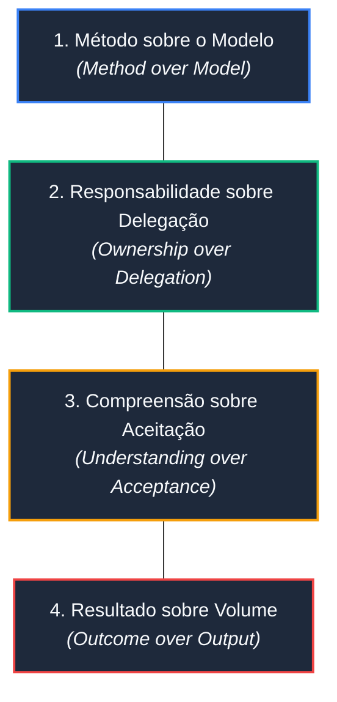
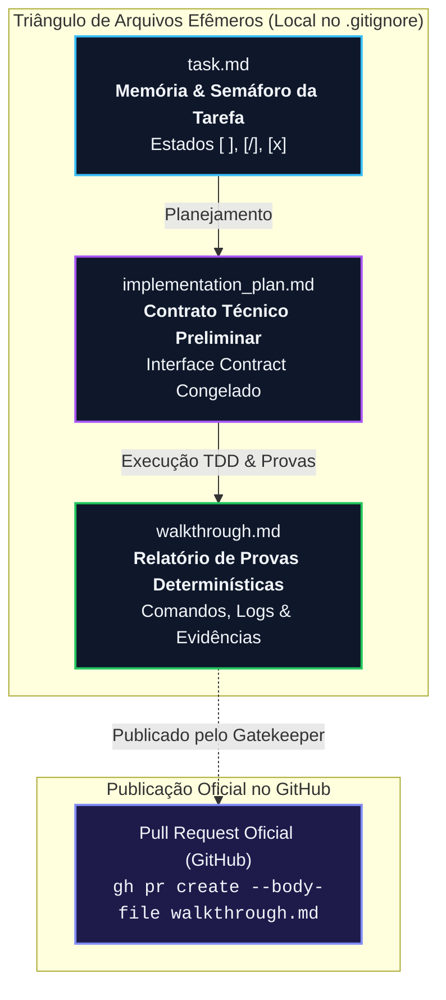
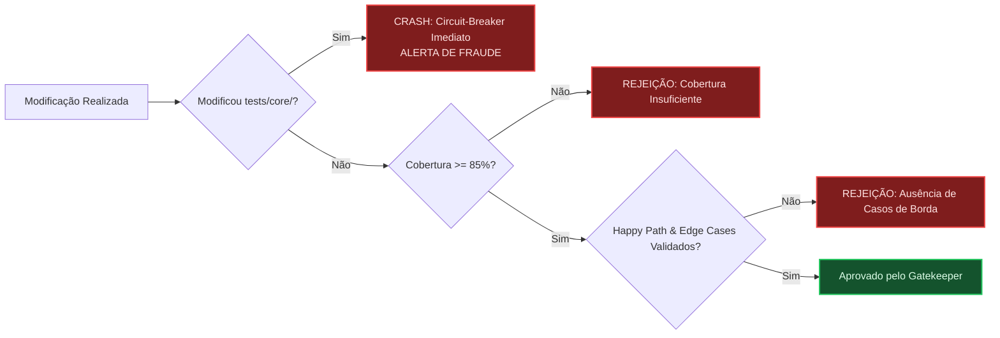

# Manifesto AIDD (AI-Driven Development) & Diretrizes de Governança

O **Manifesto AIDD** (*AI-Driven Development*) define a filosofia, os padrões operacionais e os guardrails inegociáveis que regem o desenvolvimento de software conduzido por agentes autônomos de Inteligência Artificial no ecossistema `my-agents` e em projetos consumidores.

---

## 🏛️ 1. Os 4 Valores Fundamentais do Manifesto AIDD

O desenvolvimento de software com IA não substitui o rigor da engenharia; ele amplifica a necessidade de contratos formais, determinismo e verificação contínua.



1. **Método sobre o Modelo (*Method over Model*)**:
   O processo, o sandboxing estéril, as travas de Git e as máquinas de estados determinísticas importam infinitamente mais do que qual LLM está sendo executado. Um modelo de ponta sem método produz alucinações caóticas; um modelo intermediário sob guardrails rígidos entrega código de nível sênior.

2. **Responsabilidade sobre Delegação (*Ownership over Delegation*)**:
   A IA acelera e sintetiza soluções, mas os contratos determinísticos, os testes de aceitação e os engenheiros humanos garantem as regras inegociáveis. Não existe delegação cega: toda alteração gerada é rastreada, tipada e auditada.

3. **Compreensão sobre Aceitação (*Understanding over Acceptance*)**:
   Não se aceita código por presunção ou convicção textual do modelo; aceita-se exclusivamente por testes determinísticos executados com evidências irrefutáveis e demonstráveis no relatório de entrega (`walkthrough.md`).

4. **Resultado sobre Volume (*Outcome over Output*)**:
   Gerar milhares de linhas de código ou queimar milhões de tokens sem foco é desperdício. O que gera valor real é a issue atômica resolvida com blast radius controlado e CI verde.

---

## 🔺 2. O Triângulo de Arquivos de Ciclo de Vida Efêmero

Agentes autônomos **não gerenciam estado de execução através de texto corrido no chat**. A coordenação e o ciclo de vida do desenvolvimento residem exclusivamente em três arquivos efêmeros padronizados na raiz do workspace.



### 2.1. Natureza Efêmera e Publicação no Pull Request
- Os arquivos `task.md`, `implementation_plan.md` e `walkthrough.md` são ferramentas de trabalho locais e **devem constar obrigatoriamente no `.gitignore`**.
- Eles **nunca poluem a branch `main`**. A persistência histórica do `walkthrough.md` é efetuada pelo subagente `gatekeeper` diretamente no corpo oficial do Pull Request no GitHub (`gh pr create --body-file walkthrough.md`).

### 2.2. Especificação dos Arquivos

#### `task.md` (A Memória e Semáforo da Tarefa Ativa)
- Mantém o rastreamento atômico das etapas com marcações rígidas:
  - `[ ]`: Tarefa pendente.
  - `[/]`: Tarefa em progresso.
  - `[x]`: Tarefa concluída com testes verdes e evidências aprovadas.
- **Regra de Semáforo Inviolável**: **Apenas UMA tarefa pode estar em `[/]` por vez**. O agente é estritamente proibido de iniciar a tarefa seguinte enquanto a atual não estiver com testes passando e carimbada com `[x]`.

#### `implementation_plan.md` (O Contrato Técnico Preliminar)
- Especifica com precisão cirúrgica quais arquivos serão criados ou editados em `src/`, quais funções e interfaces serão expostas e quais testes serão exigidos em `tests/features/`.
- Contém a seção obrigatória `## Interface Contract`, que congela assinaturas, tipos e estruturas de dados antes de qualquer implementação.
- **Regra Zero**: Nenhum código de produção em `src/` pode ser gerado antes de esse plano existir e ser aprovado.

#### `walkthrough.md` (O Relatório de Provas Determinísticas)
- Substitui a inspeção manual no editor e atua como a descrição oficial do Pull Request.
- Contém a prova irrefutável de cumprimento da tarefa: comando exato executado (ex.: `pytest`, `npm test`, `tests/features/test_*.sh`), logs de 100% de sucesso, saída de `git status --short` e diff dos arquivos modificados.
- **Provas Demonstrativas Universais Mandatórias**: Nenhuma entrega é isenta de comprovação comprobatória real:
  - **UIs, Front-end e Jogos (Web, Mobile, 2D/3D ou TUIs ricas)**: Testes unitários lógicos 100% verdes NÃO são suficientes. O relatório DEVE conter evidências visuais irrefutáveis (screenshot gerado via navegador headless como `chromium --headless`, logs de renderização do canvas ou prova gráfica visual), prevenindo interfaces quebradas, textos ilegíveis ou paletas sem contraste de luminância.
  - **Backend, CLI, Scripts e Infraestrutura**: Tarefas puramente backend, CLI ou de infraestrutura NÃO são isentas de provas demonstrativas; o relatório DEVE conter evidências demonstrativas reais de execução (saída CLI formatada, snapshots de terminal ou logs estruturados), comprovando a integridade dos fluxos e discriminando cenários de Happy Path e Edge Cases / Failure Modes.

### 2.3. Tolerância Zero a Falsos Positivos em Automações (Fail-Fast Mandatório)
- Scripts de automação, workflows de CI/CD, hooks e steps em bash **NUNCA devem mascarar falhas de operações dependentes com `exit 0`** (ex.: capturar erro de clone, push ou rede e sair com sucesso informativo).
- Todo script de automação deve iniciar com `set -euo pipefail`.
- Se uma dependência externa falhar (ex: clone da Wiki, API indisponível, build ausente), o script DEVE emitir erro explícito e encerrar com `exit 1` (usando anotações `::error::` no GitHub Actions), garantindo que o pipeline fique vermelho (**RED**) imediatamente.

---

## 🛡️ 3. A Trava Dupla Anti-Fraude (Defesa em Profundidade)

Para impedir o "golpe do estagiário" (quando o modelo tenta alterar, comentar ou apagar testes antigos para forçar uma suíte quebrada a passar de forma espúria):



### 3.1. Separação Canônica de Pastas de Teste
- `tests/core/`: Guarda as regras de negócio históricas, invariantes e fundamentais da aplicação. **Zona intocável.**
- `tests/features/`: Onde o QA Engineer cria novos testes de aceitação específicos da issue ativa.

### 3.2. A "Golden Rule" via Bash (Gatekeeper & CI)
Antes de comitar ou abrir PR, o Gatekeeper e os pipelines de CI executam a checagem determinística do Git:
```bash
MODIFIED=$(git diff --name-only origin/main...HEAD 2>/dev/null | grep -E '^tests/core/' || true)
if [ -n "$MODIFIED" ]; then
  echo "ALERTA DE FRAUDE: O agente modificou arquivos protegidos em tests/core/!"
  exit 1
fi
```
Se houver **1 caractere alterado** em `tests/core/`, a esteira é abortada imediatamente com erro fatal.

### 3.3. Anti-Triviality & Mutation Testing
- Proibido escrever testes vazios ou tautológicos (ex.: `expect(true).toBe(true)` ou `assert True`).
- O teste deve conter asserções de negócio e falhar comprovadamente no estado inicial (**RED**).
- Em auditorias estritas, testes de mutação (invertendo operadores lógicos e condicionais) devem comprovar que os testes quebram quando o comportamento do código é alterado.

### 3.4. Cobertura Mínima Mandatória (Code Coverage $\ge$ 85%)
- O Code Coverage da aplicação e dos módulos sob teste deve ser estritamente superior ou igual a **85%** (linhas, statements, funções e branches).
- A suíte de testes deve emitir relatório determinístico de cobertura aferida.
- **Fail-Fast / Circuit-Breaker**: Se a cobertura for inferior a 85% (`cobertura < 85%`), o Gatekeeper e a automação de CI bloqueiam a entrega sumariamente sem prosseguir para merge ou release.

### 3.5. Discriminação Mandatória de Casos de Teste (Happy Path e Edge Cases / Failure Modes)
- As suítes de testes em `tests/features/` devem discriminar explicitamente:
  - **Happy Path**: Fluxos principais de sucesso e atendimento aos requisitos funcionais.
  - **Edge Cases & Failure Modes**: Casos de borda, entradas inválidas, limites numéricos, timeouts, falhas de conectividade e resiliência a erros.
- Entregas desprovidas de cobertura de cenários de borda ou com testes exclusivamente tautológicos são sumariamente rejeitadas.

---

## 🌐 4. Comunicação e Idioma (Padrão Híbrido)

- **Interação com o Desenvolvedor**: A comunicação direta, relatórios, resumos de planos e explicações de decisões devem ser feitas em **Português (pt-BR)** de forma clara, objetiva e colaborativa.
- **Artefatos de Código e Engenharia**:
  - Código-fonte, nomes de variáveis, funções, classes, interfaces e testes: **Inglês**.
  - Mensagens de commit e títulos de Pull Request: **Inglês** (seguindo Conventional Commits: `feat`, `fix`, `docs`, `refactor`, `test`, `chore`).
  - Documentação inline (docstrings e comentários de código): **Inglês**.

---

## ⚡ 5. Eficiência de Contexto e Neutralidade de Domínio

- **Princípio Search-First**: Proibido varrer o repositório cegamente (`find .`, `ls -R`). O agente orienta-se primariamente pelo `PROJECT_CONTEXT.md` na raiz e realiza buscas cirúrgicas por símbolos.
- **Leitura Delimitada**: Utilize paginação com `StartLine` e `EndLine` para inspecionar apenas os trechos necessários do código.
- **Delegação para `research`**: Para investigações extensivas, delegue ao subagente de pesquisa isolando a janela de contexto.
- **Princípio da Neutralidade de Domínio em Plugins Globais**:
  - Em plugins globais (como `my-agents`), é estritamente proibido criar regras globais em `rules/` contendo convenções específicas de um único nicho (ex: física de jogos 2D, frameworks específicos de frontend ou ORMs particulares).
  - Regras de nicho pertencem a Skills (`skills/`) sob *Progressive Disclosure*, garantindo Zero Token Waste em projetos que operam em outros domínios.

---

## 🧪 6. Protocolo de Validação Isolada em Sandbox (Clean Room Testing)

Para certificar que novos plugins, esteiras, skills e regras funcionem de forma idêntica à experiência de um usuário real em um repositório externo consumidor:

1. **O Princípio do Clean Room (Ambiente Estéril)**:
   - Nunca execute testes de esteiras ou validações no sandbox dependendo do histórico acumulado na conversa principal de desenvolvimento. O agente que atua no sandbox deve operar com contexto 100% limpo.
   - O diretório `sandbox/` deve possuir sua própria infraestrutura de repositório consumidor: seu próprio `.git`, seu `PROJECT_CONTEXT.md` e sua pasta local `.agents/` (contendo `.agents/plugins.json` e/ou os plugins baixados em `.agents/plugins/<nome>`).

2. **Isolamento de Workspace Obrigatório (`cd` no Sandbox + Nova Instância `agy`)**:
   - Navegar via `cd` para dentro do diretório do sandbox antes de disparar o comando do Antigravity CLI.
   - Disparar uma **nova instância desacoplada do CLI** (`agy`) em modo de execução pontual:
   ```bash
   cd /caminho/do/sandbox && agy --dangerously-skip-permissions -p "<comando ou instrução a ser testada>"
   ```
   - Isso garante que a descoberta de configurações aconteça estritamente a partir do CWD do sandbox, sem vazamento de contexto pai.
