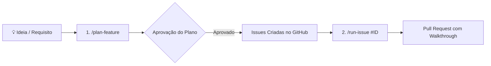

# Guia de Introdução e Onboarding (`Getting-Started.md`)

Bem-vindo ao **`my-agents`**! Este guia fornece instruções passo a passo para configurar e utilizar o ecossistema de governança, personas especializadas e esteiras determinísticas do Manifesto AIDD (*AI-Driven Development*) com o **Antigravity CLI** (`agy`).

---

## 🚀 1. Visão Geral

O `my-agents` é um pacote de extensões (plugin) projetado para potencializar o desenvolvimento assistido por agentes de IA no Antigravity CLI. Ele fornece:
- **Governança AIDD**: Proteções contra falsos positivos, fraudes em testes e poluição de contexto (*Zero Token Waste*).
- **Subagentes Confinados**: Personas com papéis bem delimitados (Product Owner, Arquiteto, QA Engineer, Coder, Gatekeeper e UI/UX Designer).
- **Skills Sob Demanda**: Habilidades especializadas ativadas por *Progressive Disclosure* (planejamento de features, esteira TDD de issues, revisão de código, padrões de jogos 2D, etc.).
- **Statusline de Alta Performance**: Monitoramento em tempo real de quota e status do Git com latência garantida sub-50ms.

---

## 📋 2. Pré-requisitos

Antes de iniciar, certifique-se de possuir instalado e configurado em seu sistema:

1. **Git (>= 2.30+)**:
   ```bash
   git --version
   ```
2. **GitHub CLI (`gh`)**:
   - Necessário para que os agentes possam interagir com issues, milestones e pull requests.
   - Verifique e autentique-se:
     ```bash
     gh auth status
     # Caso não autenticado:
     gh auth login
     ```
3. **Antigravity CLI (`agy`)**:
   - O cliente de IA da Google para terminal.
   ```bash
   agy --version
   ```
4. **Ecossistema de Execução do seu Projeto**:
   - Node.js (npm/pnpm/yarn), Python (pytest), Go ou a stack tecnológica correspondente ao repositório consumidor.

---

## ⚙️ 3. Instalação e Configuração de Plugins via `plugins.json`

O Antigravity CLI descobre e carrega plugins declarados em arquivos de configuração `plugins.json`.

### 3.1. Clonando o Repositório do Plugin

Clone o repositório `my-agents` em um diretório de sua preferência (por exemplo, dentro de seus projetos pessoais ou central de plugins):

```bash
git clone https://github.com/vitor/my-agents.git ~/Projetos/my-agents
```

### 3.2. Configurando o Plugin no Projeto Consumidor (Recomendado)

Para que um projeto específico consuma as personas, regras e skills do `my-agents`, crie ou edite o arquivo `.agents/plugins.json` na raiz do seu projeto consumidor:

```bash
mkdir -p .agents
```

Crie o arquivo `.agents/plugins.json` com a declaração do caminho absoluto para o `my-agents`:

```json
{
  "entries": [
    {
      "path": "/home/seu-usuario/Projetos/my-agents"
    }
  ]
}
```

> [!TIP]
> Caminhos relativos também são suportados em `path` e resolvem em relação ao diretório onde está localizada a pasta `.agents/`.

### 3.3. Configurando o Plugin Globalmente (Opcional)

Se você preferir que o `my-agents` esteja ativo em todos os projetos abertos no seu terminal, declare a entrada no arquivo global em `~/.gemini/config/plugins.json`:

```json
{
  "entries": [
    {
      "path": "/home/seu-usuario/Projetos/my-agents"
    }
  ]
}
```

### 3.4. Validando o Carregamento

Abra uma sessão no terminal do seu projeto:

```bash
agy
```

Ao iniciar, o Antigravity registrará automaticamente os hooks, regras em `rules/AGENTS.md`, personas de subagentes e o catálogo de skills do `my-agents`.

---

## 🏛️ 4. Estrutura Canônica no Repositório Consumidor

Para tirar o máximo proveito da esteira determinística e das travas de segurança do AIDD, o repositório consumidor deve seguir a seguinte organização:

```text
meu-projeto/
├── .agents/
│   └── plugins.json          # Registro do plugin my-agents
├── PROJECT_CONTEXT.md        # Mapa de arquitetura e regras canônicas do projeto
├── .gitignore                # Proteção de arquivos transitórios
├── src/                      # Código de produção (exclusivo do Coder)
└── tests/
    ├── core/                 # Testes legados intocáveis (protegidos pela Trava Dupla)
    └── features/             # Novos testes de aceitação da issue ativa (QA Engineer)
```

### 4.1. Configuração do `.gitignore`
Os arquivos de semáforo e relatório de execução são efêmeros e **não devem** ser comitados na branch principal:

```gitignore
# Arquivos de ciclo de vida efêmero do AIDD
task.md
implementation_plan.md
walkthrough.md
```

### 4.2. O Arquivo `PROJECT_CONTEXT.md`
Crie um arquivo `PROJECT_CONTEXT.md` na raiz do seu projeto contendo:
- Stack tecnológica e versões de dependências.
- Estrutura de pastas canônicas.
- Invariantes de negócio que o agente deve respeitar sem varrer o repositório cegamente (*Zero Token Waste*).

### 4.3. Estrutura de Testes: `tests/core/` vs `tests/features/`
Para garantir a Trava Dupla Anti-Fraude do Manifesto AIDD:
- **`tests/core/`**: Guarda os testes fundamentais e regras de negócio históricas. Esta pasta é **estritamente intocável** por qualquer subagente durante a execução de issues.
- **`tests/features/`**: Destinada exclusivamente aos novos testes de critérios de aceite escritos pelo `qa-engineer` para validar o comportamento da issue ativa.

---

## 🎯 5. Executando o Primeiro Comando com Antigravity CLI (`agy`)

O Antigravity CLI pode ser utilizado tanto de modo interativo quanto através de comandos pontuais com a flag `-p`.

### Modo Interativo

```bash
cd /caminho/do/meu-projeto
agy
```

No prompt, você pode conversar com o agente e acionar slash commands como `/plan-feature` e `/run-issue`.

### Modo Pontual (Headless Execution)

Para automações ou testes isolados em terminal:

```bash
agy -p "Liste as personas de subagentes disponíveis neste workspace"
```

---

## 🔄 6. O Primeiro Ciclo AIDD Passo a Passo

O fluxo padrão do ecossistema `my-agents` segue uma esteira determinística em duas fases principais:



### Passo 1: Planejamento com `/plan-feature`
No prompt do `agy`, digite a descrição da funcionalidade desejada:

```text
/plan-feature Sistema de autenticação JWT com rota de login e validação de token
```

O orquestrador acionará o `product-owner` para definir requisitos e critérios de aceite, o `uiux-designer` (se envolver interface) e o `system-architect` para estruturar a arquitetura técnica, verificar impacto na base e fatiar a demanda em issues atômicas (com no máximo 3 passos por issue).

### Passo 2: Aprovação e Criação das Issues
Ao final do planejamento, o agente apresenta a proposta estruturada em `planning_proposal.md`. Com a sua aprovação, as issues serão criadas automaticamente no repositório GitHub com os metadados e dependências corretas.

### Passo 3: Execução Determinística com `/run-issue`
Com a issue criada (por exemplo, `#1`), dispare a esteira de construção:

```text
/run-issue #1
```

A máquina de estados executará sequencialmente:
1. **`planner`**: Triagem e contrato atômico (`implementation_plan.md` e `task.md`).
2. **`qa-engineer`**: Criação de testes de aceitação em `tests/features/` comprovando o estado inicial de falha (**RED**).
3. **`coder`**: Construção do código de produção exclusivamente em `src/` até que todos os testes fiquem verdes (**GREEN**) com cobertura $\ge 85\%$.
4. **`gatekeeper`**: Auditoria anti-fraude (Golden Rule), verificação de interface gráfica se aplicável, compilação das evidências em `walkthrough.md` e criação do Pull Request no GitHub.

---

## 📊 7. Setup da Statusline de Alta Performance (Opcional)

O repositório inclui um renderizador de statusline de alta performance com latência garantida sub-50ms, exibindo consumo de quota (5 horas e semanal), status do Git e modelo ativo:

```bash
cd ~/Projetos/my-agents
bash scripts/install-statusline.sh
```

O script fará backup da sua configuração em `~/.gemini/antigravity-cli/settings.json` e ativará a statusline automaticamente. Para validar o benchmark de performance:

```bash
bash scripts/test-statusline.sh
```

---

## 📚 8. Próximos Passos e Leituras Recomendadas

- [Catálogo de Subagentes (`docs/Subagents.md`)](./Subagents.md): Detalhamento das 7 personas, ferramentas concedidas e contratos de entrada/saída.
- [Catálogo de Skills (`docs/Skills-Catalog.md`)](./Skills-Catalog.md): Documentação completa de todas as habilidades sob demanda e gatilhos de *Progressive Disclosure*.
- [Arquitetura e Decisões Técnicas (`docs/ARCHITECTURE.md`)](./ARCHITECTURE.md): Fonte única da verdade das decisões de engenharia do repositório.
