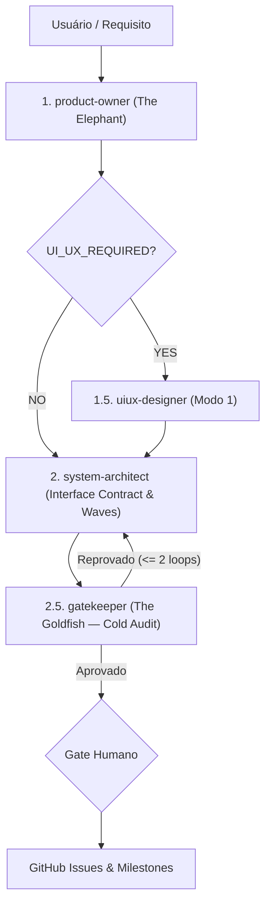
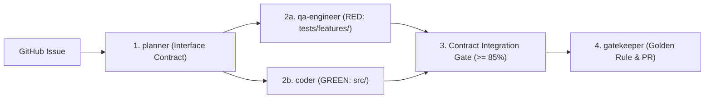

# 🤖 Sumário de Subagentes (`Subagents`)

> **Cabeçalho de Controle (Pressman / Sommerville)**  
> - **Escopo / Filtros Aplicados**: `agents/*/agent.md` • Status: `Ativos` • Ordenação: `Ciclo AIDD (Planejamento ➔ Execução)`  
> - **Data/Hora de Emissão**: `2026-11-22 15:33 BRT` *(sincronizado via `.github/workflows/wiki-sync.yml`)*  
> - **Fonte Canônica**: [`agents/`](https://github.com/VitorJacom/my-agents/tree/main/agents)

Este documento é o **índice central e resumo executivo** das **7 personas especializadas de subagentes** do ecossistema `my-agents`. Cada subagente possui sua própria **página dedicada na Wiki** com regras operacionais, modos de atuação, confinamentos e contratos de I/O.

---

## 🏛️ 1. Princípios da Especialização Multiagente Confinada

O [Manifesto AIDD](AIDD-Manifesto) proíbe agentes monolíticos generalistas e impõe segregação estrita de deveres:
1. **Princípio do Menor Privilégio (*Least Privilege*)**: Personas analíticas (`product-owner` e `planner`) operam somente em leitura; executores têm escrita confinada exclusivamente à sua pasta de domínio.
2. **Eliminação do "Golpe do Estagiário"**: O `coder` só toca em `src/`; o `qa-engineer` só toca em `tests/features/`.
3. **Proibição de Emulação Monolítica**: Cada papel deve ser instanciado como subagente independente via `invoke_subagent`.

---

## 📊 2. Matriz Geral de Personas e Permissões

Clique no nome de qualquer subagente para acessar sua **página dedicada**:

| # | Subagente | Papel Principal | Ferramentas (`tools`) | Qtd. Tools | Confinamento de Escrita | Fase AIDD | Definição |
| ---: | :--- | :--- | :--- | ---: | :--- | :--- | :--- |
| 1 | **[`product-owner`](Agent-product-owner)** | *The Elephant* — Requisitos Socráticos & Long-Horizon Context | `read_file`, `search_web` | 2 | Somente leitura | Planejamento | [`agent.md`](https://github.com/VitorJacom/my-agents/blob/main/agents/product-owner/agent.md) |
| 2 | **[`system-architect`](Agent-system-architect)** | Design Técnico, `Interface Contract`, ADRs & *Execution Waves* | `read_file`, `search_web`, `write_file`, `edit_file` | 4 | `docs/ARCHITECTURE.md` e `planning_proposal.md` | Planejamento | [`agent.md`](https://github.com/VitorJacom/my-agents/blob/main/agents/system-architect/agent.md) |
| 3 | **[`uiux-designer`](Agent-uiux-designer)** | *Mockup-as-Code*, *Value Contrast* ($\ge 2:1$), **WCAG AA** & Auditoria Headless | `read_file`, `write_file`, `edit_file`, `search_web`, `run_command` | 5 | Living Specs (`docs/mockups/`, `docs/screenshots/`) e pareceres | Planejamento & Auditoria | [`agent.md`](https://github.com/VitorJacom/my-agents/blob/main/agents/uiux-designer/agent.md) |
| 4 | **[`planner`](Agent-planner)** | Triagem Atômica ($\le 3$ passos), *Blast Radius* & Semáforo | `read_file`, `search_web` | 2 | Somente leitura | Execução (Triage) | [`agent.md`](https://github.com/VitorJacom/my-agents/blob/main/agents/planner/agent.md) |
| 5 | **[`qa-engineer`](Agent-qa-engineer)** | Engenharia TDD (**RED**) — Happy Path & Edge Cases | `read_file`, `write_file`, `edit_file`, `run_command` | 4 | Exclusivo em `tests/features/` (proibido `src/` e `tests/core/`) | Execução (RED) | [`agent.md`](https://github.com/VitorJacom/my-agents/blob/main/agents/qa-engineer/agent.md) |
| 6 | **[`coder`](Agent-coder)** | Implementação Contract-Driven (**GREEN**) & Cobertura $\ge 85\%$ | `read_file`, `write_file`, `edit_file`, `run_command` | 4 | Exclusivo em `src/` (proibido alterar `tests/`) | Execução (GREEN) | [`agent.md`](https://github.com/VitorJacom/my-agents/blob/main/agents/coder/agent.md) |
| 7 | **[`gatekeeper`](Agent-gatekeeper)** | *The Goldfish* (Cold Audit) & Guardião *Golden Rule* / PR | `read_file`, `write_file`, `edit_file`, `run_command` | 4 | `walkthrough.md`, commits e abertura de PR | Planejamento (Modo 1) & Finalização (Modo 2) | [`agent.md`](https://github.com/VitorJacom/my-agents/blob/main/agents/gatekeeper/agent.md) |
| **Total** | **7 Subagentes** | **2 Somente Leitura • 5 Confinados** | **5 ferramentas distintas** | **25** | **100% confinamento estrito** | **2 Esteiras** | **7/7 ativos** |

---

## 🔌 3. Resumo dos Contratos de Entrada e Saída (I/O)

- **Planejamento ([`/plan-feature`](Skill-plan-feature))**:
  - **Contrato de Entrada**: Ideia, requisito funcional ou issue macro do usuário.
  - **Fluxo**: [`product-owner`](Agent-product-owner) ➔ [`uiux-designer`](Agent-uiux-designer) *(se `UI_UX_REQUIRED: YES`, garantindo Value Contrast $\ge 2:1$ e WCAG AA $\ge 4.5:1$)* ➔ [`system-architect`](Agent-system-architect) ➔ [`gatekeeper`](Agent-gatekeeper) *(Modo 1: Cold Audit)*.
  - **Contrato de Saída**: `planning_proposal.md` aprovado (`SPEC_AUDIT: APPROVED`), ADRs em [`ARCHITECTURE`](ARCHITECTURE) e issues atômicas no GitHub.
- **Execução ([`/issue-pipeline`](Skill-issue-pipeline))**:
  - **Contrato de Entrada**: Issue atômica no GitHub com `## Interface Contract` e `PROJECT_CONTEXT.md`.
  - **Fluxo**: [`planner`](Agent-planner) ➔ *Concurrent Fork* ([`qa-engineer`](Agent-qa-engineer) + [`coder`](Agent-coder)) ➔ *Join Point* ➔ [`uiux-designer`](Agent-uiux-designer) *(Modo 2, se UI)* ➔ [`gatekeeper`](Agent-gatekeeper) *(Modo 2)*.
  - **Contrato de Saída**: Testes em `tests/features/`, código em `src/` com cobertura $\ge 85\%$, `walkthrough.md` e Pull Request aberto no GitHub.

---

## 🔄 4. Fluxos de Orquestração

### 4.1. Planejamento (`/plan-feature` — Ciclo Elephant-Goldfish)

### 4.2. Execução TDD (`/issue-pipeline` — Concurrent Fork)

---

## 📚 5. Leituras Complementares

- [Guia de Introdução (`Getting-Started`)](./Getting-Started.md): Setup de ambiente e execução com Antigravity CLI.
- [Sumário de Skills (`Skills-Catalog`)](./Skills-Catalog.md): As 11 skills sob demanda do ecossistema.
- [Sumário de Scripts (`Scripts-Catalog`)](Scripts-Catalog): Os utilitários que sustentam os portões das personas.
- [Arquitetura e Decisões Técnicas (`ARCHITECTURE`)](ARCHITECTURE): Detalhamento dos padrões de engenharia e ADRs.

---

> **Rodapé de Controle — Totalizadores & Paginação**  
> **Totalizadores**: `7 Subagentes` • `2 Somente Leitura` • `5 Com Escrita Confinada` • `7 Páginas Dedicadas`  
> **Paginação**: `Catálogo 1 de 4` — [🏠 Home](Home) | [Próximo Catálogo: 🧰 Skills →](Skills-Catalog)
