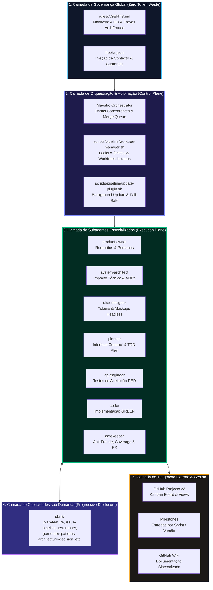
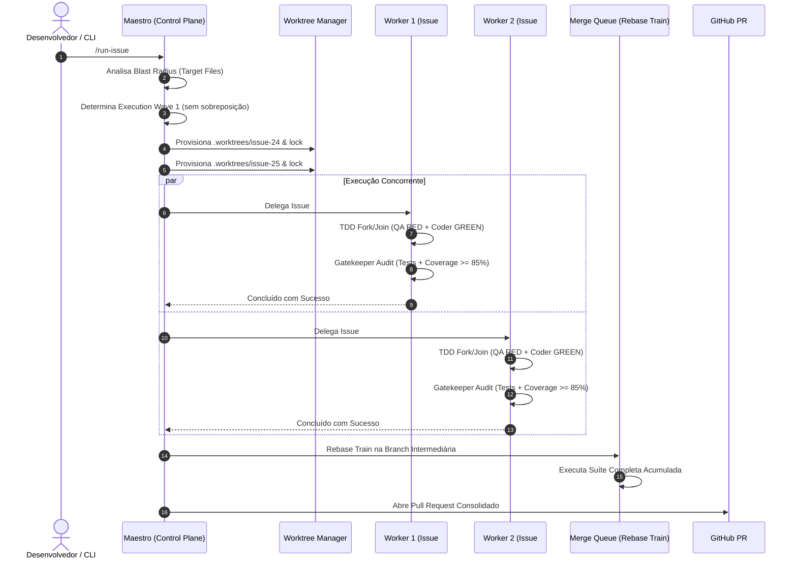
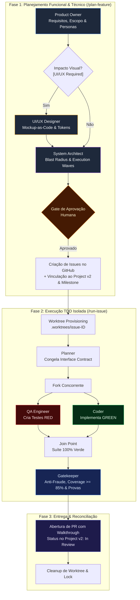

# Arquitetura do Sistema `my-agents`

Esta página apresenta a visão sistêmica, o modelo de decomposição em camadas, as máquinas de estado de execução multiagente e o índice consolidado de Decisões de Arquitetura (ADRs) do ecossistema `my-agents`.

---

## 🏛️ 1. Visão Sistêmica e Arquitetura em Camadas

O `my-agents` é um repositório central de governança, automações e guardrails para o **Antigravity CLI** (Gemini CLI), desenhado sob a filosofia do **Manifesto AIDD** (*AI-Driven Development*). A plataforma opera segundo uma arquitetura modular desacoplada em 5 camadas concêntricas:

### Taxonomia de Componentes

| Diretório / Arquivo | Responsabilidade | Mecanismo de Carregamento |
| :--- | :--- | :--- |
| `rules/AGENTS.md` | Manifesto AIDD, Travas Anti-Fraude e regras inegociáveis | Carregado automaticamente no contexto raiz pelo CLI |
| `hooks.json` | Gatilhos de ciclo de vida de sessão e injeção dinâmica de contexto | Executado nativamente pelo Antigravity CLI |
| `agents/` | Definições das 7 personas canônicas de agentes de IA | Invocados sob demanda via `invoke_subagent` |
| `skills/` | Habilidades e esteiras de execução encapsuladas | Descobertas sob demanda (*Progressive Disclosure*) |
| `scripts/` | Utilitários de bash e python (Worktrees, Statusline, Métricas, Atualização) | Execução desacoplada em subprocessos |
| `docs/` | Documentação viva espelhada automaticamente para a GitHub Wiki | Sincronização via GitHub Actions (`wiki-sync.yml`) |

### Taxonomia de Scripts de Pipeline e Telemetria

Os utilitários do diretório `scripts/` são particionados em domínios operacionais bem delineados:
- **Esteira de Pipeline (`scripts/pipeline/`)**:
  - `worktree-manager.sh`: Gestor de ciclo de vida de worktrees estéreis com lockfiles atômicos.
  - `update-plugin.sh`: Mecanismo desacoplado de atualização de plugins e sincronização upstream (`--check`, `--status`, `--apply`), garantindo proteção preventiva com *dirty tree fail-safe* e escrita atômica em cache JSON (formalizado no [ADR-0016](#-4-índice-consolidado-de-decisões-de-arquitetura-adrs)).
  - `sync-project-context.py`: Sincronizador de `PROJECT_CONTEXT.md` com desacoplamento de estado Git volátil.
  - `project-status-sync.sh`: Sincronizador resiliente de status de issues e pull requests no GitHub Projects v2 com auto-inclusão idempotente e normalização de taxonomia canônica (formalizado no [ADR-0018](#-4-índice-consolidado-de-decisões-de-arquitetura-adrs)).
  - `reconcile-github-governance.sh`: Reconciliador idempotente de Milestones, status inicial ("Planned") e encerramento ("Done") no GitHub Projects v2 (formalizado no [ADR-0009](#-4-índice-consolidado-de-decisões-de-arquitetura-adrs) e [ADR-0018](#-4-índice-consolidado-de-decisões-de-arquitetura-adrs)).
  - `promote-core-test.sh`: Promotor interativo de testes de regras de negócio aprovados para `tests/core/` com modernização da Golden Rule via `--diff-filter=MD` (formalizado no [ADR-0015](#-4-índice-consolidado-de-decisões-de-arquitetura-adrs)).
  - `audit-token-efficiency.py`: Analisador determinístico de consumo de tokens, detecção de anomalias de cache e score de eficiência (formalizado no [ADR-0017](#-4-índice-consolidado-de-decisões-de-arquitetura-adrs)).
  - `metrics-collector.py`: Coletor de métricas concorrentes de tempo e concorrência no modo Maestro.
- **Camada de Telemetria e Statusline (`scripts/statusline/`)**:
  - `statusline-quota.sh`: Renderizador polimórfico de telemetria sub-50ms integrando quotas (5h/semanal), contexto e o widget assíncrono `widget_update` para notificação zero-noise de novas versões.
  - `install-statusline.sh`: Instalador idempotente da configuração no Antigravity CLI.
  - `test-statusline.sh`: Suíte determinística de validação de SLA e benchmark de latência.

---

## ⚡ 2. Orquestração Multi-Task Concorrente (Maestro)

Quando múltiplas issues são disparadas simultaneamente (`/run-issue #24 #25 #26` ou `/run-issue --epic #20`), o sistema opera através do padrão **Maestro (Control Plane)**, que não altera código de produção diretamente, delegando o trabalho para subagentes workers isolados.

### Princípios da Execução Paralela
1. **Ondas de Execução (*Execution Waves*)**: Máximo de 3 workers simultâneos por onda, garantindo que issues na mesma onda possuam arquivos-alvo 100% disjuntos.
2. **Worktrees Estéreis com Locks Atômicos**: Cada worker opera em `.worktrees/issue-<id>` protegido por arquivo de lock (`.worktrees/.lock-<id>`), evitando colisão de arquivos de trabalho.
3. **Merge Queue & Auto-Reconciliação**: As entregas são integradas sequencialmente em uma branch intermediária (`integration/batch-<id>`). Se houver divergência semântica ou conflito pós-rebase, o Maestro aciona até 2 iterações de auto-reconciliação estrita com o `coder`.

---

## 🔄 3. Ciclo de Vida Ponta a Ponta de uma Issue

Toda funcionalidade ou correção percorre um pipeline padronizado e auditável:

---

## 📜 4. Índice Consolidado de Decisões de Arquitetura (ADRs)

A evolução arquitetural do `my-agents` é registrada formalmente através de Architecture Decision Records (ADRs). Abaixo consta o índice consolidado de todas as decisões tomadas:

| ADR ID | Título | Data | Status | Escopo & Impacto |
| :---: | :--- | :---: | :---: | :--- |
| **0001** | Generalização de Regras Visuais, Subagente UI/UX e Desacoplamento de Domínio (Game Dev) | 2026-11-04 | Implementada | Desacoplamento de regras de física e games de `rules/` para `skills/game-dev-patterns/` (*Zero Token Waste*), criação do `uiux-designer` e exigência condicional de provas visuais. |
| **0002** | Governança Efêmera de Arquivos de Tarefa, Fonte Única ARCHITECTURE.md e Wiki Sync | 2026-11-04 | Implementada | Adição de `task.md`, `implementation_plan.md` e `walkthrough.md` ao `.gitignore`; consolidação da documentação em `docs/` e sincronização automática via `.github/workflows/wiki-sync.yml`. |
| **0003** | Arquitetura Modular de Statusline Plug-and-Play e Performance Sub-50ms | 2026-11-04 | Proposta | Decomposição modular da statusline (`scripts/statusline/statusline-quota.sh`), instalador idempotente (`scripts/statusline/install-statusline.sh`) e suíte de benchmark sub-50ms (`scripts/statusline/test-statusline.sh`). |
| **0004** | Orquestração Multi-Task Concorrente (Maestro), Git Worktrees, Ondas e Merge Queue | 2026-11-06 | Proposta | Arquitetura Maestro com subagentes workers isolados, locks atômicos, análise de Target Files, ondas sequenciais de execução e Rebase Train em branch intermediária. |
| **0005** | Paralelismo Intra-Task Baseado em Contrato Congelado (QA & Coder) | 2026-11-04 | Aprovada | Decomposição da etapa TDD em Fork concorrente entre QA Engineer e Coder a partir da seção `## Interface Contract` congelada no `implementation_plan.md`. |
| **0006** | Orquestração Condicional do `uiux-designer` e Protocolo Mockup-as-Code (Figma-less) | 2026-11-06 | Proposta | Protocolo em 3 camadas (Wireframe ASCII, Design Tokens de luminância e Protótipo HTML headless) acionado condicionalmente em `/plan-feature` e `/run-issue`. |
| **0007** | Integração Nativa de Milestones e GitHub Projects v2 com Degradação Graciosa | 2026-11-06 | Proposta | Amarração automática de Milestones e transição de status no GitHub Projects v2 em `/plan-feature` e `/run-issue` com resiliência a falta de permissões de token. |
| **0008** | Arquitetura da Informação Modular e Governança da GitHub Wiki | 2026-11-06 | Proposta | Decomposição funcional de `docs/` em artefatos modulares (`Home.md`, `_Sidebar.md`, `_Footer.md`, `Getting-Started.md`, `AIDD-Manifesto.md`, `System-Architecture.md`, `Troubleshooting.md`), eliminando colisões de casing com `ARCHITECTURE.md`. |
| **0009** | Reconciliação Idempotente de Governança no GitHub e Backfill de Backlog | 2026-11-06 | Implementada | Script utilitário `reconcile-github-governance.sh`, vinculação resiliente a Milestones e Projects v2 e integração operacional com `plan-feature`. |
| **0010** | Telemetria de Concorrência e Eficiência no Modo Maestro (Wall-Clock e Speedup) | 2026-11-06 | Proposta | Modelo hierárquico por ondas em `metrics-collector.py`, com cálculo de Wall-Clock time real, detecção de worker gargalo e speedup. |
| **0011** | Esteira Automatizada de Code Review de PRs e Governança (/review-pr) | 2026-11-06 | Proposta | Motor determinístico `pr-reviewer.sh`, validação de Golden Rule, submissão via `gh pr review`, criação de issues rastreáveis e reconciliação. |
| **0012** | Telemetria Resiliente de Quotas na Statusline do Antigravity CLI, Isolamento Multiterminal e Portabilidade Universal | 2026-11-06 | Aprovada | Parser JSON resiliente via Python inline, eliminação de dependências frágeis, telemetria de 5h/semanal e isolamento multi-instância. |
| **0013** | Modernização do Ciclo de Vida de Issues: Épicos Temáticos via Milestones, Releases no Project v2 e Sub-issues Hierárquicas | 2026-11-06 | Aprovada | Desacoplamento de versão física e épicos temáticos, releases via campo customizado de Project v2 e fatiamento com `--parent`. |
| **0014** | Incorporação do Modelo Elephant-Goldfish no Ciclo AIDD | 2026-11-09 | Aprovada | Segregação estrita entre The Elephant (PO: Requisitos & Valor Socrático com memória de longo prazo) e The Goldfish (Gatekeeper: Cold Audit e Clean Room sem viés). |
| **0015** | Promoção Interativa de Testes de Regras de Negócio para `tests/core/` e Modernização da Golden Rule Anti-Fraude | 2026-11-09 | Aprovada | Promoção auditada de testes de negócio pós-GREEN via `promote-core-test.sh`, permitindo adição legítima (`--diff-filter=MD`) enquanto preserva a trava contra modificações e deleções ilícitas. |
| **0016** | Mecanismo Desacoplado de Atualização de Plugins e Notificação Zero-Noise na Statusline | 2026-11-09 | Aprovada | Arquitetura assíncrona de verificação com cache JSON local (TTL 24h), `scripts/pipeline/update-plugin.sh`, proteção *dirty tree fail-safe* e widget `widget_update` na statusline (`scripts/statusline/statusline-quota.sh`) com notificação discreta em âmbar bold. |
| **0017** | Auditor Automatizado de Eficiência de Tokens e Telemetria da Esteira AIDD | 2026-11-09 | Aprovada | Analisador determinístico `scripts/pipeline/audit-token-efficiency.py`, detecção de anomalias de cache miss, score 0-100 de qualidade e fail-fast `--min-score` para CI/CD. |
| **0018** | Ciclo de Vida Reativo, Inicialização Idempotente e Reconciliação Contínua de Status no GitHub Projects v2 | 2026-11-09 | Aprovada | Governança reativa via `.github/workflows/project-v2-automation.yml`, auto-inclusão resiliente em `scripts/pipeline/project-status-sync.sh`, eliminação de cartões órfãos ("No Status") via `scripts/pipeline/reconcile-github-governance.sh` e padronização da taxonomia canônica de status (Planned, In Progress, In Review, Done). |

> [!NOTE]
> Para o histórico detalhado, contexto de motivação, alternativas descartadas e consequências técnicas aprofundadas de cada decisão, consulte o documento interno canônico [docs/ARCHITECTURE.md](https://github.com/VitorJacom/my-agents/blob/main/docs/ARCHITECTURE.md).
