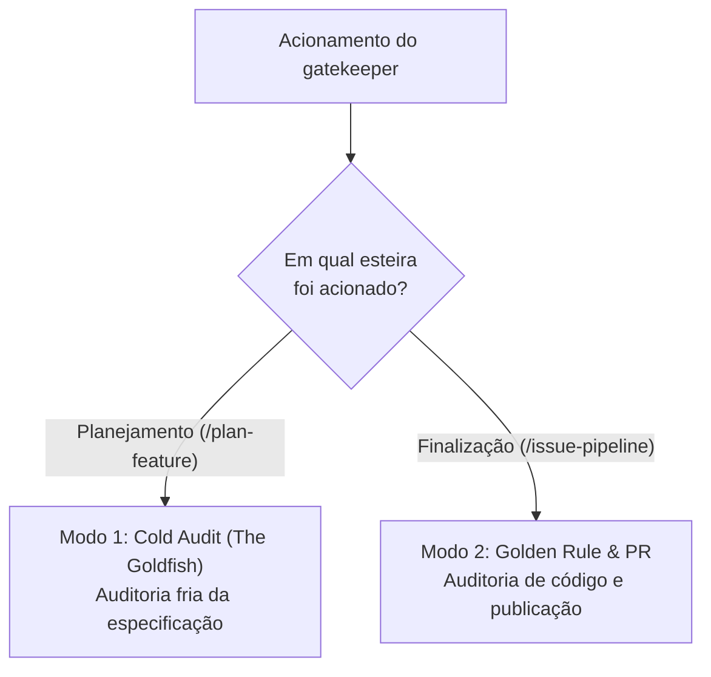
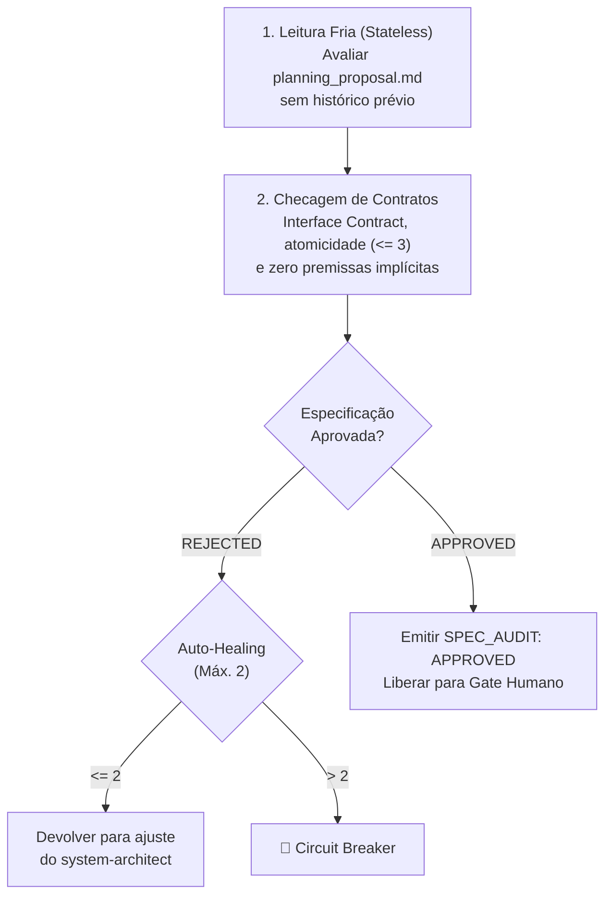
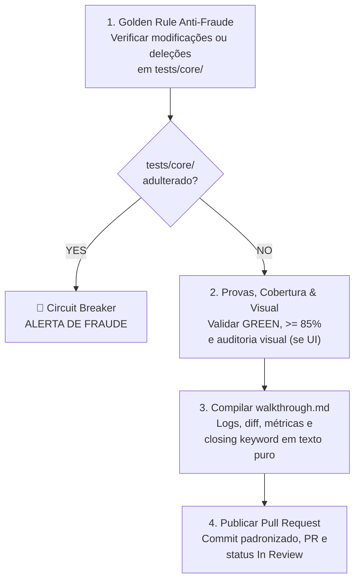

[← Voltar ao Sumário de Subagentes](Subagents)

> **The Goldfish**  
> **Definição Canônica**: [`agents/gatekeeper/agent.md`](https://github.com/VitorJacom/my-agents/blob/main/agents/gatekeeper/agent.md)  
> **Fase AIDD**: Planejamento ([`plan-feature`](Skill-plan-feature) — Estado 2.5) & Finalização ([`issue-pipeline`](Skill-issue-pipeline) — Estado 4)  
> **Ferramentas (`tools`)**: `read_file`, `write_file`, `edit_file`, `run_command`  
> **Confinamento**: Auditoria, geração de `walkthrough.md`, commits padronizados e abertura de Pull Request

---

## 🎯 Missão

Atuar como o **portão final de integridade** do ecossistema ([`AIDD-Manifesto`](AIDD-Manifesto)) em dois papéis complementares: auditoria fria de especificações (**The Goldfish Reviewer**) e guardião anti-fraude/finalizador de Pull Requests (**Modo 2**), com travas verificadas continuamente por [`Test-governance`](Test-governance).

---

## 🔄 Roteamento & Modos de Operação

### Modo 1 — Auditoria de Especificação (*The Goldfish Reviewer* / Cold Audit)

#### 📋 Responsabilidades por Estado (Modo 1)

| Estado | Responsável | O que acontece nesta etapa |
| :--- | :--- | :--- |
| **1. Leitura Fria (*Stateless*)** | [`gatekeeper`](Agent-gatekeeper) | Avalia o `planning_proposal.md` de forma isolada, sem depender do histórico da conversa do [`product-owner`](Agent-product-owner) ou do [`system-architect`](Agent-system-architect). |
| **2. Checagem de Contratos** | [`gatekeeper`](Agent-gatekeeper) | Barra planos sem `## Interface Contract` completo, tarefas com mais de 3 passos ou premissas vagas/especulativas ("supõe-se", "obviamente"). |
| **3. Veredito & Auto-Healing** | [`gatekeeper`](Agent-gatekeeper) | Emite `SPEC_AUDIT: REJECTED` (acionando até 2 tentativas de reparo antes do *Circuit Breaker*) ou `SPEC_AUDIT: APPROVED` para avançar ao Gate Humano do [`plan-feature`](Skill-plan-feature). |

### Modo 2 — Auditoria de Código, Golden Rule & PR

#### 📋 Responsabilidades por Estado (Modo 2)

| Estado | Responsável | O que acontece nesta etapa |
| :--- | :--- | :--- |
| **1. Golden Rule Anti-Fraude** | [`gatekeeper`](Agent-gatekeeper) | Executa checagem Git com `--diff-filter=MD` bloqueando qualquer modificação (`M`) ou remoção (`D`) em [`tests/core/`](Test-core), permitindo adições legítimas (`A`) promovidas via [`promote-core-test.sh`](Script-pipeline). |
| **2. Provas, Cobertura & Visual** | [`gatekeeper`](Agent-gatekeeper) | Confirma suíte 100% verde com cobertura $\ge 85\%$ (Happy Path + Edge Cases). Quando `UI_UX_REQUIRED: true`, exige `VISUAL_AUDIT: APPROVED` do [`uiux-designer`](Agent-uiux-designer), URLs absolutas `raw.githubusercontent.com` e `Implemented-Screens-Catalog` atualizado. |
| **3. Compilar `walkthrough.md`** | [`gatekeeper`](Agent-gatekeeper) | Consolida evidências reais de execução, `git status`, telemetria de tokens e a diretiva `Fixes #<id>` em texto puro (sem crases). |
| **4. Publicar Pull Request** | [`gatekeeper`](Agent-gatekeeper) + [`git-workflow`](Skill-git-workflow) | Realiza commit padronizado, publica o Pull Request no GitHub usando o `walkthrough.md` como corpo oficial e atualiza o status no Project v2 para **`In Review`**. |

---

## 🔗 Navegação

[← Anterior: `coder`](Agent-coder) | [Sumário de Subagentes](Subagents)
