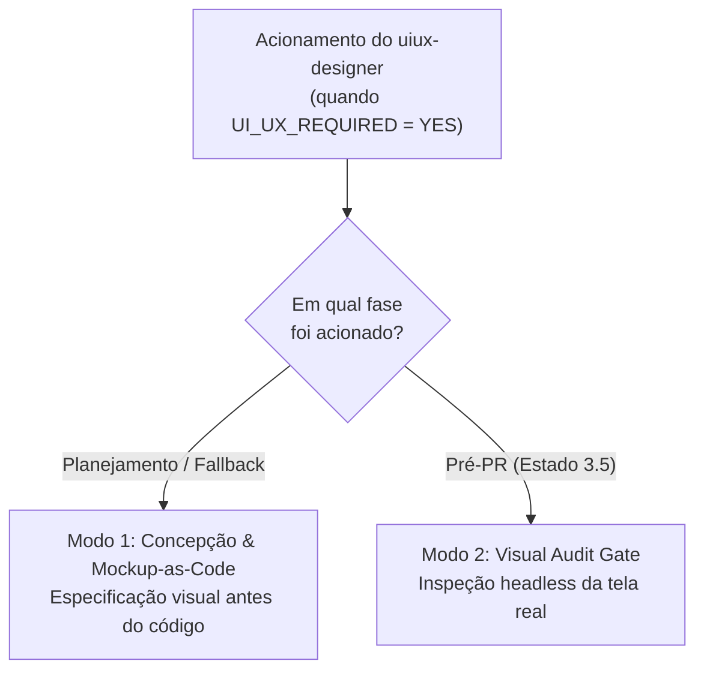
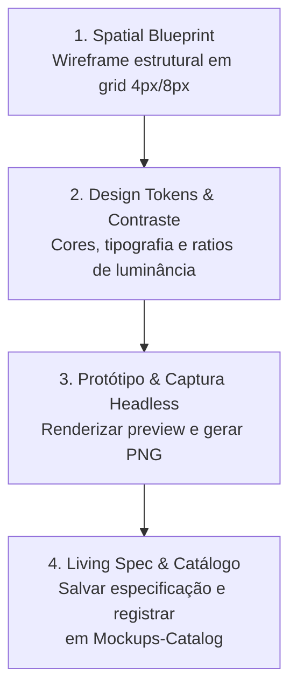
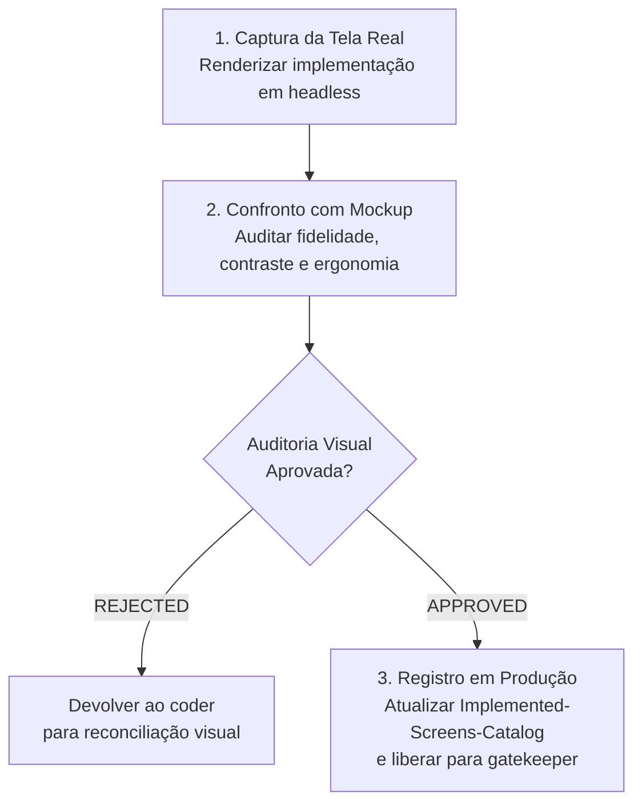

[← Voltar ao Sumário de Subagentes](Subagents)

> **Definição Canônica**: [`agents/uiux-designer/agent.md`](https://github.com/VitorJacom/my-agents/blob/main/agents/uiux-designer/agent.md)  
> **Fase AIDD**: Planejamento ([`plan-feature`](Skill-plan-feature) — Estado 1.5) & Auditoria Visual ([`issue-pipeline`](Skill-issue-pipeline) — Estado 3.5)  
> **Ferramentas (`tools`)**: `read_file`, `write_file`, `edit_file`, `search_web`, `run_command`  
> **Confinamento**: Artefatos visuais, Living Specs (`docs/mockups/`, `docs/screenshots/`), capturas headless e pareceres

---

## 🎯 Missão

Atuar como guardião de usabilidade, acessibilidade (**WCAG AA**), **contraste de luminância monocromático (Value Contrast)**, ergonomia mobile e combate a clichês visuais de IA (*AI-Slop*), operando em parceria direta com a skill [`ui-ux-design`](Skill-ui-ux-design) e validado pelas suítes de [`Test-ui-ux`](Test-ui-ux).

---

## 🎨 Pilares Técnicos Inegociáveis

1. **Teoria do Contraste de Valor (Value Contrast & Luminance)**:
   - Teste monocromático (escala de cinza): contraste mínimo $\ge 2:1$ entre superfícies/elementos e fundo.
   - **WCAG AA**: contraste mínimo $\ge 4.5:1$ para textos normais ($\ge 3:1$ para textos grandes).
2. **Ancoragem Visual & Oclusão**: Sombras de contato e bordas sutis para hierarquia clara.
3. **Affordance & Ergonomia**: Estados visuais nítidos (`default`, `hover`, `active`, `focus`, `disabled`) e hitboxes $\ge 44\text{px}$.
4. **Game Feel & Microinterações**: Física de molas (*Apple WWDC Fluid Motion*) e feedback tátil consistente.

---

## 🔄 Roteamento & Modos de Operação

### Modo 1 — Concepção & Mockup-as-Code (Planejamento)

#### 📋 Responsabilidades por Estado (Modo 1)

| Estado | Responsável | O que acontece nesta etapa |
| :--- | :--- | :--- |
| **1. Spatial Blueprint** | [`uiux-designer`](Agent-uiux-designer) | Define zonas da tela, hierarquia de informação, espaçamentos em grid e estados interativos em wireframe estrutural. |
| **2. Design Tokens & Contraste** | [`uiux-designer`](Agent-uiux-designer) | Congela a tabela de tokens visuais comprovando Value Contrast $\ge 2:1$ e WCAG AA $\ge 4.5:1$ com apoio da skill [`ui-ux-design`](Skill-ui-ux-design). |
| **3. Protótipo & Captura Headless** | [`uiux-designer`](Agent-uiux-designer) | Monta um protótipo autocontido e captura a imagem de referência em navegador headless para validação humana no [`plan-feature`](Skill-plan-feature). |
| **4. Living Spec & Catálogo** | [`uiux-designer`](Agent-uiux-designer) | Salva a especificação viva (`docs/mockups/<slug>.md` + PNG) e registra no catálogo `Mockups-Catalog`. |

### Modo 2 — Visual Audit Gate (Execução / Pré-PR)

#### 📋 Responsabilidades por Estado (Modo 2)

| Estado | Responsável | O que acontece nesta etapa |
| :--- | :--- | :--- |
| **1. Captura da Tela Real** | [`uiux-designer`](Agent-uiux-designer) | Gera a captura oficial da interface implementada (`docs/screenshots/<slug>-preview.png`) via navegador headless no Estado 3.5 de [`issue-pipeline`](Skill-issue-pipeline). |
| **2. Confronto com Mockup** | [`uiux-designer`](Agent-uiux-designer) | Compara a tela construída contra o mockup aprovado e os Design Tokens, barrando desvios de layout, contraste ou *AI-Slop*. |
| **3. Registro & Veredito** | [`uiux-designer`](Agent-uiux-designer) | Emite `VISUAL_AUDIT: REJECTED` (devolvendo ao [`coder`](Agent-coder)) ou `VISUAL_AUDIT: APPROVED`, registrando a tela em `Implemented-Screens-Catalog` para o [`gatekeeper`](Agent-gatekeeper). |

---

## 🔗 Navegação

[← Anterior: `system-architect`](Agent-system-architect) | [Sumário de Subagentes](Subagents) | [Próximo Subagente: `planner` →](Agent-planner)
