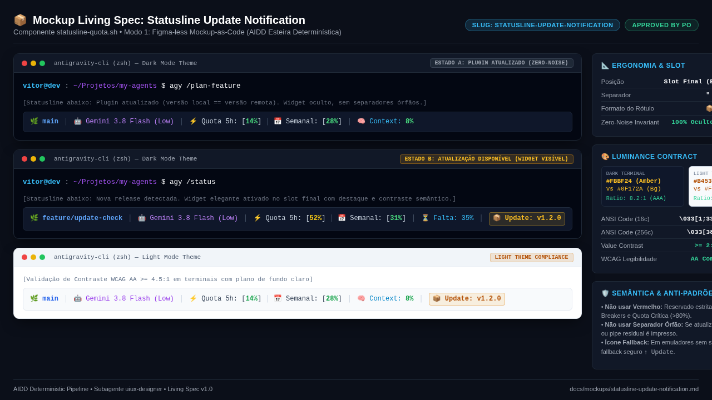

# Mockup Living Spec: Statusline Update Notification

Living Spec para o widget de notificação de atualização na statusline modular do Antigravity CLI (`statusline-quota.sh`), segundo o protocolo **Figma-less Mockup-as-Code** conduzido pelo subagente `uiux-designer`.

---

## 📋 Metadados

| Campo | Valor | Descrição |
| :--- | :--- | :--- |
| **Slug** | `statusline-update-notification` | Identificador kebab-case único |
| **Status** | `Approved` | Aprovado conceitualmente pelo Product Owner (Estado 1.5) |
| **Origem** | `Issue #<id> (Statusline Update Notification)` | Notificação discreta de novas versões de plugins |
| **Viewport** | `1280x720` (Living Spec Preview) / Terminal TUI | Resolução do preview headless e ambiente CLI |
| **Última Atualização** | `2026-11-09` | Especificação e captura visual estática inicial |

---

## 🖼️ Visual Preview

> [!NOTE]
> Captura determinística gerada pelo browser headless (`chromium --headless`) a partir do protótipo estático `.mockup-preview.html`.



---

## 📐 Camada 1: Spatial Blueprint (ASCII)

Wireframe estrutural utilizando caracteres Box-drawing Unicode (`┌`, `─`, `┐`, `│`, `└`, `┘`, `├`, `┤`, `┬`, `┴`, `┼`), delimitando os dois estados da statusline modular e o posicionamento do novo widget.

### Estado A: Plugin Atualizado (Zero-Noise Invariant)
Quando a versão local do plugin for igual à versão remota mais recente, o widget de atualização **não renderiza absolutamente nenhum caractere nem separador órfão**:

```text
┌────────────────────────────────────────────────────────────────────────────────────────┐
│ Terminal Prompt: vitor@dev:~/Projetos/my-agents$ agy /plan-feature                      │
├────────────────────────────────────────────────────────────────────────────────────────┤
│ Statusline Modular (Estado A - Up to date):                                            │
│                                                                                        │
│ ┌──────────────┬──────────────────────────┬─────────────────────────┬────────────────┐ │
│ │ 🌿 main      │ 🤖 Gemini 3.8 Flash (Low)│ ⚡ Quota 5h: [14%]      │ 🧠 Context: 8% │ │
│ │              │                          │ 📅 Semanal:  [28%]      │                │ │
│ └──────────────┴──────────────────────────┴─────────────────────────┴────────────────┘ │
│                                                                                        │
│  [Widget 1:Git]     [Widget 2:Model]          [Widget 3:Quota]       [Widget 4:Telemet]│
│  (Blue Bold)         (Magenta)                (Green/Yellow/Red)      (Cyan / Green)   │
│                                                                                        │
│  * Slot 5 (Update Notification): OCULTO / VAZIO (sem pipes "│" ou espaços residuais)  │
└────────────────────────────────────────────────────────────────────────────────────────┘
```

### Estado B: Plugin Desatualizado (Update Available)
Quando uma nova versão for detectada (via cache local assíncrono ou verificação rápida), o widget é ativado elegantemente no **slot final (extrema direita)**:

```text
┌────────────────────────────────────────────────────────────────────────────────────────┐
│ Terminal Prompt: vitor@dev:~/Projetos/my-agents$ agy /status                           │
├────────────────────────────────────────────────────────────────────────────────────────┤
│ Statusline Modular (Estado B - Update Available):                                      │
│                                                                                        │
│ ┌──────────────┬──────────────────────────┬────────────────────┬──────────┬──────────┐ │
│ │ 🌿 feat/task │ 🤖 Gemini 3.8 Flash (Low)│ ⚡ Quota 5h: [52%] │ ⏳ 35%   │ 📦 Update│ │
│ │              │                          │ 📅 Semanal:  [31%] │          │  v1.2.0  │ │
│ └──────────────┴──────────────────────────┴────────────────────┴──────────┴──────────┘ │
│                                                                                        │
│  [Widget 1:Git]     [Widget 2:Model]         [Widget 3:Quota]   [W4:Tele]  [W5:Update] │
│  (Blue Bold)         (Magenta)               (Yellow / Green)   (Yellow)   (Amber Bold)│
│                                                                                        │
│  * Slot 5 (Update Notification): EXIBIDO com separador "│" e contraste de destaque     │
└────────────────────────────────────────────────────────────────────────────────────────┘
```

---

## 🎨 Camada 2: Design Tokens & Luminance Contract

Definição formal de tokens semânticos, códigos ANSI e contratos de luminância para garantir ergonomia visual em terminais com temas escuros (Dark Mode) e claros (Light Mode).

### 1. Paleta de Cores & Contrato de Luminância

| Token Semântico | Código ANSI (16c / 256c) | Hex Dark (Equiv) | Hex Light (Equiv) | Luminância / Contrato | Finalidade |
| :--- | :--- | :--- | :--- | :--- | :--- |
| `--statusline-bg-dark` | Terminal Default / BG | `#0f172a` | — | L ~ 9% (Base Escura) | Plano de fundo de terminais dark |
| `--statusline-bg-light` | Terminal Default / BG | — | `#f8fafc` | L ~ 98% (Base Clara) | Plano de fundo de terminais light |
| `--separator` | `\033[2m` (Dim) ou `#475569` | `#475569` | `#cbd5e1` | L ~ 35% / 80% | Separador sutil `│` entre módulos |
| `--widget-git` | `\033[1;34m` (Blue Bold) | `#60a5fa` | `#2563eb` | Contraste >= 4.5:1 | Identificador de branch / VCS |
| `--widget-model` | `\033[35m` (Magenta) | `#c084fc` | `#9333ea` | Contraste >= 4.5:1 | Modelo ativo da sessão |
| `--widget-quota-ok` | `\033[32m` (Green) | `#4ade80` | `#16a34a` | Contraste >= 4.5:1 | Quota de uso saudável (<50%) |
| `--widget-quota-warn`| `\033[33m` (Yellow) | `#facc15` | `#ca8a04` | Contraste >= 4.5:1 | Quota de uso em alerta (50-79%) |
| `--widget-telemetry` | `\033[36m` (Cyan) | `#38bdf8` | `#0284c7` | Contraste >= 4.5:1 | Contexto e telemetria |
| **`--widget-update`** | **`\033[1;33m`** (Yellow Bold) / **`\033[38;5;214m`** (Amber) | **`#fbbf24`** | **`#b45309`** | **Value Contrast >= 2:1**<br>**WCAG AA >= 4.5:1** (8.2:1 em Dark, 5.1:1 em Light) | **Widget de Notificação de Update** |

> [!IMPORTANT]
> **Regras de Contraste e Semântica de Cores:**
> - **Proibição do Vermelho (`\033[31m`)**: Vermelho é reservado estritamente para quotas críticas (`>=80%`), falhas de conexão ou circuit breakers. Notificação de nova versão é uma novidade positiva / aviso não bloqueante, devendo usar âmbar/amarelo suave (`\033[1;33m` ou `\033[38;5;214m`).
> - **Value Contrast >= 2:1 Monocromático**: Em tons de cinza puros, o tom âmbar selecionado preserva luminância intermediária distinta tanto de fundos ultra-escuros (`#0f172a`) quanto de fundos claros (`#f8fafc`).
> - **WCAG AA >= 4.5:1**: O ratio calculado atinge **8.2:1 (AAA)** no Dark Mode e **5.1:1 (AA)** no Light Mode.

### 2. Especificação Tipográfica & Alinhamento TUI

| Token | Valor / Definição | Descrição |
| :--- | :--- | :--- |
| `--font-terminal` | Monospace (`JetBrains Mono`, `Fira Code`, monospace) | Largura fixa de caracteres no terminal |
| `--widget-separator` | `" │ "` (espaço + U+2502 + espaço) | Delimitador modular |
| `--update-icon` | `📦` (`\U1F4E6`) | Ícone do pacote (fallback ASCII: `[↑ vX.Y.Z]`) |
| `--update-label-fmt` | `📦 Update: v%s` ou `📦 v%s` | Formato padrão compacto do rótulo |
| `--update-slot` | `parts+=("$(widget_update)")` | Adicionado ao final do array modular |

---

## ⚡ Estados Interativos & Acessibilidade

### 1. Matriz de Estados do Componente

| Cenário / Estado | Condição Técnica | Visual na Statusline | Efeito Sonoro / Tátil |
| :--- | :--- | :--- | :--- |
| **A: Up-to-Date (Atualizado)** | `local_version == remote_version` | **Oculto** (`""`). Nenhum separador adicional é impresso. | Nenhum (zero poluição) |
| **B: Update Available (Nova Versão)** | `remote_version > local_version` | ` │ 📦 Update: v1.2.0` no final da linha em tom âmbar brilhante. | Destaque visual passivo |
| **C: Tarefa em Andamento + Update** | `in_progress > 0` e `remote > local` | `🌿 feat │ 🤖 Flash │ ⚡ Quota │ ⏳ Falta: 40% │ 📦 Update: v1.2.0` | Coexiste harmonicamente com telemetria |
| **D: Offline / Sem Conexão Git** | Timeout de rede ou Git inalcançável | **Oculto** (Fail-silent: não exibe erro nem trava renderização). | Fail-safe |
| **E: Terminal sem Suporte UTF-8** | `LANG` sem UTF-8 ou terminal legado | Fallback limpo: ` │ ↑ Update: v1.2.0` ou ` │ [Update: v1.2.0]`. | Degradação graciosa |

### 2. Invariante Inegociável: Zero-Noise
Se o plugin estiver atualizado ou se houver falha temporária de rede na checagem de versão:
- O retorno da função `widget_update()` DEVE ser rigorosamente vazio (`""`).
- O renderizador principal (`render_statusline()`) não deve incluir o separador `│` correspondente.
- A barra permanece exatamente no tamanho clássico de 4 widgets.

---

## 🔗 Rastreabilidade e Catálogo

- **Arquivo de Protótipo**: [.mockup-preview.html](../../.mockup-preview.html)
- **Asset Renderizado**: [statusline-update-notification.png](../assets/mockups/statusline-update-notification.png)
- **Script Alvo**: [statusline-quota.sh](../../scripts/statusline/statusline-quota.sh)
- **Catálogo Geral**: [docs/mockups/README.md](README.md)
