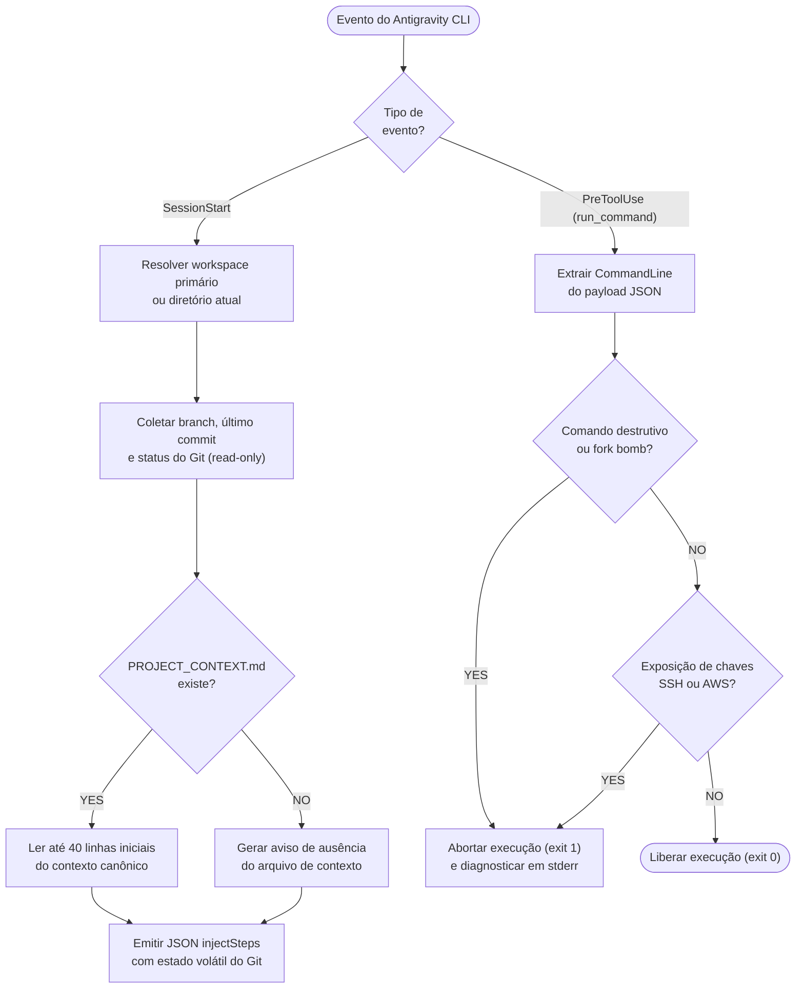

[← Voltar ao Sumário de Scripts](Scripts-Catalog)

> **Hooks de Runtime**  
> **Diretório**: [`scripts/hooks/`](https://github.com/VitorJacom/my-agents/tree/main/scripts/hooks)  
> **Quantidade**: 2 scripts (Bash + Python inline)  
> **Orquestração**: Declarados em [`hooks.json`](https://github.com/VitorJacom/my-agents/blob/main/hooks.json)

---

## 🎯 Propósito

Os scripts em `scripts/hooks/` compõem a camada de interceptação em **runtime** da [`System-Architecture`](System-Architecture), sendo disparados automaticamente pelo **Antigravity CLI** em eventos determinísticos do ciclo de vida da sessão.

Eles materializam dois pilares do [`AIDD-Manifesto`](AIDD-Manifesto):

1. **Zero Token Waste & Grounding Inicial**: Injetam dinamicamente o contexto arquitetural canônico (`PROJECT_CONTEXT.md`) e o estado volátil do Git na abertura da sessão, evitando varreduras cegas e impedindo que metadados efêmeros poluam arquivos versionados (invariante auditado em [`Test-core`](Test-core)).
2. **Defesa Preventiva em Runtime**: Interceptam chamadas de terminal antes da execução para bloquear comandos destrutivos sem escopo e tentativas de exposição de chaves privadas ou credenciais críticas.

---

## 🔄 Arquitetura de Interceptação (Runtime)

O Antigravity CLI aciona os hooks declarados em [`hooks.json`](https://github.com/VitorJacom/my-agents/blob/main/hooks.json) via entrada e saída padrão (`stdin`/`stdout`/`stderr`) em dois momentos distintos da sessão:



---

## 📋 Especificação dos Hooks (2)

| Hook | Evento | Matcher | Linguagem | Ação Principal |
| :--- | :--- | :--- | :--- | :--- |
| **`session-start-context.sh`** | `SessionStart` | `—` | Bash + Python 3 | Injeta contexto canônico e estado volátil do Git via `injectSteps`. |
| **`safety-guard.sh`** | `PreToolUse` | `run_command` | Bash (`set -euo pipefail`) | Bloqueia comandos destrutivos e leitura de credenciais antes do shell. |

---

### 1. `session-start-context.sh`

- **Evento**: `SessionStart` (registrado sob a chave `context-loader` em `hooks.json`).
- **Contrato de Entrada (`stdin`)**: Recebe o payload JSON da sessão contendo `workspacePaths`. Extrai o caminho do workspace primário e, caso esteja ausente ou inválido, utiliza o diretório corrente (`pwd`) como fallback seguro.
- **Coleta Volátil do Git (Read-Only / In-Memory)**:
  - **Branch Ativa**: `git -C <workspace> branch --show-current` (fallback: `detached/none`).
  - **Último Commit**: `git -C <workspace> log -1 --pretty=format:'%h - %s (%an)'` (fallback: `Sem commits registrados`).
  - **Status da Working Tree**: `git -C <workspace> status --short` (fallback: `Working tree limpa`).
- **Injeção de Contexto (`PROJECT_CONTEXT.md`)**:
  - **Quando presente**: Lê as primeiras **40 linhas** de `PROJECT_CONTEXT.md`, envolve no cabeçalho `📌 [PROJECT CONTEXT CARREGADO AUTOMATICAMENTE - ZERO TOKEN WASTE]`, anexa o bloco `## 📍 Estado Volátil do Git (Live SessionStart)` e acrescenta a diretriz de busca cirúrgica e Duplo Gate.
  - **Quando ausente**: Emite alerta `📌 [SESSION START]` recomendando a inicialização de `PROJECT_CONTEXT.md` para economia de tokens, mantendo a injeção do estado volátil do Git.
- **Contrato de Saída (`stdout`)**: Emite um objeto JSON válido com a chave raiz `injectSteps` contendo um `systemMessage` aninhado pronto para consumo pelo runtime do Antigravity CLI.

> [!NOTE]
> A separação entre contexto canônico estático (`PROJECT_CONTEXT.md`) e metadados voláteis injetados em memória é validada continuamente pela suíte [`Test-core`](Test-core), garantindo zero conflitos de merge em commits consecutivos.

#### Códigos de Saída (`session-start-context.sh`)

| Código | Significado | Comportamento |
| ---: | :--- | :--- |
| `0` | Sucesso | Payload JSON `injectSteps` impresso em `stdout` e injetado na sessão. |
| `> 0` | Falha de runtime | Erro inesperado de I/O ou interpretador sob `set -euo pipefail` (consulte [`Troubleshooting`](Troubleshooting)). |

---

### 2. `safety-guard.sh`

- **Evento**: `PreToolUse` (registrado sob a chave `safety-guard` em `hooks.json` com `matcher: "run_command"`).
- **Contrato de Entrada (`stdin`)**: Recebe o JSON da chamada da ferramenta e extrai o valor do campo `"CommandLine"`. Caso o campo esteja vazio ou ausente, o hook encerra imediatamente com `exit 0` sem interferir na execução.
- **Regras de Proteção e Padrões Bloqueados (ERE)**:
  1. **Comandos destrutivos sistêmicos ou deleção em massa sem escopo**:
     - `rm` com combinação recursiva e forçada (`-rf`, `-fr`, `-irf`, etc.) apontando para `/`, `~`, `$HOME`, `*` ou `..`.
     - Formatação ou escrita direta em dispositivos de bloco: `mkfs` e `dd if=`.
     - *Fork bombs* em shell no padrão `:(){ ...`.
  2. **Exposição deliberada de chaves privadas e credenciais críticas**:
     - Comandos de leitura/filtragem (`cat`, `less`, `more`, `tail`, `head`, `grep`) direcionados a `.ssh/`, `id_rsa`, `id_ed25519` ou `.aws/credentials`.
- **Contrato de Saída (`stderr`)**: Quando uma regra é violada, escreve diagnóstico explícito em `stderr` (`[ERRO DE SEGURANÇA]: ...`) informando o motivo do bloqueio e orientando uso restrito ao escopo do projeto ou execução manual pelo desenvolvedor.

#### Códigos de Saída (`safety-guard.sh`)

| Código | Significado | Comportamento |
| ---: | :--- | :--- |
| `0` | Comando permitido | Nenhuma violação detectada (ou `CommandLine` vazio); a tool `run_command` prossegue normalmente. |
| `1` | Execução bloqueada | Padrão proibido detectado; mensagem de erro enviada para `stderr` e chamada abortada antes do shell. |

> [!TIP]
> Para portões determinísticos de contrato, worktrees isoladas e validação de cobertura durante a esteira de desenvolvimento, consulte [`Script-pipeline`](Script-pipeline).

---

## 💻 Exemplos Práticos & Simulação

É possível validar o comportamento de ambos os hooks localmente simulando os payloads JSON enviados pelo Antigravity CLI na `stdin`:

```bash
# 1. Simular SessionStart no diretório atual
echo '{"workspacePaths":["'"$(pwd)"'"]}' | ./scripts/hooks/session-start-context.sh

# 2. Simular PreToolUse com comando seguro (retorna exit 0, sem saída)
echo '{"CommandLine":"git status --short"}' | ./scripts/hooks/safety-guard.sh

# 3. Simular PreToolUse com comando destrutivo (retorna exit 1 e bloqueia em stderr)
echo '{"CommandLine":"rm -rf /"}' | ./scripts/hooks/safety-guard.sh

# 4. Simular PreToolUse tentando expor chave SSH privada (retorna exit 1)
echo '{"CommandLine":"cat ~/.ssh/id_ed25519"}' | ./scripts/hooks/safety-guard.sh
```

---

## 🔗 Navegação

[← Voltar ao Sumário de Scripts](Scripts-Catalog) | [Próxima Categoria: Esteira & Governança AIDD →](Script-pipeline)
