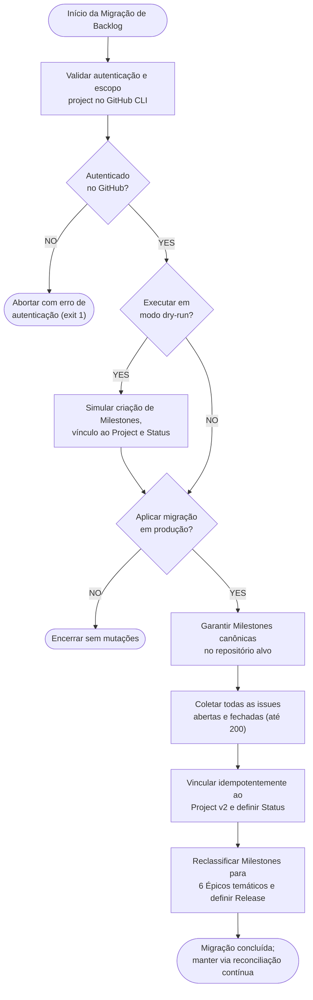

[← Voltar ao Sumário de Scripts](Scripts-Catalog)

> **Migrações Históricas**  
> **Diretório**: [`scripts/migrations/`](https://github.com/VitorJacom/my-agents/tree/main/scripts/migrations)  
> **Quantidade**: 2 scripts (1 Bash + 1 Python — *one-off*)  
> **Referências Relacionadas**: [`Script-pipeline`](Script-pipeline), [`Test-governance`](Test-governance), [`AIDD-Manifesto`](AIDD-Manifesto), [`Troubleshooting`](Troubleshooting)

---

## 🎯 Propósito

Reúne utilitários históricos (*one-off*) construídos para operações em lote de migração e reclassificação de backlog no GitHub. Eles materializam a transição de repositórios legados para o modelo de governança do [`AIDD-Manifesto`](AIDD-Manifesto), onde **Épicos temáticos** são representados por Milestones e o ciclo de entrega (`Status` e `Release`) é gerenciado no **GitHub Projects v2**.

> [!NOTE]
> Para a manutenção contínua do backlog no dia a dia, utilize sempre [`reconcile-github-governance.sh`](Script-pipeline) em vez dos scripts de migração *one-off*. A conformidade dessas regras é verificada pela suíte [`Test-governance`](Test-governance).

---

## 🔄 Fluxo de Migração Segura

O fluxo abaixo descreve a sequência recomendada de execução segura, desde a validação de credenciais até a reclassificação final de Épicos e Releases:



---

## 📋 Especificação dos Utilitários (2)

| Script | Linguagem | Papel Principal |
| :--- | :--- | :--- |
| **`migrate-issues-to-project.sh`** | Bash + Python 3 | Importa issues abertas e fechadas para Milestones e **GitHub Project v2**, sincronizando o campo `Status` com suporte a `--dry-run`. |
| **`reclassify-epics-and-releases.py`** | Python 3 | Converte Milestones anteriores em **6 Épicos temáticos** canônicos e preenche o campo Single Select `Release` no Project `#1`. |

---

### 1. `migrate-issues-to-project.sh`

Script Bash (`set -euo pipefail`) com bloco Python 3 embarcado para migração determinística de issues históricas (abertas e fechadas) para Milestones e para o GitHub Project v2.

- **Pré-condições & Pre-flight Check**:
  - Verifica autenticação via `gh auth status` (exige `"Logged in to github.com"`; caso contrário, encerra com `exit 1`).
  - Checa se o token possui o escopo `'project'` ou `read:project`. Se ausente, emite aviso orientando `gh auth refresh -s project` sem abortar o pre-flight (em caso de falhas de permissão na API do Project, consulte [`Troubleshooting`](Troubleshooting)).
  - Requer `python3` disponível no `PATH`.
- **Flags Suportadas**:
  - `--dry-run`: Simula todas as operações (criação de Milestone, `gh issue edit`, `gh project item-add` e `gh project item-edit`) sem alterar o estado no GitHub.
  - `--repo, -R <owner/repo>`: Repositório alvo (padrão: `VitorJacom/my-agents`).
  - `--project <number>`: Número do GitHub Project v2 alvo (padrão: `1`).
  - `--owner <user/org>`: Proprietário do Project v2 (padrão: `VitorJacom`).
  - `-h, --help`: Exibe a ajuda de uso e encerra com código `0`.
- **Idempotência & Operações GitHub API / CLI**:
  - **Validação de Milestones**: Consulta `gh api "repos/$REPO/milestones?state=all" --paginate`. Garante a existência da Milestone `v1.0.0 - Foundation & AIDD Core` via `POST repos/$REPO/milestones` (respeitando `--dry-run`).
  - **Coleta de Issues**: Lista até `200` issues (`--state all`) via `gh issue list --json number,title,state,milestone,url` em arquivo temporário com limpeza automática via `trap`.
  - **Deduplicação no Project v2**: Carrega previamente todas as URLs já vinculadas via `gh project item-list "$PROJECT_NUM" --owner "$OWNER" --format json`. Só executa `gh project item-add` quando a URL da issue ainda não consta no conjunto existente.
  - **Regras de Mapeamento (Milestones e `Status`)**:
    - *Milestone*: Preserva a Milestone caso a issue já possua uma atribuída; caso contrário, atribui `v1.0.0 - Foundation & AIDD Core` para issues `CLOSED`, `v1.2.0 - Documentation & Wiki Governance` para as issues documentais `{24, 25, 26, 27}` e `v1.1.0` para as demais abertas (`gh issue edit --milestone`).
    - *Status no Project v2* (`gh project item-edit --field "Status"`): Define `Done` para issues `CLOSED`, `In Review` para o conjunto `{24, 25, 26, 27, 46}` e `Planned` para as demais abertas.
  - **Resiliência por Item**: Falhas pontuais em `gh issue edit`, `gh project item-add` ou `gh project item-edit` emitem aviso (`⚠️`) e não interrompem o processamento das issues restantes.

#### Códigos de Saída (`migrate-issues-to-project.sh`)

| Código | Significado | Comportamento |
| ---: | :--- | :--- |
| `0` | Sucesso ou ajuda | Exibe ajuda (`-h`/`--help`) ou conclui a migração / simulação `--dry-run`. |
| `1` | Erro de entrada ou autenticação | Flag desconhecida ou `gh auth status` não autenticado no `github.com`. |
| `> 0` | Falha de comando crítico | Erro em chamadas obrigatórias (`gh issue list` ou criação inicial de Milestone) sob `set -euo pipefail`. |

---

### 2. `reclassify-epics-and-releases.py`

Utilitário Python 3 (*one-off*) projetado para consolidar Milestones temporais legadas em **6 Épicos temáticos** canônicos e preencher o campo Single Select `Release` no GitHub Project `#1`.

- **Escopo e Parâmetros**:
  - Não aceita flags de linha de comando (não possui `--dry-run` nem sobrescrita de alvo). Opera diretamente sobre as constantes `REPO = "VitorJacom/my-agents"`, `OWNER = "VitorJacom"` e `PROJECT_NUM = "1"`.
- **Operações GitHub API / CLI**:
  - **Provisionamento dos 6 Épicos (Milestones)**: Consulta `gh api repos/VitorJacom/my-agents/milestones?state=all` e cria via `POST` os Épicos ausentes com título e descrição canônica.
  - **Reclassificação em Lote**: Coleta até `200` issues (`gh issue list --state all --limit 200`), aplica `gh issue edit --milestone` apenas quando a Milestone atual difere do Épico alvo, garante vínculo no Project `#1` via `gh project item-add` e atualiza `--field Release` via `gh project item-edit`.
- **Regras de Mapeamento (Épicos & Releases)**:
  - **6 Épicos Temáticos (`EPICS`)**:
    - `Epic: AIDD Core & Engineering Governance`: `{1, 2, 4, 10, 12, 19, 20, 21, 22, 35, 36, 44, 45, 46}` *(também utilizado como fallback padrão para issues não mapeadas)*.
    - `Epic: Multi-Agent Parallel Pipeline & Worktrees`: `{8, 9, 11, 42, 48}`.
    - `Epic: UI/UX Design System & Living Mockups`: `{6, 7, 13, 14, 15, 17, 31, 32, 33}`.
    - `Epic: Automated PR Review Skill`: `{51, 52, 53, 54}`.
    - `Epic: Wiki & Living Documentation`: `{24, 25, 26, 27, 57}`.
    - `Epic: Multi-Model Adversarial Pipeline & Metrics`: `{28, 29, 30, 49, 56}`.
  - **Releases (`RELEASES`)**:
    - `v1.0.0`: `{1, 2, 4, 8, 9, 12, 13, 14, 15, 19, 20, 21, 22, 35, 36, 42}`.
    - `v1.1.0`: `{6, 7, 10, 11, 17, 31, 32, 33, 44, 45, 46, 48, 49, 51, 52, 53, 54, 56, 57}` *(também utilizado como fallback padrão para issues não mapeadas)*.
    - `v1.2.0`: `{24, 25, 26, 27, 28, 29, 30}`.

#### Códigos de Saída (`reclassify-epics-and-releases.py`)

| Código | Significado | Comportamento |
| ---: | :--- | :--- |
| `0` | Sucesso | Épicos garantidos e todas as issues processadas no Project `#1`. |
| `!= 0` | Falha de pré-requisito / API | `run_cmd(..., check=True)` propaga o código de erro do `gh` se falhar ao listar/criar Milestones ou listar issues. Mutações por item usam `check=False` e não abortam o loop. |

---

## 💻 Exemplos Práticos

```bash
# 1. Simular migração de backlog sem alterar nada no GitHub (--dry-run)
./scripts/migrations/migrate-issues-to-project.sh --dry-run

# 2. Executar migração em um repositório e Project v2 específicos
./scripts/migrations/migrate-issues-to-project.sh \
  --repo VitorJacom/my-agents \
  --project 1 \
  --owner VitorJacom

# 3. Reclassificar Milestones para os 6 Épicos temáticos e preencher o campo Release
# (Requer gh autenticado com escopo 'project')
python3 scripts/migrations/reclassify-epics-and-releases.py

# 4. Para manutenção contínua após a migração inicial, use a governança da esteira:
./scripts/pipeline/reconcile-github-governance.sh --dry-run
```

---

## 🔗 Navegação

[← Anterior: Statusline & Quota CLI](Script-statusline) | [Sumário de Scripts](Scripts-Catalog)
