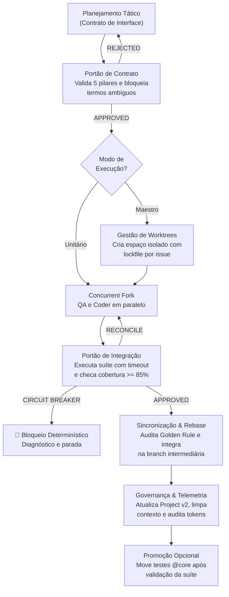

[← Voltar ao Sumário de Scripts](Scripts-Catalog)

> **Esteira & Governança AIDD**  
> **Diretório**: [`scripts/pipeline/`](https://github.com/VitorJacom/my-agents/tree/main/scripts/pipeline)  
> **Quantidade**: 12 scripts (7 Bash + 5 Python)  
> **Suítes Relacionadas**: [`Test-pipeline`](Test-pipeline), [`Test-governance`](Test-governance), [`Test-core`](Test-core)

---

## 🎯 Propósito

Concentra os motores determinísticos da máquina de estados do [`AIDD-Manifesto`](AIDD-Manifesto) acionados pelas esteiras [`plan-feature`](Skill-plan-feature) e [`issue-pipeline`](Skill-issue-pipeline). Esses scripts garantem que decisões críticas da esteira — validação de contratos, isolamento de **Git Worktrees** no Modo Maestro, integração do *Concurrent Fork*, promoção segura de testes para [`tests/core/`](Test-core), governança no GitHub Projects v2 e auditoria de tokens — ocorram de forma determinística, sem depender de julgamento subjetivo do modelo.

---

## 🔄 Fluxo na Esteira AIDD

O diagrama abaixo ilustra como os scripts de `scripts/pipeline/` atuam nos portões de qualidade, no isolamento paralelo e na governança contínua da esteira:



---

## 📋 Catálogo Detalhado de Scripts

### 1. 🔄 Orquestração & Worktrees

| Script | Linguagem | Papel Principal |
| :--- | :--- | :--- |
| **`worktree-manager.sh`** | Bash | Gerencia o ciclo de vida de Git Worktrees isoladas (`.worktrees/issue-<id>`) para o Modo Maestro da skill [`issue-pipeline`](Skill-issue-pipeline) ([`ARCHITECTURE`](ARCHITECTURE) — ADR-0004). |

- **`worktree-manager.sh`**
  - **Subcomandos & Flags**:
    - `create <issue_id> [--base <branch>]`: Cria a worktree em `.worktrees/issue-<id>` na branch `feature/issue-<id>` (a partir de `--base`, `origin/main`, `main` ou `HEAD`) e grava PID em `.worktrees/.lock-<id>`.
    - `list`: Lista todas as worktrees em `.worktrees/` exibindo branch ativa e estado do lock (`lock ativo`, `stale lock` ou `sem lock`).
    - `rebase-sync <issue_id> [--base <branch>]`: Executa `git rebase` sobre a branch base com *auto-abort* em conflito e auditoria anti-fraude em `tests/core/` (*Golden Rule*) e arquivos pré-existentes em `tests/features/`.
    - `remove <issue_id>`: Desmonta a worktree, executa `git worktree prune` e remove o lockfile correspondente.
  - **Entradas / Saídas**: Recebe ID da issue (com ou sem `#`) e opcionalmente `--base`; imprime mensagens de status em `stdout` e diagnósticos de erro/fraude em `stderr`.
  - **Códigos de Saída**: `0` (sucesso), `1` (argumento inválido ou branch inexistente), `2` (lock ativo por outro PID), `3` (fraude detectada), `4` (conflito de rebase abortado).

---

### 2. 🛡️ Portões de Contrato & Promoção

| Script | Linguagem | Papel Principal |
| :--- | :--- | :--- |
| **`validate-interface-contract.sh`** / **`.py`** | Bash + Python | Portão preliminar do [`planner`](Agent-planner) que valida a presença e concretude da seção `## Interface Contract`. |
| **`contract-integration-gate.sh`** / **`.py`** | Bash + Python | Portão de convergência (*Join Point*) do *Concurrent Fork* entre [`qa-engineer`](Agent-qa-engineer) e [`coder`](Agent-coder) (ADR-0005). |
| **`promote-core-test.sh`** | Bash | Promove testes aprovados de `tests/features/` para a zona protegida [`tests/core/`](Test-core) com rollback automático (ADR-0015). |

- **`validate-interface-contract.sh`** / **`validate-interface-contract.py`**
  - **Função**: O `.sh` atua como wrapper `set -euo pipefail` (respeitando `PYTHON_BIN`) para o motor Python. Verifica se a seção `## Interface Contract` existe e contém os **5 pilares obrigatórios**: `Signatures`, `Types & Interfaces`, `Inputs`, `Outputs` e `Errors`. Rejeita placeholders ou termos ambíguos (`TODO`, `TBD`, `a definir`, `n/a`, `placeholder`, `supõe-se`, etc.).
  - **Entradas / Saídas**: Caminho do arquivo de plano (ex.: `implementation_plan.md`) ou `stdin` (`-` ou omitido). Emite `✅ [INTERFACE_CONTRACT_VALID]` em `stdout` ou lista detalhada `❌ [INTERFACE_CONTRACT_ERROR]` em `stderr`.
  - **Códigos de Saída**: `0` (contrato aprovado), `1` (arquivo ausente, seção faltante/vazia, pilar ausente ou conteúdo ambíguo).

- **`contract-integration-gate.sh`** / **`contract-integration-gate.py`**
  - **Função**: O `.sh` delega ao motor Python que coordena o *Join Point* da esteira: verifica confinamento de escopo (*qa-engineer* proibido em `src/` e `tests/core/`; *coder* proibido em `tests/`), executa a suíte com timeout rígido (anti-hang) e avalia o teto de reconciliação (máximo 2 iterações) com cobertura mínima de `85.0%`. Recusa execução sem `--test-cmd` ou `--test-exit-code` explícito (proibição de fallback pesado silencioso).
  - **Flags Principais**: `--test-cmd <cmd>`, `--test-timeout <seg>` (padrão `60.0`), `--test-exit-code <int>`, `--iteration <n>` (padrão `1`), `--max-iterations <n>` (padrão `2`), `--coverage <float>`, `--min-coverage <float>` (padrão `85.0`), `--qa-files <csv>`, `--coder-files <csv>`, `--json`.
  - **Entradas / Saídas**: Emite veredito textual (`APPROVED`, `RECONCILE_REQUIRED`, `FAILED_CONTRACT_INTEGRATION`, `ANTI_FRAUD_VIOLATION`) ou payload JSON estruturado quando `--json` é informado. Timeouts internos no subprocesso retornam `124`.
  - **Códigos de Saída**: `0` (`APPROVED`), `1` (`RECONCILE_REQUIRED` ou erro de parâmetros), `2` (`FAILED_CONTRACT_INTEGRATION` — *Circuit Breaker*), `3` (`ANTI_FRAUD_VIOLATION`).

- **`promote-core-test.sh`**
  - **Flags & Subcomandos**:
    - `--list-candidates`: Lista testes `.sh` em `tests/features/` marcados com `@core` ou `CORE_RULE` (priorizando o diff contra a branch base).
    - `--promote <arquivo>`: Move o arquivo de `tests/features/` para `tests/core/`, executa `./tests/run.sh --core` e realiza **rollback automático** restaurando o caminho original se a suíte core falhar.
    - `--dry-run`: Simula a promoção sem alterar arquivos em disco.
    - `--base <branch>`: Define branch base customizada para comparação (padrão: `origin/main` ou `main`).
  - **Códigos de Saída**: `0` (sucesso ou simulação), `1` (opção inválida, arquivo fora de `tests/features/` ou falha da suíte core após promoção).

---

### 3. 🏛️ Governança GitHub & Contexto

| Script | Linguagem | Papel Principal |
| :--- | :--- | :--- |
| **`project-status-sync.sh`** | Bash | Atualiza o campo `Status` de uma issue no GitHub Projects v2 com auto-inclusão idempotente e degradação graciosa (ADR-0007). |
| **`reconcile-github-governance.sh`** | Bash | Reconcilia Milestones (Épicos) e campos (`Status`, `Release`) de issues no GitHub Projects v2. |
| **`sync-project-context.py`** | Python | Higieniza `PROJECT_CONTEXT.md` removendo seções voláteis legadas do Git para evitar conflitos em PRs e worktrees. |

- **`project-status-sync.sh`**
  - **Argumentos**: `<issue_numero_ou_url> <status_value>`. Normaliza sinônimos para a taxonomia canônica (`Planned`, `In Progress`, `In Review`, `Done`).
  - **Comportamento**: Lê `Owner`, `Project Number` e `Status Field` de `PROJECT_CONTEXT.md` (ou `PROJECT_CONTEXT_PATH`). Se a issue não estiver no projeto, executa auto-inclusão via `gh project item-add` antes de tentar novamente. Opera de forma *non-blocking* (degradação graciosa em erros de token/escopo `403` ou configuração ausente).
  - **Códigos de Saída**: `0` em todos os cenários (emite `[OK]`, `[INFO]` ou `⚠️ [WARN]` sem interromper a esteira).

- **`reconcile-github-governance.sh`**
  - **Flags Principais**: `--dry-run` (simula ações sem mutar via `gh`), `--include-closed` (atualiza issues fechadas para `Done` no Project v2), `--repo / -R <owner/repo>`, `--context-file <path>`, `-h / --help`.
  - **Comportamento**: Lê `Active Epic (Milestone)`, `Owner`, `Project Number`, `Status Field`, `Default Status`, `Release Field` e `Default Release` de `PROJECT_CONTEXT.md`. Associa Milestone ativa a issues sem épico e sincroniza `Status`/`Release` de forma idempotente no Project v2.
  - **Códigos de Saída**: `0` (sucesso, `--dry-run` ou `PROJECT_CONTEXT.md` ausente), `1` (opção desconhecida).

- **`sync-project-context.py`**
  - **Argumentos**: `[workspace_dir]` (padrão: diretório atual).
  - **Comportamento**: Cria `PROJECT_CONTEXT.md` com o template canônico caso não exista, ou remove o bloco legado `## 📍 Estado Atual da Arquitetura & Entregas` para garantir idempotência pura sem estado volátil do Git.
  - **Códigos de Saída**: `0` (inicializado, higienizado ou *no-op*), `1` (diretório de workspace inexistente).

---

### 4. 📊 Telemetria & Atualização

| Script | Linguagem | Papel Principal |
| :--- | :--- | :--- |
| **`metrics-collector.py`** | Python | Extrai e consolida consumo de tokens (`input`, `output`, `cache_read`) e duração a partir de `transcript.jsonl` dos subagentes. |
| **`audit-token-efficiency.py`** | Python | Audita eficiência de tokens por fase AIDD, detecta hotspots/leituras redundantes e aplica *quality gate* por score (`0–100`). |
| **`update-plugin.sh`** | Bash | Verifica, consulta status e aplica atualizações de tags remotas do plugin `my-agents` com cache em JSON e trava de *dirty tree*. |

- **`metrics-collector.py`**
  - **Flags Principais**: `--agents '<json>'` (obrigatório; mapa `{"Role": "conversation_id"}`), `--issue <num>`, `--markdown` (formata saída em tabela Markdown para o `walkthrough.md` do [`gatekeeper`](Agent-gatekeeper)).
  - **Entradas / Saídas**: Lê logs em `~/.gemini/antigravity-cli/brain/<cid>/.system_generated/logs/transcript.jsonl` e exibe tabela no terminal ou Markdown.
  - **Códigos de Saída**: `0` (sucesso), `1` (JSON inválido em `--agents`).

- **`audit-token-efficiency.py`**
  - **Flags Principais**: `--transcript / -t <path>`, `--file / -f / --input <path>`, `--agents / -a '<json>'`, `--brain-dir <dir>`, `--stdin`, `--issue / -i <num>`, `--json`, `--markdown / -m`, `--min-score <int>`.
  - **Comportamento**: Mapeia papéis (`planner`, `qa-engineer`, `coder`, `gatekeeper`) para fases AIDD, sinaliza passos com mais de `50.000` tokens (hotspot), identifica leituras repetidas de arquivos e avalia taxa de cache. Se `--min-score` for informado e o score ficar abaixo, aciona *fail-fast*.
  - **Códigos de Saída**: `0` (sucesso e score $\ge$ mínimo), `1` (entrada ausente/inválida, arquivo não encontrado ou score abaixo de `--min-score`).

- **`update-plugin.sh`**
  - **Subcomandos & Flags**: `-c / --check`, `--force-check`, `-f / --force` (ignora TTL do cache), `-s / --status` (padrão), `-a / --apply`, `-h / --help`.
  - **Variáveis de Ambiente**: `MY_AGENTS_AUTO_UPDATE=1`, `MY_AGENTS_CACHE_FILE`, `MY_AGENTS_CACHE_TTL` (padrão `86400`s), `MY_AGENTS_LOCK_TIMEOUT` (padrão `10`s).
  - **Comportamento**: Usa `flock` exclusivo e escrita atômica no cache JSON. O subcomando `--apply` aborta com *fail-safe* se `git status --porcelain` detectar alterações locais não comitadas.
  - **Códigos de Saída**: `0` (sucesso), `1` (opção inválida, timeout de lock, *working tree* suja no `--apply` ou falha ao resolver tag remota).

---

## 🚦 Códigos de Saída & Circuit Breakers

A tabela abaixo resume os códigos de saída críticos utilizados pela orquestração para interromper execuções inseguras ou acionar reconciliação (consulte [`Troubleshooting`](Troubleshooting) para resolução de locks e circuit breakers):

| Script | Condição / Estado | Ação na Esteira | Exit Code |
| :--- | :--- | :--- | ---: |
| **`validate-interface-contract.sh`** | Contrato ausente, incompleto ou ambíguo | Rejeita planejamento antes do *Concurrent Fork* | `1` |
| **`contract-integration-gate.sh`** | Discrepância na iteração $1 \le n \le 2$ (`RECONCILE_REQUIRED`) | Devolve ao [`coder`](Agent-coder) para correção | `1` |
| **`contract-integration-gate.sh`** | Teto de iterações esgotado (`FAILED_CONTRACT_INTEGRATION`) | Aciona *Circuit Breaker* e interrompe entrega | `2` |
| **`contract-integration-gate.sh`** | Violação de confinamento ou *Golden Rule* (`ANTI_FRAUD_VIOLATION`) | Bloqueio imediato por fraude | `3` |
| **`worktree-manager.sh`** | Lock ativo retido por outro processo (`create`) | Impede colisão de concorrência na mesma issue | `2` |
| **`worktree-manager.sh`** | Modificação ilegal em `tests/core/` ou teste pré-existente (`rebase-sync`) | Aborta integração na Merge Queue por fraude | `3` |
| **`worktree-manager.sh`** | Conflito durante rebase (`rebase-sync`) | Executa `git rebase --abort` graciosamente | `4` |
| **`promote-core-test.sh`** | Falha da suíte core após movimentação (`--promote`) | Restaura o teste original via rollback automático | `1` |
| **`update-plugin.sh`** | *Working tree* suja durante `--apply` | Aborta atualização (*fail-safe*) para proteger código local | `1` |
| **`audit-token-efficiency.py`** | Score calculado inferior a `--min-score` | Falha no *quality gate* de eficiência de tokens | `1` |

---

## 💻 Exemplos Práticos de Uso

```bash
# 1. Validar Interface Contract antes do Concurrent Fork
./scripts/pipeline/validate-interface-contract.sh implementation_plan.md

# 2. Executar o Join Point com timeout rígido, cobertura e checagem de escopo
./scripts/pipeline/contract-integration-gate.sh \
  --iteration 1 \
  --test-cmd "./tests/run.sh --category pipeline" \
  --test-timeout 60 \
  --coverage 88.5 \
  --qa-files "tests/features/pipeline/test_gate.sh" \
  --coder-files "src/gate.py"

# 3. Gerenciar worktree isolada no Modo Maestro
./scripts/pipeline/worktree-manager.sh create 42 --base integration/wave-1
./scripts/pipeline/worktree-manager.sh list
./scripts/pipeline/worktree-manager.sh rebase-sync 42 --base integration/wave-1
./scripts/pipeline/worktree-manager.sh remove 42

# 4. Promover teste aprovado para tests/core/ (com simulação prévia)
./scripts/pipeline/promote-core-test.sh --list-candidates
./scripts/pipeline/promote-core-test.sh --dry-run --promote tests/features/pipeline/test_foo.sh

# 5. Sincronizar status e reconciliar governança no GitHub Projects v2
./scripts/pipeline/project-status-sync.sh 42 "In Progress"
./scripts/pipeline/reconcile-github-governance.sh --dry-run

# 6. Coletar telemetria e auditar eficiência de tokens
./scripts/pipeline/metrics-collector.py --issue 42 --markdown --agents '{"Planner":"<cid>","Coder":"<cid>"}'
./scripts/pipeline/audit-token-efficiency.py --transcript transcript.jsonl --min-score 75

# 7. Checar e exibir status de atualização do plugin
./scripts/pipeline/update-plugin.sh --check
./scripts/pipeline/update-plugin.sh --status
```

---

## 🔗 Navegação

[← Anterior: Hooks de Runtime](Script-hooks) | [Sumário de Scripts](Scripts-Catalog) | [Próxima Categoria: Revisor de PR & Telemetria →](Script-pr-reviewer)
