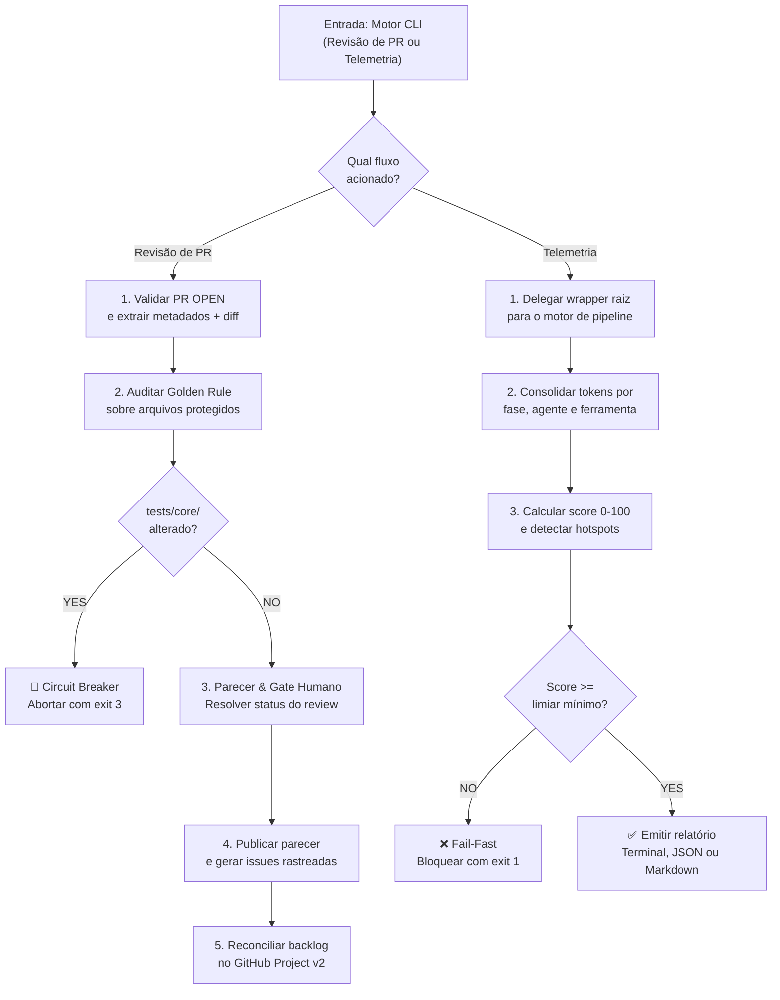

[← Voltar ao Sumário de Scripts](Scripts-Catalog)

> **Revisor de PR & Telemetria**  
> **Diretório**: [`scripts/`](https://github.com/VitorJacom/my-agents/tree/main/scripts) *(raiz)*  
> **Quantidade**: 2 scripts (`pr-reviewer.sh` e wrapper `audit-token-efficiency.py`)

---

## 🎯 Propósito

Disponibiliza os pontos de entrada de alto nível na raiz de `scripts/` para duas frentes críticas da governança do [`AIDD-Manifesto`](AIDD-Manifesto):

1. **Esteira de Revisão de Pull Requests ([`/pr`](Skill-pr))**: O motor `pr-reviewer.sh` automatiza validação de PR aberta, extração de diff, proteção anti-fraude (*Golden Rule*), submissão de parecer e abertura de issues rastreadas com reconciliação via [`Script-pipeline`](Script-pipeline).
2. **Telemetria & Eficiência de Tokens**: O wrapper `audit-token-efficiency.py` expõe na raiz a auditoria determinística de *transcripts* multiagente, detecção de *hotspots* e *quality gate* de score mínimo (`--min-score`).

A confiabilidade desses utilitários é verificada continuamente pelas suítes [`Test-pr-review`](Test-pr-review) e [`Test-governance`](Test-governance).

---

## 🔄 Fluxo do Motor CLI



---

## 📋 Especificação dos Utilitários (2)

### 1. `scripts/pr-reviewer.sh`

Motor CLI determinístico em Bash (`set -euo pipefail`) que executa as operações remotas e de auditoria da skill [`pr`](Skill-pr) sobre o GitHub CLI (`gh`). Utiliza `jq` como parser primário de JSON com *fallback* automático para `python3`.

Todos os subcomandos exigem o número da PR (`<pr_number>`) e validam previamente que a Pull Request existe e está no estado `OPEN`.

| Subcomando | Fase `/pr` | Flags & Parâmetros | Comportamento & Regras |
| :--- | :--- | :--- | :--- |
| **`fetch-diff`** | Fase 1 | `<pr_number>` | Extrai metadados (`Number`, `Title`, `State`, `Author`, `Head -> Base`, `URL`) e o diff unificado completo (`=== PR #<id> METADATA ===` e `=== UNIFIED DIFF ===`). |
| **`audit-integrity`** | Fase 2 | `<pr_number>` | Aplica a *Golden Rule* do [`AIDD-Manifesto`](AIDD-Manifesto): inspeciona cabeçalhos de diff (`diff --git`, `---`, `+++`) sob [`tests/core/`](Test-core). Qualquer adição, modificação ou remoção aborta imediatamente com **exit code 3**. |
| **`submit-review`** | Fase 5 | `<pr_number>` `--body-file <arq>` `[--status <modo>]` `[--dry-run]` | Publica o parecer formal via `gh pr review`. Requer arquivo de parecer existente e não vazio. Suporta `--dry-run` para simular comando e conteúdo sem mutação remota. |
| **`create-issues`** | Fase 5 | `<pr_number>` `--findings-file <arq>` `[--dry-run]` | Extrai apontamentos elegíveis (`🚨 Crítico` ➔ `type:fix` / `fix(review):`; `⚠️ Importante` ➔ `type:refactor` / `refactor(review):`), cria issues vinculadas à PR/branch/`headRefOid` com labels `status:planned,source:code-review` e dispara [`reconcile-github-governance.sh`](Script-pipeline). |

#### Resolução Automática de Status (`submit-review --status auto`)

Quando `--status` é omitido ou definido como `auto` (padrão), o script inspeciona o conteúdo de `--body-file` (case-insensitive) na seguinte ordem de precedência:

1. **`request-changes`**: Se detectar `🚨`, `crítico` / `critico` ou `violação de integridade`.
2. **`comment`**: Se não houver críticos, mas detectar `⚠️`, `importante`, `💡` ou `sugestão` / `sugestao`.
3. **`approve`**: Caso contrário (nenhum apontamento impeditivo ou sugestivo).

> [!NOTE]
> Os modos explícitos `--status approve`, `--status request-changes` e `--status comment` ignoram a detecção automática e aplicam exatamente a decisão informada.

---

### 2. `scripts/audit-token-efficiency.py`

*Wrapper* de compatibilidade na raiz que delega a execução diretamente para [`scripts/pipeline/audit-token-efficiency.py`](Script-pipeline), validando a existência do script core antes de executá-lo.

#### Fontes de Entrada e Formatos de Saída

| Grupo | Opções | Descrição |
| :--- | :--- | :--- |
| **Entrada** *(obrigatória uma)* | `--transcript` / `-t` *(aliases `--file`, `-f`, `--input`)*, `--agents` / `-a`, `--stdin` | Lê um `transcript.jsonl` direto, um mapa JSON de papéis para *conversation IDs* (`--brain-dir`, padrão `~/.gemini/antigravity-cli/brain`) ou linhas JSONL via `stdin`. |
| **Saída** | *(padrão terminal)*, `--json`, `--markdown` / `-m`, `--issue` / `-i` | Emite tabela colorida no terminal, JSON estruturado ou relatório Markdown (opcionalmente identificado por `--issue <id>`). |
| **Quality Gate** | `--min-score <0-100>` | Compara o score calculado com o limiar informado; se `score < min-score`, emite `[FAIL-FAST]` em `stderr` e encerra com **exit code 1**. |

#### Métricas, Penalidades e Detecção de Hotspots

O score parte de **100 pontos** (limitado ao intervalo `0–100`) e consolida o consumo por fase canônica AIDD (`Planning`, `QA`, `Coding`, `Gatekeeper`, ou fallback `Execution`) e por *tool call*:

- **Eficiência de Prompt Cache** (`cache_read_tokens / (input_tokens + cache_read_tokens)`):
  - `>= 60%`: Sem penalidade.
  - `45% – 59.9%`: `-5` pontos.
  - `30% – 44.9%`: Até `-20` pontos (`LOW_CACHE_RATIO`).
  - `< 30%`: `-30` pontos (`CRITICAL_CACHE_MISS`).
  - Queda brusca de cache entre steps consecutivos (`> 15k` para `< 2k` com entrada `> 15k`): `-5` pontos (`SUDDEN_CACHE_DROP`).
- **Explosão de Tokens por Step (`STEP_TOKEN_SPIKE`)**: Cada etapa com `input_tokens >= 50.000` desconta `8` pontos (teto de `-25`).
- **Leituras Redundantes (`REDUNDANT_FILE_READ`)**: Mesmo arquivo lido via `read_file` ou `view_file` mais de `2` vezes desconta `4` pontos por arquivo (teto de `-15`).
- **Desbalanceamento Multiagente (`AGENT_TOKEN_IMBALANCE`)**: Em execuções com 2 ou mais agentes, qualquer agente que concentre mais de `65%` do total de tokens desconta `10` pontos.
- **Classificação Final**: `Classe A (Excelente)` (`>= 90`), `Classe B (Bom)` (`>= 75`), `Classe C (Regular)` (`>= 50`) e `Classe D/F (Crítico)` (`< 50`).

---

## 🚦 Códigos de Saída & Validações

| Script | Exit Code | Significado & Condição de Disparo |
| :--- | :---: | :--- |
| **`pr-reviewer.sh`** | `0` | Operação concluída com sucesso, PR íntegra na *Golden Rule* ou simulação `--dry-run` executada sem erros. |
| **`pr-reviewer.sh`** | `1` | Erro operacional: parâmetros ausentes/inválidos, arquivo vazio/inexistente, PR fechada ou inexistente, nenhum finding elegível, falha no `gh` CLI ou reconciliador, ou ausência de `jq` e `python3`. |
| **`pr-reviewer.sh`** | `3` | **Circuit Breaker (`ALERTA DE FRAUDE`)**: `audit-integrity` detectou alteração em [`tests/core/`](Test-core). |
| **`audit-token-efficiency.py`** | `0` | Auditoria concluída e dentro do limiar `--min-score` (quando especificado). |
| **`audit-token-efficiency.py`** | `1` | Script core ausente, entrada ausente/vazia/inválida, JSON malformado em `--agents` ou violação do gate `--min-score` (`[FAIL-FAST]`). |

---

## 💻 Exemplos Práticos

```bash
# 1. Consultar metadados e diff de uma PR aberta (Fase 1 de /pr)
./scripts/pr-reviewer.sh fetch-diff 54

# 2. Verificar integridade da Golden Rule em tests/core/ (Fase 2; exit 3 se violada)
./scripts/pr-reviewer.sh audit-integrity 54

# 3. Simular e publicar parecer automático na PR (Fase 5)
./scripts/pr-reviewer.sh submit-review 54 --body-file parecer.md --status auto --dry-run
./scripts/pr-reviewer.sh submit-review 54 --body-file parecer.md --status auto

# 4. Simular e criar issues rastreadas a partir de findings críticos/importantes
./scripts/pr-reviewer.sh create-issues 54 --findings-file findings.md --dry-run
./scripts/pr-reviewer.sh create-issues 54 --findings-file findings.md

# 5. Auditar eficiência de tokens via wrapper raiz com quality gate (>= 80)
python3 ./scripts/audit-token-efficiency.py --transcript transcript.jsonl --issue 54 --markdown --min-score 80
```

---

## 🔗 Navegação

[← Anterior: Esteira & Governança AIDD](Script-pipeline) | [Sumário de Scripts](Scripts-Catalog) | [Próxima Categoria: Statusline & Quota CLI →](Script-statusline)
