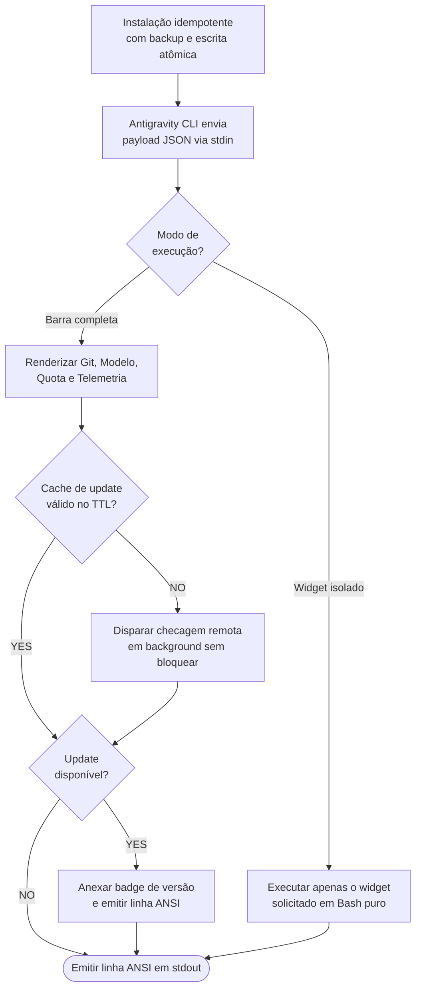

[← Voltar ao Sumário de Scripts](Scripts-Catalog)

> **Statusline & Quota CLI**  
> **Diretório**: [`scripts/statusline/`](https://github.com/VitorJacom/my-agents/tree/main/scripts/statusline)  
> **Quantidade**: 3 scripts (Bash + Python 3 inline no instalador)  
> **Orquestração**: Configurado em `~/.gemini/antigravity-cli/settings.json`

---

## 🎯 Propósito

Os scripts em `scripts/statusline/` fornecem a barra de status modular integrada ao rodapé do **Antigravity CLI** (apresentada em [`Getting-Started`](Getting-Started)), exibindo branch Git, modelo ativo, consumo de quota (5 horas e semanal), telemetria dinâmica de contexto ou progresso de tarefa e notificação silenciosa de atualizações do plugin.

Eles sustentam a experiência em tempo real da [`System-Architecture`](System-Architecture) sob três garantias operacionais auditadas por [`Test-statusline`](Test-statusline):

1. **Latência Sub-50ms**: O renderizador principal opera em Bash puro com leitura direta de cache local e disparo assíncrono em segundo plano, evitando bloqueios na interface do terminal.
2. **Instalação Idempotente & Atômica**: O instalador preserva configurações pré-existentes no `settings.json`, gera backup `.bak` e grava via substituição atômica.
3. **Degradação Graciosa**: Payloads vazios, nulos ou JSONs corrompidos na `stdin` nunca quebram a barra nem poluem `stderr`, assumindo fallbacks seguros.

---

## 🔄 Arquitetura & Fluxo da Barra de Status

O ciclo de vida da statusline abrange a injeção idempotente no `settings.json`, a renderização síncrona de widgets em **< 50ms** e a checagem assíncrona de atualizações via cache XDG:



---

## 📋 Especificação dos Scripts (3)

| Script | Papel | Linguagem | Integração Principal |
| :--- | :--- | :--- | :--- |
| **`install-statusline.sh`** | Injetor idempotente em `settings.json` | Bash + Python 3 | `ANTIGRAVITY_SETTINGS_PATH` |
| **`statusline-quota.sh`** | Motor modular de renderização (`< 50ms`) | Bash puro | `stdin` JSON + cache XDG + `update-plugin.sh` |
| **`test-statusline.sh`** | Wrapper de validação e benchmark sub-50ms | Bash | [`Test-statusline`](Test-statusline) |

---

### 1. `install-statusline.sh`

Configura automaticamente o bloco `"statusLine"` no arquivo de configurações do Antigravity CLI (`~/.gemini/antigravity-cli/settings.json` por padrão), preservando demais chaves do usuário e atributos existentes dentro de `statusLine`.

- **Flags Suportadas**:
  - `--settings-path <caminho>` (ou `--settings-path=<caminho>`): Define um caminho customizado para o `settings.json`.
  - `--script-path <caminho>` (ou `--script-path=<caminho>`): Define o script alvo executado pela statusline (padrão: `scripts/statusline/statusline-quota.sh`).
  - `--dry-run`: Simula a injeção e imprime o JSON resultante em `stdout` sem gravar no disco.
  - `-h`, `--help`: Exibe a ajuda de uso e encerra.
- **Variáveis de Ambiente**:
  - `ANTIGRAVITY_SETTINGS_PATH`: Sobrescreve o caminho padrão do `settings.json`.
  - `STATUSLINE_SCRIPT_PATH`: Sobrescreve o caminho padrão do script de statusline.
- **Comportamento de Segurança & Idempotência**:
  - Resolve o caminho absoluto do script alvo (quando existente) e garante permissão de execução (`chmod +x`).
  - Define `"type": "command"`, `"command": "<caminho-absoluto>"` e `"enabled": true`.
  - Se o `settings.json` já estiver idêntico ao conteúdo calculado, encerra sem reescrever o arquivo (`[INFO]`).
  - Antes de gravar alterações, cria diretórios pai ausentes, salva cópia de segurança em `<settings_path>.bak` e realiza escrita atômica via `<settings_path>.tmp.<pid>` + `os.replace`.

#### Códigos de Saída (`install-statusline.sh`)

| Código | Significado | Comportamento |
| ---: | :--- | :--- |
| `0` | Sucesso ou No-Op | Configuração aplicada, já idempotente, `--dry-run` ou `--help`. |
| `1` | Erro de entrada ou JSON | Flag desconhecida, argumento ausente ou JSON pré-existente inválido em `settings.json`. |

---

### 2. `statusline-quota.sh`

Renderizador modular responsável por montar a barra de status em **< 50ms** a partir do payload JSON enviado pelo Antigravity CLI via `stdin` (ou `{}` quando executado em terminal interativo `[ -t 0 ]` / entrada vazia).

- **Flags Suportadas**:
  - `--widget <nome>`: Renderiza isoladamente um único widget em vez da barra completa. Valores aceitos:
    - `git` ➔ `widget_git`
    - `model` ➔ `widget_model`
    - `quota` ➔ `widget_quota`
    - `telemetry` | `activity` | `context` ➔ `widget_telemetry`
    - `update` ➔ `widget_update`
    - Qualquer outro valor (ou ausência da flag) aciona `render_statusline`, unindo os widgets ativos com ` │ `.

#### Os 5 Widgets Modulares

| Widget | Fonte Primária | Fallback / Default | Saída Visual |
| :--- | :--- | :--- | :--- |
| **`widget_git`** | Campo `"branch"` no JSON de `stdin` | `git rev-parse --abbrev-ref HEAD` (ou `--short HEAD`) | `🌿 <branch>` (omitido fora de repo Git) |
| **`widget_model`** | `"display_name"` ou `"model"` no JSON | `"model"` em `settings.json` ➔ `"Gemini 3.8 Flash (Low)"` | `🤖 <modelo>` |
| **`widget_quota`** | Buckets `"5h"` e `"weekly"`/`"week"` (`used_percentage`) | Extração sequencial ➔ `ok` em ciano | `⚡ Quota 5h: [X%] │ 📅 Semanal: [Y%]` |
| **`widget_telemetry`** | `task.md` ativo (`[/]`) ou `"status"`/`"state"` no JSON | Modo Idle com cálculo de uso de contexto (`0%`) | `⏳ Falta: Y%` (tarefa) ou `🧠 Context: X%` (idle) |
| **`widget_update`** | Cache JSON em `XDG_CACHE_HOME` | Checagem assíncrona via `update-plugin.sh --check` | `📦 Update: v<tag>` (oculto se atualizado) |

- **Robustez de Quota e Telemetria**:
  - `widget_quota` isola a formatação numérica com `LC_ALL=C LC_NUMERIC=C` para evitar falhas de ponto flutuante em locales como `pt_BR.UTF-8` e aceita buckets em qualquer ordem. Valores `< 50%` usam verde, `>= 50%` amarelo e `>= 80%` vermelho.
  - `widget_telemetry` prioriza a detecção de tarefas em andamento (`[/]`) no arquivo `task.md` (em `${ANTIGRAVITY_WORKSPACE}/task.md` ou `./task.md`), alternando para `⏳ Falta: Y%`; em estado *Idle*, calcula o percentual da janela de contexto (padrão `1000000` tokens quando `context_window` não é informado).
- **Integração com `widget_update` e Caminhos de Cache XDG**:
  - **Diretório/Arquivo de Cache**: `MY_AGENTS_CACHE_DIR` (padrão: `${XDG_CACHE_HOME:-$HOME/.cache}/antigravity`) e `MY_AGENTS_CACHE_FILE` (padrão: `$cache_dir/my-agents-update.json`).
  - **TTL e Disparo Assíncrono**: Lê `update_available`, `latest_tag`/`latest_version`, `last_checked_timestamp`/`timestamp` e `ttl_seconds`/`ttl` (padrão: `86400` segundos / 24h). Se o cache não existir, estiver ilegível/vazio ou expirar (`now - last_checked >= ttl`), dispara `( "$update_script" --check </dev/null >/dev/null 2>&1 & )` em segundo plano sem atrasar a renderização síncrona.
  - **Descoberta do `update-plugin.sh`**: Procura o executável em `${ANTIGRAVITY_WORKSPACE}/scripts/pipeline/update-plugin.sh`, `${MY_AGENTS_WORKSPACE_ROOT}/scripts/pipeline/update-plugin.sh`, `$SCRIPT_DIR/../pipeline/update-plugin.sh` ou `./scripts/pipeline/update-plugin.sh` (documentado em [`Script-pipeline`](Script-pipeline)).
  - **Normalização Visual**: Quando `update_available` é `true`, prefixa `v` em tags numéricas/semânticas (`📦 Update: v<tag>`) ou exibe `📦 Update disponível` em âmbar negrito.
- **Variáveis de Ambiente**:
  - `ANTIGRAVITY_WORKSPACE`: Workspace ativo para localizar `task.md` e `scripts/pipeline/update-plugin.sh`.
  - `MY_AGENTS_WORKSPACE_ROOT`: Raiz alternativa do repositório para localizar `scripts/pipeline/update-plugin.sh`.
  - `XDG_CACHE_HOME`, `MY_AGENTS_CACHE_DIR`, `MY_AGENTS_CACHE_FILE`: Controle do caminho de cache de atualizações.

#### Códigos de Saída (`statusline-quota.sh`)

| Código | Significado | Comportamento |
| ---: | :--- | :--- |
| `0` | Renderização concluída | Emite a statusline (ou widget isolado) em `stdout` com fallbacks silenciosos em caso de JSON inválido. |
| `> 0` | Falha inesperada de ambiente | Erro de shell/sistema não tratado sob `set -euo pipefail` (consulte [`Troubleshooting`](Troubleshooting)). |

---

### 3. `test-statusline.sh`

Wrapper executável de fumaça e benchmark que delega diretamente (`exec bash ... "$@"`) para [`tests/features/statusline/test_statusline.sh`](https://github.com/VitorJacom/my-agents/blob/main/tests/features/statusline/test_statusline.sh), descrita em detalhes em [`Test-statusline`](Test-statusline).

- **O que é validado**:
  - Exportação e executabilidade das funções modulares (`widget_git`, `widget_model`, `widget_quota`, `widget_telemetry`, `render_statusline`).
  - Tolerância a `{}`, `/dev/null`, JSON corrompido e valores `null` sem emissão em `stderr`.
  - Parsing independente da ordem dos buckets, robustez sob `LC_NUMERIC=pt_BR.UTF-8` e alternância Idle vs Tarefa (`task.md` e JSON).
  - Consistência de escapes ANSI no modo `--widget <nome>`.
  - **Benchmark obrigatório sub-50ms**: Executa **10 iterações consecutivas** e valida que a latência média (`AVG_MS`) seja estritamente inferior a `50ms`.

#### Códigos de Saída (`test-statusline.sh`)

| Código | Significado | Comportamento |
| ---: | :--- | :--- |
| `0` | Suíte aprovada | Todas as asserções passaram e a latência média em 10 iterações ficou `< 50ms`. |
| `1` | Falha de contrato ou latência | Pelo menos uma verificação falhou ou a latência média atingiu `>= 50ms`. |

---

## 💻 Exemplos Práticos & Diagnóstico

```bash
# 1. Simular a instalação sem alterar ~/.gemini/antigravity-cli/settings.json
./scripts/statusline/install-statusline.sh --dry-run

# 2. Instalar a statusline em um arquivo de configurações customizado
./scripts/statusline/install-statusline.sh --settings-path /tmp/settings.json

# 3. Testar a renderização completa simulando payload JSON do Antigravity CLI
echo '{"model":{"display_name":"Gemini 3.8 Pro"},"telemetry":{"total_tokens":42000}}' | ./scripts/statusline/statusline-quota.sh

# 4. Inspecionar apenas um widget isolado (ex.: update com cache customizado)
MY_AGENTS_CACHE_FILE=/tmp/my-agents-update.json ./scripts/statusline/statusline-quota.sh --widget update

# 5. Executar a validação funcional e o benchmark sub-50ms
./scripts/statusline/test-statusline.sh
```

> [!TIP]
> Se a notificação de atualização não aparecer ou o cache estiver desatualizado, force a verificação com `./scripts/pipeline/update-plugin.sh --check --force` (detalhes em [`Script-pipeline`](Script-pipeline)) ou consulte [`Troubleshooting`](Troubleshooting) para diagnóstico de locks e permissões.

---

## 🔗 Navegação

[← Anterior: Revisor de PR & Telemetria](Script-pr-reviewer) | [Sumário de Scripts](Scripts-Catalog) | [Próxima Categoria: Migrações Históricas →](Script-migrations)
