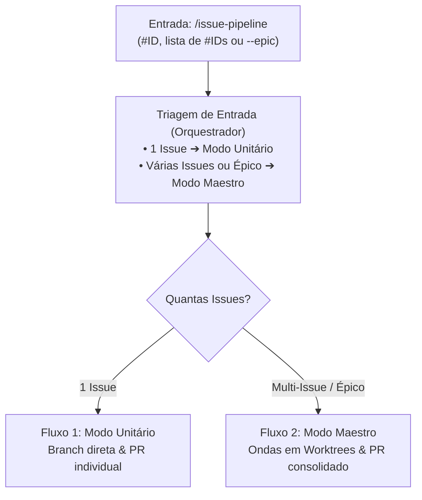
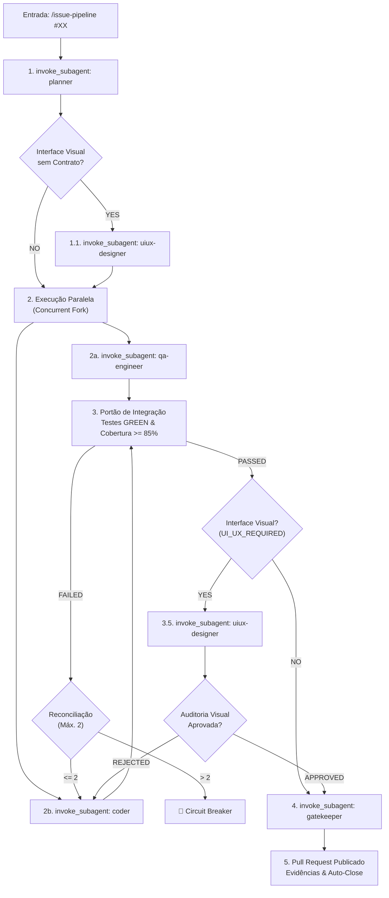
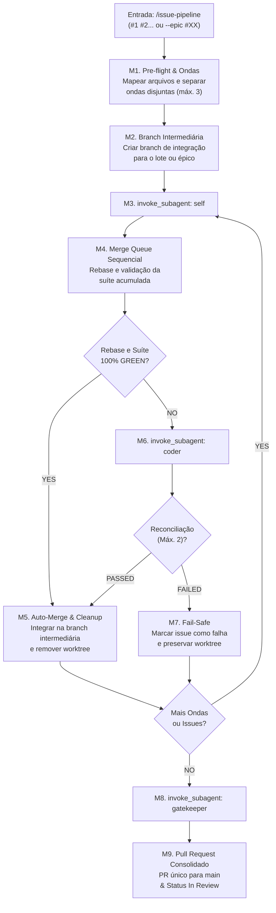

[← Voltar ao Sumário de Skills](Skills-Catalog)

> **Esteira TDD Unitária e Modo Maestro**  
> **Definição Canônica**: [`skills/issue-pipeline/SKILL.md`](https://github.com/VitorJacom/my-agents/blob/main/skills/issue-pipeline/SKILL.md)  
> **Categoria**: Esteiras & Orquestração AIDD  
> **Comando de Invocação**: `/issue-pipeline <#ID>` ou `/issue-pipeline <#1 #2 #3>` / `/issue-pipeline --epic <#ID>`

---

## 🎯 Objetivo

A skill **`issue-pipeline`** orquestra a máquina de estados determinística do ecossistema ([`AIDD-Manifesto`](AIDD-Manifesto)) para implementar uma ou múltiplas issues do GitHub planejadas via [`plan-feature`](Skill-plan-feature), garantindo **TDD rigoroso**, execução concorrente sob contrato congelado (*Concurrent Fork*), cobertura mínima de **85%**, auditoria visual (quando aplicável) e proteção anti-fraude (*Golden Rule*).

---

## ⚡ Quando Acionar (*Progressive Disclosure*)

- Ao implementar uma issue planejada do GitHub de ponta a ponta até a abertura do Pull Request.
- Ao executar um lote de issues ou um épico inteiro em paralelo usando Git Worktrees isoladas e Merge Queue.

---

## 🚀 Exemplos de Invocação

```text
# Modo Unitário (1 Issue)
/issue-pipeline #12
/issue-pipeline 12
/issue-pipeline https://github.com/VitorJacom/my-agents/issues/12

# Modo Maestro (Multi-Issue concorrente)
/issue-pipeline #12 #13 #14
/issue-pipeline 12 13 14

# Modo Maestro por Épico
/issue-pipeline --epic #10
```

---

## 🧭 Roteamento de Modo (Triagem de Entrada)

Ao receber o comando `/issue-pipeline`, o orquestrador analisa a entrada e decide automaticamente qual fluxo seguir:



---

## 🔄 Fluxo 1: Modo Unitário (1 Issue)



### 📋 Responsabilidades por Estado (Modo Unitário)

| Estado | Responsável | O que acontece nesta etapa |
| :--- | :--- | :--- |
| **1. Planejamento Tático** | [`planner`](Agent-planner) | Valida se a issue é atômica ($\le 3$ passos), prepara o plano técnico com o contrato de interface congelado (`implementation_plan.md` e `task.md`) e move o cartão no quadro do projeto para **`In Progress`**. |
| **1.1. Fallback Visual** *(Condicional)* | [`uiux-designer`](Agent-uiux-designer) | Acionado apenas se a issue exigir interface visual mas ainda não possuir especificação de mockup. Gera o contrato visual antes da codificação. |
| **2a. Testes de Aceitação** *(Paralelo)* | [`qa-engineer`](Agent-qa-engineer) | Trabalha isolado na camada de testes, criando cenários de *Happy Path* e *Edge Cases / Failure Modes* que falham inicialmente (**RED**) com base no contrato congelado. |
| **2b. Implementação** *(Paralelo)* | [`coder`](Agent-coder) | Trabalha simultaneamente no código de produção respeitando rigorosamente as assinaturas, tipos e erros definidos no contrato congelado. |
| **3. Portão de Integração** | Orquestrador + [`Script-pipeline`](Script-pipeline) | Executa os testes com timeout rígido e verifica se todos estão verdes (**GREEN**) com cobertura $\ge 85\%$. Se falhar, aciona até 2 ciclos de correção antes do *Circuit Breaker*. |
| **3.5. Auditoria Visual** *(Condicional)* | [`uiux-designer`](Agent-uiux-designer) | Quando a entrega possui interface visual, captura a tela renderizada em navegador headless e audita fidelidade, contraste e responsividade. Se reprovar, devolve ao [`coder`](Agent-coder) para ajuste visual. |
| **4. Auditoria & Handoff** | [`gatekeeper`](Agent-gatekeeper) | Verifica a *Golden Rule* (nenhuma adulteração em [`tests/core/`](Test-core)), compila o relatório de provas (`walkthrough.md`) e publica o Pull Request com fechamento automático da issue. |

---

## 🌊 Fluxo 2: Modo Maestro (Multi-Issue & `--epic`)

No Modo Maestro, a sessão principal opera estritamente como **Control Plane** (sem codificar nem rodar TDD na raiz), delegando cada issue para workers isolados em Git Worktrees.



### 📋 Responsabilidades por Estado (Modo Maestro)

| Estado | Responsável | O que acontece nesta etapa |
| :--- | :--- | :--- |
| **M1. Pre-flight & Ondas** | Maestro (Control Plane) | Analisa os arquivos-alvo (`Target Files`) e dependências de cada issue, agrupando em ondas de até 3 issues com arquivos 100% disjuntos para eliminar conflitos paralelos. |
| **M2. Branch Intermediária** | Maestro | Cria uma branch dedicada de integração para o lote ou épico a partir de `main`, servindo de base comum para todas as worktrees das ondas. |
| **M3. Despacho de Workers** | Maestro ➔ `invoke_subagent: self` + [`Script-pipeline`](Script-pipeline) | Provisiona uma Git Worktree isolada com lock exclusivo por issue, atualiza os cartões para **`In Progress`** e despacha workers paralelos. Cada worker executa o fluxo completo do **Modo Unitário** confinado à sua worktree. |
| **M4. Merge Queue Sequencial** | Maestro + [`Script-pipeline`](Script-pipeline) | Recebe os workers finalizados um por vez, sincroniza a worktree sobre a branch intermediária atualizada (rebase) e executa toda a suíte acumulada (`tests/core/` + `tests/features/`). |
| **M5. Auto-Merge & Cleanup** | Maestro + [`Script-pipeline`](Script-pipeline) | Com a suíte acumulada 100% verde, integra a entrega na branch intermediária e remove a worktree e seu lock de forma limpa. |
| **M6. Auto-Reconciliação** *(Condicional)* | [`coder`](Agent-coder) | Acionado apenas se houver conflito de rebase ou quebra na suíte acumulada. Tenta resolver o conflito semântico dentro da worktree em até **2 tentativas**, sem jamais alterar [`tests/core/`](Test-core) ou testes já integrados. |
| **M7. Fail-Safe** *(Condicional)* | Maestro | Se as 2 tentativas falharem, isola a issue com status de falha, preserva sua worktree para inspeção humana e segue processando o restante da fila sem quebrar a branch intermediária. |
| **M8. Auditoria Global** | [`gatekeeper`](Agent-gatekeeper) | Ao final de todas as ondas, audita a branch intermediária completa contra `main` (suíte global, *Golden Rule*, contexto e métricas de tokens) e compila o `walkthrough.md` consolidado. |
| **M9. Pull Request Consolidado** | [`gatekeeper`](Agent-gatekeeper) + [`Script-pipeline`](Script-pipeline) | Abre um único Pull Request consolidado da branch intermediária para `main` e transita as issues do lote para **`In Review`** no quadro do projeto. |

---

## 📦 Artefatos Produzidos

- **`task.md`** e **`implementation_plan.md`** (efêmeros locais no `.gitignore`).
- **Testes TDD** em `tests/features/<categoria>/` (Happy Path + Edge Cases / Failure Modes).
- **Código de produção** em `src/`.
- **`walkthrough.md`** publicado como descrição oficial do Pull Request no GitHub.

---

## 🔗 Navegação

[← Anterior: `plan-feature`](Skill-plan-feature) | [Sumário de Skills](Skills-Catalog) | [Próxima Skill: `review-pr` →](Skill-review-pr)
