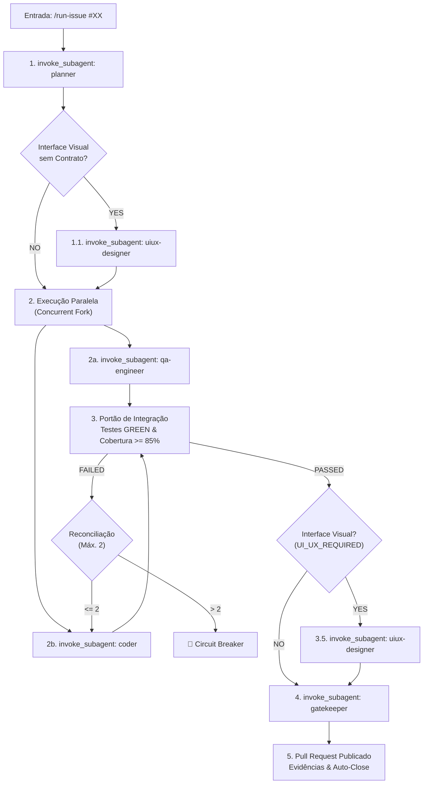

[← Voltar ao Sumário de Skills](Skills-Catalog)

# Skill: `issue-pipeline` (Esteira TDD Unitária e Modo Maestro)

> **Definição Canônica**: [`skills/issue-pipeline/SKILL.md`](https://github.com/VitorJacom/my-agents/blob/main/skills/issue-pipeline/SKILL.md)  
> **Categoria**: Esteiras & Orquestração AIDD  
> **Comando de Invocação**: `/run-issue <#ID>` ou `/run-issue <#1 #2 #3>` / `/run-issue --epic <#ID>`

---

## 🎯 Objetivo

A skill **`issue-pipeline`** orquestra a máquina de estados determinística do ecossistema ([`AIDD-Manifesto`](AIDD-Manifesto)) para implementar uma ou múltiplas issues do GitHub planejadas via [`plan-feature`](Skill-plan-feature), garantindo **TDD rigoroso**, execução concorrente sob contrato congelado (*Concurrent Fork*), cobertura mínima de **85%**, auditoria visual (quando aplicável) e proteção anti-fraude (*Golden Rule*).

---

## ⚡ Quando Acionar (*Progressive Disclosure*)

- Ao implementar uma issue planejada do GitHub de ponta a ponta até a abertura do Pull Request.
- Ao executar um lote de issues ou um épico inteiro em paralelo usando Git Worktrees isoladas e Merge Queue.

---

## 🚀 Exemplos de Invocação

```text
# Modo Unitário (1 Issue)
/run-issue #12
/run-issue 12
/run-issue https://github.com/VitorJacom/my-agents/issues/12

# Modo Maestro (Multi-Issue concorrente)
/run-issue #12 #13 #14
/run-issue 12 13 14

# Modo Maestro por Épico
/run-issue --epic #10
```

---

## 🔄 Os Dois Modos de Operação

### 1. Modo Unitário (1 Issue)



### 📋 Responsabilidades por Estado (Modo Unitário)

| Estado | Responsável | O que acontece nesta etapa |
| :--- | :--- | :--- |
| **1. Planejamento Tático** | [`planner`](Agent-planner) | Valida se a issue é atômica ($\le 3$ passos), prepara o plano técnico com o contrato de interface congelado (`implementation_plan.md` e `task.md`) e move o cartão no quadro do projeto para **`In Progress`**. |
| **1.1. Fallback Visual** *(Condicional)* | [`uiux-designer`](Agent-uiux-designer) | Acionado apenas se a issue exigir interface visual mas ainda não possuir especificação de mockup. Gera o contrato visual antes da codificação. |
| **2a. Testes de Aceitação** *(Paralelo)* | [`qa-engineer`](Agent-qa-engineer) | Trabalha isolado na camada de testes, criando cenários de *Happy Path* e *Edge Cases / Failure Modes* que falham inicialmente (**RED**) com base no contrato congelado. |
| **2b. Implementação** *(Paralelo)* | [`coder`](Agent-coder) | Trabalha simultaneamente no código de produção respeitando rigorosamente as assinaturas, tipos e erros definidos no contrato congelado. |
| **3. Portão de Integração** | Orquestrador + [`Script-pipeline`](Script-pipeline) | Executa os testes com timeout rígido e verifica se todos estão verdes (**GREEN**) com cobertura $\ge 85\%$. Se falhar, aciona até 2 ciclos de correção antes do *Circuit Breaker*. |
| **3.5. Auditoria Visual** *(Condicional)* | [`uiux-designer`](Agent-uiux-designer) | Quando a entrega possui interface visual, captura a tela renderizada em navegador headless e audita fidelidade, contraste e responsividade antes do PR. |
| **4. Auditoria & Handoff** | [`gatekeeper`](Agent-gatekeeper) | Verifica a *Golden Rule* (nenhuma adulteração em [`tests/core/`](Test-core)), compila o relatório de provas (`walkthrough.md`) e publica o Pull Request com fechamento automático da issue. |

### 2. Modo Maestro (Multi-Issue & `--epic`)

- **Segregação Control Plane vs. Execution Plane**: A sessão principal atua exclusivamente como Maestro e delega cada issue da onda via `invoke_subagent` em worktrees isoladas (`.worktrees/issue-<id>`), gerenciadas pelos utilitários de [`Script-pipeline`](Script-pipeline).
- **Pre-flight & Wave Partitioning**: Agrupa issues com arquivos-alvo (`Target Files`) 100% disjuntos em ondas concorrentes, evitando conflitos simultâneos.
- **Merge Queue Sequencial**: Integra cada worktree na branch intermediária e executa a suíte acumulada com até 2 tentativas de auto-reconciliação em caso de regressão.
- **PR Consolidado**: Ao término de todas as ondas, o [`gatekeeper`](Agent-gatekeeper) audita o resultado integrado e abre um Pull Request consolidado para `main`.

---

## 📦 Artefatos Produzidos

- **`task.md`** e **`implementation_plan.md`** (efêmeros locais no `.gitignore`).
- **Testes TDD** em `tests/features/<categoria>/` (Happy Path + Edge Cases / Failure Modes).
- **Código de produção** em `src/`.
- **`walkthrough.md`** publicado como descrição oficial do Pull Request no GitHub.

---

## 🔗 Navegação

[← Anterior: `plan-feature`](Skill-plan-feature) | [Sumário de Skills](Skills-Catalog) | [Próxima Skill: `review-pr` →](Skill-review-pr)
