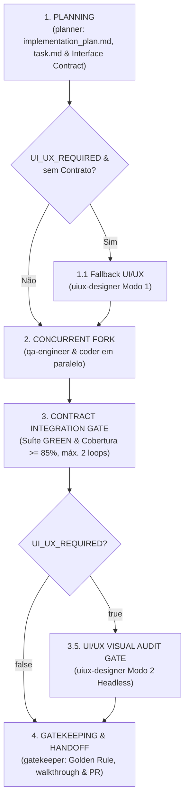

[← Voltar ao Sumário de Skills](Skills-Catalog)

# Skill: `issue-pipeline` (Esteira TDD Unitária e Modo Maestro)

> **Definição Canônica**: [`skills/issue-pipeline/SKILL.md`](https://github.com/VitorJacom/my-agents/blob/main/skills/issue-pipeline/SKILL.md)  
> **Categoria**: Esteiras & Orquestração AIDD  
> **Comando de Invocação**: `/run-issue <#ID>` ou `/run-issue <#1 #2 #3>` / `/run-issue --epic <#ID>`

---

## 🎯 Objetivo

A skill **`issue-pipeline`** orquestra a máquina de estados determinística do ecossistema AIDD para implementar uma ou múltiplas issues do GitHub com **TDD rigoroso**, execução concorrente sob contrato congelado (*Concurrent Fork*), cobertura mínima de **85%**, auditoria visual headless (quando aplicável) e proteção anti-fraude (*Golden Rule*).

---

## ⚡ Quando Acionar (*Progressive Disclosure*)

- Ao implementar uma issue planejada do GitHub de ponta a ponta até a abertura do Pull Request.
- Ao executar um lote de issues ou um épico inteiro em paralelo usando Git Worktrees isoladas e Merge Queue.

---

## 🚀 Exemplos de Invocação

```text
# Modo Unitário (1 Issue)
/run-issue #12
/run-issue 12
/run-issue https://github.com/VitorJacom/my-agents/issues/12

# Modo Maestro (Multi-Issue concorrente)
/run-issue #12 #13 #14
/run-issue 12 13 14

# Modo Maestro por Épico
/run-issue --epic #10
```

---

## 🔄 Os Dois Modos de Operação

### 1. Modo Unitário (1 Issue)



- **Estado 1 (`planner`)**: Valida atomicidade ($\le 3$ passos) e o portão `validate-interface-contract.sh`. Atualiza o status no GitHub Project v2 para `In Progress`.
- **Estado 2 (*Concurrent Fork*)**: Dispara `qa-engineer` (confinado a `tests/features/`) e `coder` (confinado a `src/`) em paralelo sob a seção congelada `## Interface Contract`.
- **Estado 3 (*Contract Integration Gate*)**: Executa `contract-integration-gate.sh` com timeout rígido (60s), validando testes GREEN e cobertura $\ge 85\%$ (até 2 loops de reconciliação).
- **Estado 3.5 (*Visual Audit Gate*)**: Quando `UI_UX_REQUIRED: true`, o `uiux-designer` (Modo 2) audita capturas headless antes do PR.
- **Estado 4 (`gatekeeper`)**: Verifica a *Golden Rule* (zero modificações em `tests/core/`), compila o `walkthrough.md` com `Fixes #<id>` em texto puro e abre o PR.

### 2. Modo Maestro (Multi-Issue & `--epic`)

- **Segregação Control Plane vs. Execution Plane**: A sessão principal atua exclusivamente como Maestro e delega cada issue da onda via `invoke_subagent` em worktrees isoladas (`.worktrees/issue-<id>`).
- **Pre-flight & Wave Partitioning**: Agrupa issues com `Target Files` 100% disjuntos em ondas concorrentes.
- **Merge Queue Sequencial**: Integra cada worktree na branch intermediária via `worktree-manager.sh rebase-sync`, rodando a suíte acumulada com até 2 tentativas de auto-reconciliação.
- **PR Consolidado**: Ao término de todas as ondas, o `gatekeeper` abre um Pull Request consolidado para `main`.

---

## 📦 Artefatos Produzidos

- **`task.md`** e **`implementation_plan.md`** (efêmeros locais no `.gitignore`).
- **Testes TDD** em `tests/features/<categoria>/` (Happy Path + Edge Cases / Failure Modes).
- **Código de produção** em `src/`.
- **`walkthrough.md`** publicado como descrição oficial do Pull Request no GitHub.

---

## 🔗 Navegação

[← Anterior: `plan-feature`](Skill-plan-feature) | [Sumário de Skills](Skills-Catalog) | [Próxima Skill: `review-pr` →](Skill-review-pr)
