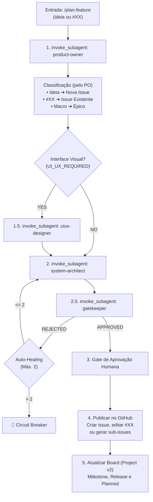

[← Voltar ao Sumário de Skills](Skills-Catalog)

> **Esteira de Planejamento & Ciclo Elephant-Goldfish**  
> **Definição Canônica**: [`skills/plan-feature/SKILL.md`](https://github.com/VitorJacom/my-agents/blob/main/skills/plan-feature/SKILL.md)  
> **Categoria**: Esteiras & Orquestração AIDD  
> **Comando de Invocação**: `/plan-feature <ideia, funcionalidade ou #issue>`

---

## 🎯 Objetivo

A skill **`plan-feature`** conduz o ciclo completo de planejamento funcional, design visual e arquitetura técnica sob o modelo **Elephant-Goldfish** antes que qualquer linha de código de produção seja escrita.

Ela elimina especificações ambíguas, garante atomicidade ($\le 3$ passos por issue), congela contratos técnicos explícitos (`## Interface Contract`) e prepara o backlog no GitHub pronto para execução determinística via [`issue-pipeline`](Skill-issue-pipeline).

---

## ⚡ Quando Acionar (*Progressive Disclosure*)

- Ao conceber uma nova funcionalidade, módulo ou épico do zero.
- Ao refinar uma issue macro ou mal especificada existente no backlog (refinamento *in-place* com `gh issue edit`).
- Quando uma demanda precisa de análise de *Blast Radius*, contratos de interface congelados e fatiamento em *Execution Waves*.

---

## 🚀 Exemplos de Invocação

```text
/plan-feature Sistema de notificações push com suporte a WebSockets
/plan-feature Refinar a issue #14 adicionando suporte a autenticação multifator
/plan-feature Nova tela de dashboard com métricas em tempo real
```

---

## 🔄 Máquina de Estados (Ciclo Elephant-Goldfish)



---

## 📋 Responsabilidades por Estado

| Estado | Responsável | O que acontece nesta etapa |
| :--- | :--- | :--- |
| **1. Descoberta Funcional** | [`product-owner`](Agent-product-owner) | Faz perguntas para tirar dúvidas de negócio, classifica se a demanda é uma **Nova Issue**, **Issue Existente (`#XX`)** ou **Épico**, define critérios de aceite claros, identifica eventuais regras críticas (*Core*) e decide se a entrega envolve interface visual (`UI_UX_REQUIRED`). |
| **1.5. Design Visual** *(Condicional)* | [`uiux-designer`](Agent-uiux-designer) | Acionado apenas se houver interface visual. Desenha a estrutura da tela, define o padrão visual, gera um protótipo de preview e salva a especificação visual do mockup para aprovação antes de programar. |
| **2. Design Técnico** | [`system-architect`](Agent-system-architect) | Mapeia quais arquivos do projeto serão impactados, registra decisões técnicas em [`ARCHITECTURE`](ARCHITECTURE), congela o contrato de interface (entradas, saídas e erros) e fatia o trabalho em tarefas pequenas ($\le 3$ passos) organizadas em ondas de execução sem conflito de arquivos. |
| **2.5. Auditoria da Especificação** | [`gatekeeper`](Agent-gatekeeper) | Faz uma revisão independente do plano sem depender do histórico da conversa, barrando ambiguidades, contratos incompletos ou tarefas grandes demais. Se reprovar, devolve para ajuste automático (até 2 tentativas) antes de acionar o *Circuit Breaker*. |
| **3. Gate Humano** | Orquestrador + Desenvolvedor | Apresenta o plano consolidado (`planning_proposal.md`) — e o preview visual, quando houver — para revisão e aprovação explícita do desenvolvedor antes de publicar no GitHub. |
| **4. Publicar no GitHub** | Orquestrador | Publica o plano aprovado no repositório: cria novas issues, atualiza uma issue existente (`#XX`) ou gera as sub-issues vinculadas ao Épico. |
| **5. Atualizar Board (Project v2)** | Orquestrador + [`Script-pipeline`](Script-pipeline) | Sincroniza automaticamente as issues criadas ou editadas com a Milestone (Épico), define a Release prevista e posiciona os cartões com status inicial **`Planned`** no quadro do projeto. |

---

## 📦 Artefatos Produzidos

- **`planning_proposal.md`**: Documento consolidado com requisitos, contratos técnicos/visuais, matriz de *Execution Waves* e selo `SPEC_AUDIT: APPROVED`.
- **Living Spec Visual** *(quando `UI_UX_REQUIRED: YES`)*: `docs/mockups/<slug>.md` e `docs/assets/mockups/<slug>.png`.
- **ADRs atualizadas**: Registros de decisão em [`docs/ARCHITECTURE.md`](ARCHITECTURE).
- **Issues Atômicas no GitHub**: Prontas para execução imediata com [`/issue-pipeline`](Skill-issue-pipeline).

---

## 🔗 Navegação

[← Voltar ao Sumário de Skills](Skills-Catalog) | [Próxima Skill: `issue-pipeline` →](Skill-issue-pipeline)
