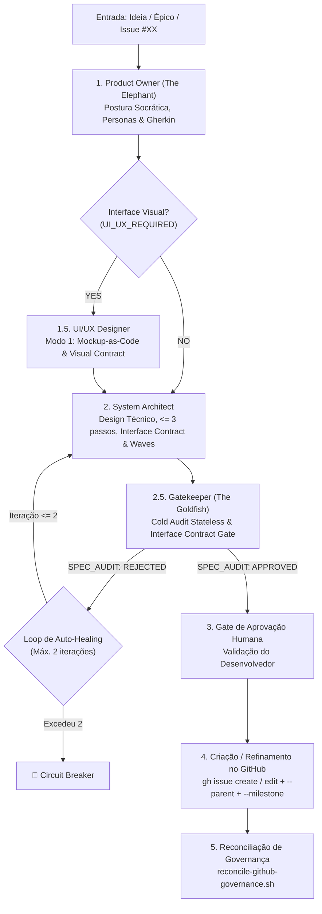

[← Voltar ao Sumário de Skills](Skills-Catalog)

# Skill: `plan-feature` (Esteira de Planejamento & Ciclo Elephant-Goldfish)

> **Definição Canônica**: [`skills/plan-feature/SKILL.md`](https://github.com/VitorJacom/my-agents/blob/main/skills/plan-feature/SKILL.md)  
> **Categoria**: Esteiras & Orquestração AIDD  
> **Comando de Invocação**: `/plan-feature <ideia, funcionalidade ou #issue>`

---

## 🎯 Objetivo

A skill **`plan-feature`** conduz o ciclo completo de planejamento funcional, design visual e arquitetura técnica sob o modelo **Elephant-Goldfish** antes que qualquer linha de código de produção seja escrita.

Ela elimina especificações ambíguas, garante atomicidade ($\le 3$ passos por issue), congela contratos técnicos explícitos (`## Interface Contract`) e prepara o backlog no GitHub pronto para execução determinística via [`issue-pipeline`](Skill-issue-pipeline).

---

## ⚡ Quando Acionar (*Progressive Disclosure*)

- Ao conceber uma nova funcionalidade, módulo ou épico do zero.
- Ao refinar uma issue macro ou mal especificada existente no backlog (refinamento *in-place* com `gh issue edit`).
- Quando uma demanda precisa de análise de *Blast Radius*, contratos de interface congelados e fatiamento em *Execution Waves*.

---

## 🚀 Exemplos de Invocação

```text
/plan-feature Sistema de notificações push com suporte a WebSockets
/plan-feature Refinar a issue #14 adicionando suporte a autenticação multifator
/plan-feature Nova tela de dashboard com métricas em tempo real
```

---

## 🔄 Máquina de Estados (Ciclo Elephant-Goldfish)



---

## 📋 Responsabilidades por Estado

| Estado | Subagente | Entregas Principais |
| :--- | :--- | :--- |
| **1. Descoberta Funcional** | `product-owner` (*The Elephant*) | Postura socrática, personas, critérios Gherkin (`Dado / Quando / Então`), detecção concreta de Regras Core e classificação `UI_UX_REQUIRED`. |
| **1.5. UI/UX Design** *(Condicional)* | `uiux-designer` (Modo 1) | *Spatial Blueprint* ASCII, *Design Tokens* (Value Contrast $\ge$ 2:1, WCAG AA $\ge$ 4.5:1), protótipo headless em `docs/assets/mockups/<slug>.png` e Living Spec em `docs/mockups/<slug>.md`. |
| **2. Design Técnico** | `system-architect` | Mapeamento de `src/`, registro de ADRs em `docs/ARCHITECTURE.md`, seção mandatória `## Interface Contract`, `## Target Files & Dependencies` e particionamento em `## Execution Waves` (máx. 3 issues disjuntas por onda). |
| **2.5. Cold Audit** | `gatekeeper` (*The Goldfish*) | Auditoria estéril anti-premissas, verificação de atomicidade ($\le 3$ passos) e validação do *Interface Contract* com loop de auto-healing de até 2 iterações. |
| **3. Gate Humano** | Orquestrador + Desenvolvedor | Apresentação do `planning_proposal.md` (e preview visual se houver UI) para aprovação explícita. |
| **4–5. GitHub & Governança** | Orquestrador | Criação/edição de issues (`--milestone`, `--parent`), vinculação ao GitHub Project v2 e execução de `reconcile-github-governance.sh`. |

---

## 📦 Artefatos Produzidos

- **`planning_proposal.md`**: Documento consolidado com requisitos, contratos técnicos/visuais, matriz de *Execution Waves* e selo `SPEC_AUDIT: APPROVED`.
- **Living Spec Visual** *(quando `UI_UX_REQUIRED: YES`)*: `docs/mockups/<slug>.md` e `docs/assets/mockups/<slug>.png`.
- **ADRs atualizadas**: Registros de decisão em [`docs/ARCHITECTURE.md`](ARCHITECTURE).
- **Issues Atômicas no GitHub**: Prontas para execução imediata com `/run-issue`.

---

## 🔗 Navegação

[← Voltar ao Sumário de Skills](Skills-Catalog) | [Próxima Skill: `issue-pipeline` →](Skill-issue-pipeline)
