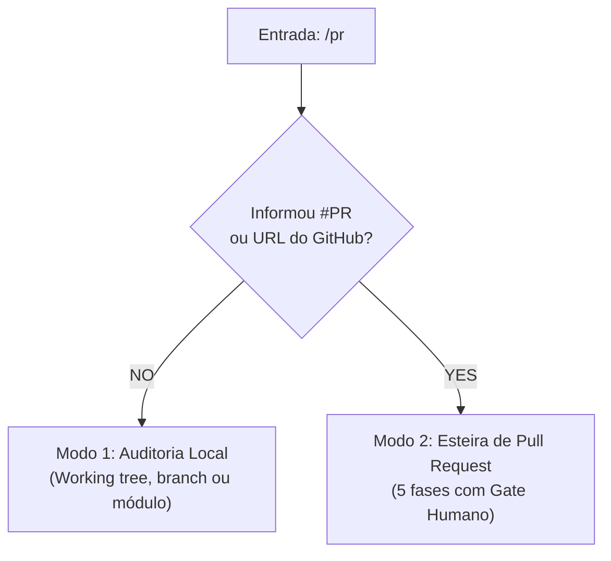
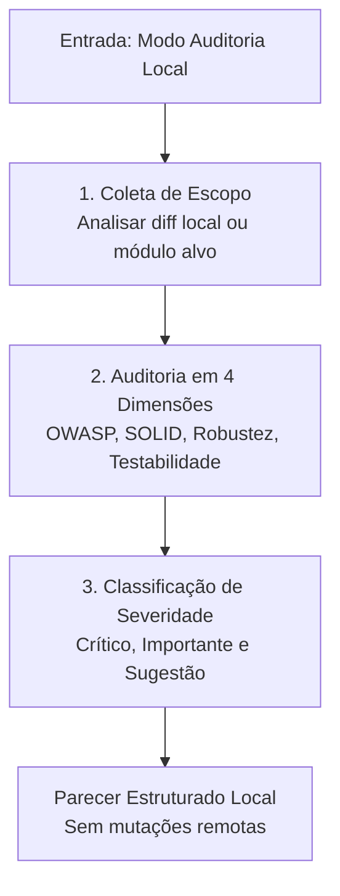
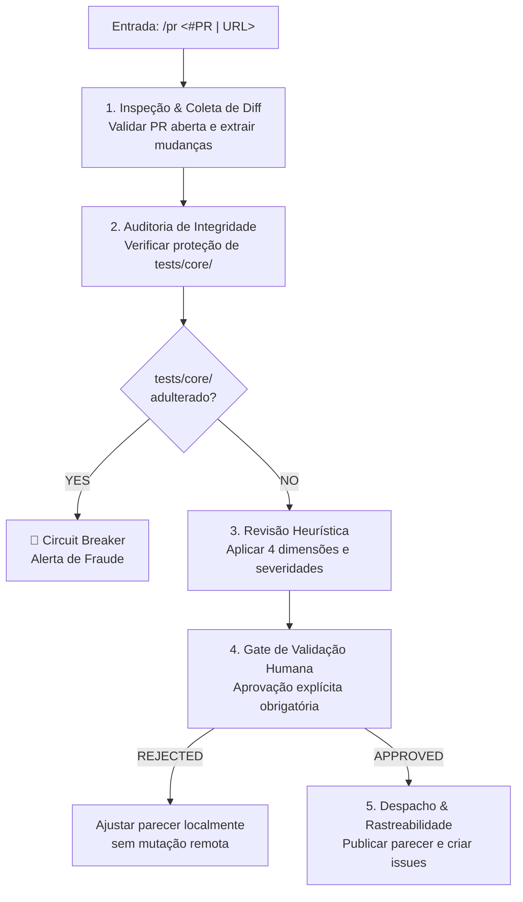

[← Voltar ao Sumário de Skills](Skills-Catalog)

> **Auditoria de Código Local & Orquestrador de Pull Requests**  
> **Definição Canônica**: [`skills/pr/SKILL.md`](https://github.com/VitorJacom/my-agents/blob/main/skills/pr/SKILL.md)  
> **Categoria**: Qualidade, Testes & Revisão  
> **Comando de Invocação**: `/pr [local | <#PR | URL>]`

---

## 🎯 Objetivo

A skill **`pr`** unifica a auditoria rigorosa de qualidade de código-fonte com a esteira determinística de revisão de Pull Requests no GitHub. Ela atua em dois modos complementares: revisão local antes do commit/PR e auditoria formal remota em **5 fases** com proteção anti-fraude (*Golden Rule*), **Gate de Validação Humana mandatório** e abertura automática de issues rastreadas no backlog.

---

## ⚡ Quando Acionar (*Progressive Disclosure*)

- **Modo Auditoria Local**: Antes de abrir uma Pull Request ou realizar merge local (complementando o [`git-workflow`](Skill-git-workflow) e o [`gatekeeper`](Agent-gatekeeper)), ou ao revisar arquivos e módulos específicos.
- **Modo Esteira de Pull Request**: Ao auditar uma Pull Request aberta no GitHub antes do merge, transformando achados críticos e importantes em issues rastreadas com vínculo para a PR e commit auditado.

---

## 🚀 Exemplos de Invocação

```text
# Modo 1: Auditoria Local
/pr
/pr local
Revise as alterações da branch atual contra vulnerabilidades OWASP

# Modo 2: Esteira de Pull Request no GitHub
/pr #12
/pr 54
/pr https://github.com/VitorJacom/my-agents/pull/12
```

---

## 🧭 Roteamento de Modo (Triagem de Entrada)



---

## 🔍 Modo 1: Auditoria Local (`/pr` ou `/pr local`)



### Responsabilidades por Estado (Modo 1)

| Etapa | Responsável | O que acontece nesta etapa |
| :--- | :--- | :--- |
| **1. Coleta de Escopo** | Orquestrador | Identifica os arquivos alterados na working tree, branch local ou módulo informado pelo desenvolvedor. |
| **2. Auditoria em 4 Dimensões** | Orquestrador | Avalia o código sob Segurança (OWASP), Arquitetura & Clean Code (SOLID), Robustez & Erros e Testabilidade. |
| **3. Classificação de Severidade** | Orquestrador | Emite relatório com `[Arquivo:Linha]` e recomendação objetiva em 3 níveis (**🚨 Crítico**, **⚠️ Importante**, **💡 Sugestão**). |

### As 4 Dimensões de Avaliação

| Dimensão | O que é Auditado |
| :--- | :--- |
| **1. Segurança (OWASP)** | SQL/Shell Injection, exposição de tokens/senhas/PII em logs, ausência de validação de inputs e schemas em APIs. |
| **2. Arquitetura & Clean Code** | Violações de SOLID (SRP), acoplamento forte sem interfaces/injeção de dependências, complexidade ciclomática excessiva (preferir *early return*). |
| **3. Robustez & Erros** | Blocos `try/catch` vazios ou que mascaram exceções, falta de timeouts em chamadas de rede/IO, riscos de `null`/`undefined`. |
| **4. Testabilidade** | Dependências estáticas/globais que impedem isolamento unitário, efeitos colaterais ocultos em cálculos ou getters. |

---

## 🔄 Modo 2: Esteira de Pull Request (`/pr <#PR | URL>`)



### Responsabilidades por Estado (Modo 2)

| Fase | Responsável | O que acontece nesta etapa |
| :--- | :--- | :--- |
| **1. Inspeção & Diff** | Orquestrador + [`Script-pr-reviewer`](Script-pr-reviewer) | Valida que a Pull Request está aberta, coleta metadados (autor, branches, commit auditado) e extrai o diff completo para análise. |
| **2. Auditoria de Integridade** | `2. invoke_subagent: gatekeeper` + [`Script-pr-reviewer`](Script-pr-reviewer) | Aplica a *Golden Rule* do [`AIDD-Manifesto`](AIDD-Manifesto), verificando se houve qualquer alteração indevida em [`tests/core/`](Test-core). Se detectar fraude, aborta imediatamente via *Circuit Breaker*. |
| **3. Revisão Heurística** | `3. invoke_subagent: gatekeeper` | Avalia o código nas **4 Dimensões** do Modo 1 e classifica os achados em **Crítico** (bloqueia merge), **Importante** (refatoração) ou **Sugestão**. |
| **4. Gate de Validação Humana** | Orquestrador + Desenvolvedor | Apresenta o resumo executivo, a tabela de apontamentos e as issues propostas. Nenhuma ação remota no GitHub ocorre sem confirmação explícita do desenvolvedor. |
| **5. Despacho & Rastreabilidade** | Orquestrador + [`Script-pr-reviewer`](Script-pr-reviewer) + [`Script-pipeline`](Script-pipeline) | Publica o parecer oficial na PR, abre issues rastreadas no backlog vinculadas à PR/commit de origem e sincroniza a governança do GitHub Project v2. |

> [!TIP]
> A validação automatizada desta esteira é garantida pelas suítes documentadas em [`Test-pr-review`](Test-pr-review).

---

## 📦 Artefatos Produzidos

- **Relatório heurístico estruturado** em 3 níveis (`🚨 Crítico`, `⚠️ Importante`, `💡 Sugestão`).
- **Parecer formal** submetido na Pull Request no GitHub (`approve`, `request-changes` ou `comment`), no Modo 2.
- **Issues rastreadas** criadas no backlog com vínculo para a PR e commit auditado, no Modo 2.

---

## 🔗 Navegação

[← Anterior: `issue-pipeline`](Skill-issue-pipeline) | [Sumário de Skills](Skills-Catalog) | [Próxima Skill: `git-workflow` →](Skill-git-workflow)
