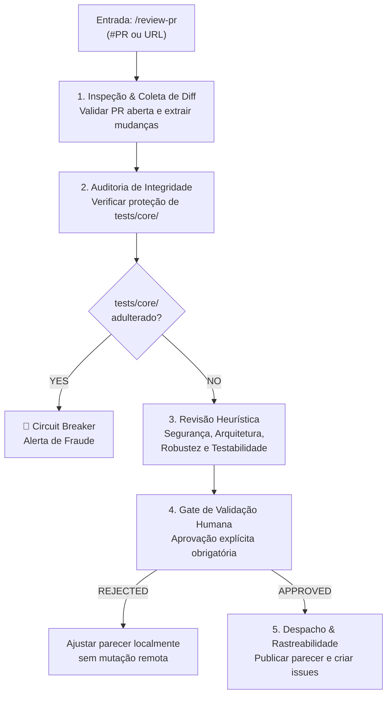

[← Voltar ao Sumário de Skills](Skills-Catalog)

> **Orquestrador de Revisão de Pull Requests**  
> **Definição Canônica**: [`skills/review-pr/SKILL.md`](https://github.com/VitorJacom/my-agents/blob/main/skills/review-pr/SKILL.md)  
> **Categoria**: Qualidade, Testes & Revisão  
> **Comando de Invocação**: `/review-pr <#PR | URL>`

---

## 🎯 Objetivo

A skill **`review-pr`** conduz uma esteira determinística de **5 fases** para auditar Pull Requests abertas no GitHub. Ela combina inspeção automatizada de diff, proteção anti-fraude (*Golden Rule*), análise heurística em 4 dimensões, **Gate de Validação Humana mandatório** e abertura automática de issues rastreadas no backlog.

---

## ⚡ Quando Acionar (*Progressive Disclosure*)

- Ao revisar ou auditar uma Pull Request aberta no GitHub antes de aprovar o merge.
- Quando você quer transformar achados de code review em issues rastreadas automaticamente com labels semânticas e link para a PR/commit de origem.

---

## 🚀 Exemplos de Invocação

```text
/review-pr #12
/review-pr 54
/review-pr https://github.com/VitorJacom/my-agents/pull/12
```

---

## 🔄 Máquina de Estados Determinística (5 Fases)



---

## 📋 Protocolo das 5 Fases

| Fase | Componente / Responsável | O que acontece nesta etapa |
| :--- | :--- | :--- |
| **1. Inspeção & Diff** | Orquestrador + [`Script-pr-reviewer`](Script-pr-reviewer) | Valida que a Pull Request está aberta, coleta metadados (autor, branches, commit auditado) e extrai o diff completo para análise. |
| **2. Auditoria de Integridade** | Orquestrador + [`Script-pr-reviewer`](Script-pr-reviewer) | Aplica a *Golden Rule* do [`AIDD-Manifesto`](AIDD-Manifesto), verificando se houve qualquer alteração indevida em [`tests/core/`](Test-core). Se detectar fraude, aborta imediatamente via *Circuit Breaker*. |
| **3. Revisão Heurística** | Orquestrador + [`code-review`](Skill-code-review) | Avalia o código em 4 dimensões (Segurança, Arquitetura, Robustez e Testabilidade) e classifica os achados em **Crítico** (bloqueia merge), **Importante** (refatoração) ou **Sugestão**. |
| **4. Gate de Validação Humana** | Orquestrador + Desenvolvedor | Apresenta o resumo executivo, a tabela de apontamentos e as issues propostas. Nenhuma ação remota no GitHub ocorre sem confirmação explícita do desenvolvedor. |
| **5. Despacho & Rastreabilidade** | Orquestrador + [`Script-pr-reviewer`](Script-pr-reviewer) + [`Script-pipeline`](Script-pipeline) | Publica o parecer oficial na PR, abre issues rastreadas no backlog vinculadas à PR/commit de origem e sincroniza a governança do GitHub Project v2. |

> [!TIP]
> A validação automatizada desta esteira é garantida pelas suítes documentadas em [`Test-pr-review`](Test-pr-review).

---

## 📦 Artefatos Produzidos

- **Parecer formal** submetido na Pull Request no GitHub (`approve`, `request-changes` ou `comment`).
- **Issues rastreadas** criadas no backlog com rastreabilidade completa para a PR e commit auditado.

---

## 🔗 Navegação

[← Anterior: `issue-pipeline`](Skill-issue-pipeline) | [Sumário de Skills](Skills-Catalog) | [Próxima Skill: `code-review` →](Skill-code-review)
