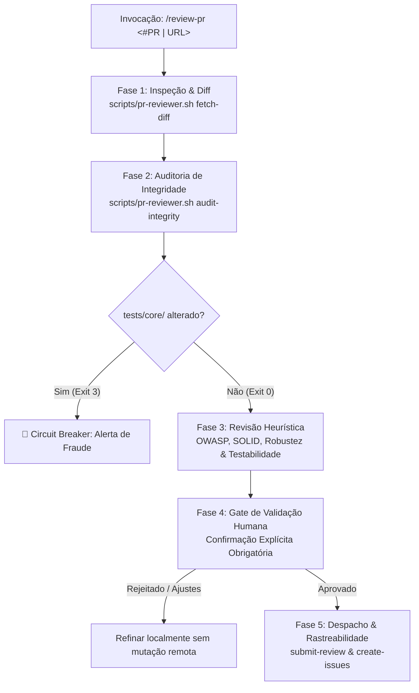

[← Voltar ao Sumário de Skills](Skills-Catalog)

# Skill: `review-pr` (Orquestrador de Revisão de Pull Requests)

> **Definição Canônica**: [`skills/review-pr/SKILL.md`](https://github.com/VitorJacom/my-agents/blob/main/skills/review-pr/SKILL.md)  
> **Categoria**: Qualidade, Testes & Revisão  
> **Comando de Invocação**: `/review-pr <#PR | URL>`

---

## 🎯 Objetivo

A skill **`review-pr`** conduz uma esteira determinística de **5 fases** para auditar Pull Requests abertas no GitHub. Ela combina inspeção automatizada de diff, proteção anti-fraude (*Golden Rule*), análise heurística em 4 dimensões, **Gate de Validação Humana mandatório** e abertura automática de issues rastreadas no backlog.

---

## ⚡ Quando Acionar (*Progressive Disclosure*)

- Ao revisar ou auditar uma Pull Request aberta no GitHub antes de aprovar o merge.
- Quando você quer transformar achados de code review em issues rastreadas automaticamente com labels semânticas e link para a PR/commit de origem.

---

## 🚀 Exemplos de Invocação

```text
/review-pr #12
/review-pr 54
/review-pr https://github.com/VitorJacom/my-agents/pull/12
```

---

## 🔄 Máquina de Estados Determinística (5 Fases)



---

## 📋 Protocolo das 5 Fases

1. **Fase 1 — Inspeção & Diff (`fetch-diff`)**: Valida que a PR está `OPEN`, extrai metadados (autor, branches, `headRefOid`) e obtém o diff unificado completo.
2. **Fase 2 — Auditoria de Integridade & Golden Rule (`audit-integrity`)**: Verifica se houve qualquer alteração em `tests/core/`. Em caso positivo, dispara **Circuit Breaker (exit code 3)** e aborta o pipeline imediatamente.
3. **Fase 3 — Revisão Heurística & Severidade**: Avalia o diff nas 4 dimensões da skill [`code-review`](Skill-code-review) (OWASP, SOLID, Robustez e Testabilidade), classificando em:
   - **🚨 Crítico (Bloqueia Merge)** ➔ `request-changes` + issue `type:fix`
   - **⚠️ Importante (Refatoração Recomendada)** ➔ issue `type:refactor`
   - **💡 Sugestão (Melhoria Opcional)**
4. **Fase 4 — Gate de Validação Humana Mandatório**: Apresenta o resumo executivo, tabela de apontamentos e lista de issues propostas. **Nenhuma mutação remota no GitHub é permitida sem confirmação explícita do desenvolvedor.**
5. **Fase 5 — Despacho & Rastreabilidade (`submit-review` & `create-issues`)**: Publica o parecer oficial na PR, cria as issues no backlog com labels (`type:*`, `status:planned`, `source:code-review`), vincula PR/branch/SHA e executa `reconcile-github-governance.sh`. Suporta modo `--dry-run`.

---

## 📦 Artefatos Produzidos

- **Parecer formal** submetido na Pull Request no GitHub (`approve`, `request-changes` ou `comment`).
- **Issues rastreadas** criadas no backlog com rastreabilidade completa para a PR e commit auditado.

---

## 🔗 Navegação

[← Anterior: `issue-pipeline`](Skill-issue-pipeline) | [Sumário de Skills](Skills-Catalog) | [Próxima Skill: `code-review` →](Skill-code-review)
