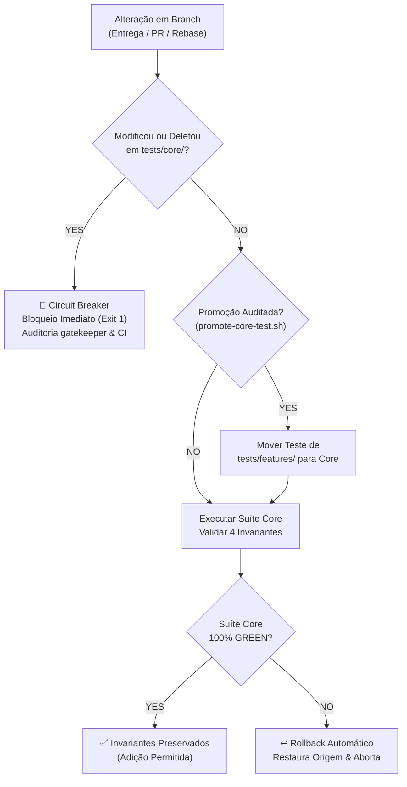

[← Voltar ao Sumário de Testes](Tests-Catalog)

> **Core Invariants (Zona Intocável)**  
> **Diretório**: [`tests/core/`](https://github.com/VitorJacom/my-agents/tree/main/tests/core)  
> **Quantidade**: 4 suítes imutáveis  
> **Comando**: `./tests/run.sh --core`

---

## 🎯 Propósito da Camada

A camada `tests/core/` constitui a **zona intocável** definida pelo [`AIDD-Manifesto`](AIDD-Manifesto) e pela [`ARCHITECTURE`](ARCHITECTURE). Ela protege as invariantes estruturais e de governança do ecossistema `my-agents` que **nunca podem sofrer regressão** durante a evolução de novas funcionalidades em `tests/features/`.

> [!IMPORTANT]
> **Golden Rule Anti-Fraude**: Qualquer modificação (`M`) ou deleção (`D`) em `tests/core/` detectada via `git diff --diff-filter=MD` contra a branch base dispara aborto imediato (**Circuit Breaker**, exit code `1`) no [`gatekeeper`](Agent-gatekeeper) e na esteira de CI. Novas suítes só ingressam nesta camada por meio de promoção auditada com [`promote-core-test.sh`](Script-pipeline).

---

## 🔄 Fluxo de Proteção & Promoção Auditada

O ecossistema separa estritamente a **proteção contra adulteração** (executada automaticamente em toda entrega) da **promoção auditada** de novos invariantes vindos de `tests/features/`:



---

## 📋 Suítes da Categoria (4)

| # | Suíte | Origem | Foco Principal | Mecanismo de Isolamento |
| ---: | :--- | :--- | :--- | :--- |
| 1 | **`test_context_volatile_decoupling.sh`** | Issue #35 | Desacoplamento de estado Git volátil do `PROJECT_CONTEXT.md` e injeção dinâmica via hook. | Repositórios Git temporários via `mktemp -d` com limpeza `trap EXIT`. |
| 2 | **`test_governance_coverage_and_test_cases.sh`** | Issue #12 | Governança de cobertura $\ge 85\%$, separação *Happy/Edge* e provas demonstrativas no `walkthrough.md`. | Auditoria estática determinística (`sed` / `grep`) em contratos normativos. |
| 3 | **`test_maestro_subagent_delegation_rules.sh`** | Issue #42 | Segregação *Control Plane vs. Execution Plane* e delegação obrigatória via `invoke_subagent`. | Inspeção normativa estática + checagem de integridade Git (`git status`). |
| 4 | **`test_worktree_manager.sh`** | Core Infra | Ciclo de vida de Git Worktrees isoladas, locks por PID, prevenção de fraude e auto-abort. | Repositório Git temporário isolado + processo background `sleep` com `cleanup`. |
| **Total** | **4 Suítes Imutáveis** | **Core** | **Invariantes Estruturais, Governança & Infraestrutura de Execução** | **100% Determinístico & Isolado** |

---

### 1. `test_context_volatile_decoupling.sh`
- **Origem**: Issue #35 (`scripts/hooks/session-start-context.sh` e `scripts/pipeline/sync-project-context.py`)
- **O que Valida**: Garante que metadados voláteis do Git (branch ativa, último commit e status da working tree) sejam injetados dinamicamente no início da sessão por [`Script-hooks`](Script-hooks) sem contaminar o arquivo versionado `PROJECT_CONTEXT.md`, evitando conflitos de merge em entregas paralelas.
- **Happy Path**:
  - Confirma que `PROJECT_CONTEXT.md` na raiz preserva as seções estáveis (`Stack Tecnológica & Dependências`, `Estrutura Canônica de Diretórios`, `Regras e Invariantes Estritas`) e não contém seções ou campos voláteis legados.
  - Valida que `session-start-context.sh` emite JSON válido com `injectSteps`, injeta o conteúdo estático + metadados Git ao vivo (ou `Working tree limpa`) e mantém o hash `sha256sum` de `PROJECT_CONTEXT.md` 100% intacto no disco.
  - Testa execução paralela em duas branches (`feature/branch-a` e `feature/branch-b`) com `sync-project-context.py`, provando idempotência e `git merge` com zero conflitos.
  - Verifica higienização automática de `PROJECT_CONTEXT.md` legado, removendo o bloco volátil antigo sem perder seções adjacentes.
- **Edge Cases / Failure Modes**:
  - Workspace sem `PROJECT_CONTEXT.md`: hook retorna JSON válido sem criar arquivo indevido; `sync-project-context.py` inicializa um contexto limpo referenciando [`ARCHITECTURE`](ARCHITECTURE).
  - Diretório não-Git e repositório Git recém-iniciado sem commits: hook aplica fallbacks seguros (`detached/none` e `Sem commits registrados`) sem quebrar o JSON.
  - Entrada `stdin` vazia ou JSON malformado: fallback para `pwd` com JSON válido; diretório inexistente passado ao `sync-project-context.py` falha com exit code $\ne 0$.
- **Isolamento & Mocks**: Cria 6 workspaces efêmeros em `mktemp -d` (`LIVE_REPO`, `PARALLEL_REPO`, `LEGACY_REPO`, `EMPTY_WS`, `NON_GIT_WS`, `UNBORN_GIT_WS`), removidos automaticamente via `trap 'rm -rf "$TMP_BASE"' EXIT`.

---

### 2. `test_governance_coverage_and_test_cases.sh`
- **Origem**: Issue #12 (`rules/AGENTS.md`, `agents/{qa-engineer,coder,gatekeeper}/agent.md`, `skills/issue-pipeline/SKILL.md`)
- **O que Valida**: Aderência cruzada entre o [`AIDD-Manifesto`](AIDD-Manifesto), os contratos dos subagentes [`qa-engineer`](Agent-qa-engineer), [`coder`](Agent-coder), [`gatekeeper`](Agent-gatekeeper) e o orquestrador [`issue-pipeline`](Skill-issue-pipeline) para três pilares: cobertura mínima $\ge 85\%$, discriminação obrigatória de casos de teste e provas demonstrativas universais no `walkthrough.md`.
- **Happy Path**:
  - `rules/AGENTS.md` (Seções 1.3, 2.4 e 2.5): exige provas demonstrativas (screenshots para UIs; saída CLI, snapshots de terminal ou logs para backend/CLI/infra), cobertura $\ge 85\%$ e categorização *Happy Path* / *Edge Cases / Failure Modes*.
  - `qa-engineer`: exige estruturação e contrato de saída discriminando *Happy Path* e *Edge Cases / Failure Modes*.
  - `coder`: exige aferição de cobertura $\ge 85\%$ e relato da métrica no contrato de saída.
  - `gatekeeper`: Gate 2 audita cobertura $\ge 85\%$, separação *Happy* / *Edge* e provas demonstrativas no `walkthrough.md`.
  - `issue-pipeline`: Estados 2, 3 e 4 propagam essas exigências ao longo do ciclo TDD.
- **Edge Cases / Failure Modes**:
  - Explícita não-isenção de provas demonstrativas para tarefas backend, CLI e infraestrutura.
  - Bloqueio *fail-fast* / *Circuit Breaker* no `coder`, no Gate 2 do `gatekeeper` e no `issue-pipeline` sempre que a cobertura for $< 85\%$ ou faltarem cenários de borda.
- **Isolamento & Mocks**: Verificação estática determinística e somente-leitura via `sed` e `grep` diretamente nos arquivos de governança e definição de agentes, sem mutação do workspace.

---

### 3. `test_maestro_subagent_delegation_rules.sh`
- **Origem**: Issue #42 (`rules/AGENTS.md` Seção 7.4 e `skills/issue-pipeline/SKILL.md` Fluxo 2)
- **O que Valida**: Garante a segregação estrita entre **Control Plane** e **Execution Plane** no Modo Maestro da skill [`issue-pipeline`](Skill-issue-pipeline), assegurando que a sessão principal apenas coordene ondas e delegue a execução para workers desacoplados.
- **Happy Path**:
  - Presença da Seção 7.4 em `rules/AGENTS.md` ([`AIDD-Manifesto`](AIDD-Manifesto)) definindo a separação *Control Plane vs. Execution Plane*.
  - Obrigatoriedade de despacho de cada issue da onda (*wave* / *batch*) para subagente worker via `invoke_subagent`.
  - Amarração normativa no Fluxo 2 (Modo Maestro) e no estado `M3` de `skills/issue-pipeline/SKILL.md`.
- **Edge Cases / Failure Modes**:
  - Proibição explícita de o Maestro codificar, executar ciclos TDD, rodar testes ou editar arquivos diretamente na raiz do projeto.
  - Confinamento físico obrigatório de cada worker em `.worktrees/issue-<id>`, impedindo interferência na raiz ou entre worktrees simultâneas.
  - Checagem de integridade (*Golden Rule*) via `git status --porcelain` contra alterações em `tests/core/` e ausência de marcadores de conflito Markdown (`<<<<<<<`, `=======`, `>>>>>>>`).
- **Isolamento & Mocks**: Auditoria estática determinística sobre `rules/AGENTS.md`, `skills/issue-pipeline/SKILL.md` e estado do Git, sem criação de worktrees ou invocação de rede.

---

### 4. `test_worktree_manager.sh`
- **Origem**: Core Infra (`scripts/pipeline/worktree-manager.sh`)
- **O que Valida**: O ciclo de vida completo do gerenciador de Git Worktrees [`worktree-manager.sh`](Script-pipeline), base física que sustenta a execução paralela isolada e a *Merge Queue* do Modo Maestro (complementado pelas suítes em [`Test-pipeline`](Test-pipeline)).
- **Happy Path**:
  - Verifica existência e permissão executável de `scripts/pipeline/worktree-manager.sh`.
  - `create <id>`: provisiona `.worktrees/issue-<id>` na branch `feature/issue-<id>` e grava lockfile `.worktrees/.lock-<id>` com PID válido.
  - `list`: exibe worktrees ativas e o status de lock correspondente.
  - `create <id> --base <branch>`: deriva a worktree exatamente do commit de uma branch base customizada (`integration/wave-1`).
  - `rebase-sync <id>`: aplica rebase limpo sobre `main`, confirmando ancestralidade com `git merge-base --is-ancestor`.
  - `remove <id>`: desmonta a worktree, remove o diretório, purga o lockfile e limpa o registro em `git worktree list`.
- **Edge Cases / Failure Modes**:
  - Concorrência *fail-fast*: lockfile com PID ativo retorna exit code `2` e mensagem de bloqueio.
  - Recuperação de *stale lock*: lockfile apontando para PID morto (`999999`) é recuperado com exit code `0` e sobrescrito pelo novo PID ativo.
  - Chamadas sem argumentos, sem `issue_id` ou com `--base` inexistente retornam exit code `1`.
  - Fraude no `rebase-sync`: alteração em `tests/core/` ou em arquivo pré-existente de `tests/features/` retorna exit code `3` reportando violação da *Golden Rule*.
  - Conflito textual no `rebase-sync`: retorna exit code `4` e executa auto-abort, garantindo ausência de estados pendentes (`rebase-apply` / `rebase-merge`).
- **Isolamento & Mocks**: Provisiona repositório Git estéril em `mktemp -d -t test_worktree_repo_XXXXXX`, simula concorrência com `sleep 30 &` (encerrado no `trap cleanup EXIT`) e consolida resultados em `.test_results` para evitar perda de contadores em subshells.

---

## ⚡ Execução & Diagnóstico

Utilize o executor canônico [`tests/run.sh`](https://github.com/VitorJacom/my-agents/blob/main/tests/run.sh) (ou a skill [`test-runner`](Skill-test-runner)) para validar a camada invariante:

```bash
# Executar todas as 4 suítes da camada core
./tests/run.sh --core

# Forma equivalente por categoria
./tests/run.sh --category core

# Executar uma suíte específica via filtro regex
./tests/run.sh --core --filter "worktree_manager"

# Listar candidatas em tests/features/ marcadas com @core ou CORE_RULE
./scripts/pipeline/promote-core-test.sh --list-candidates

# Simular promoção segura de um teste para tests/core/ (sem alterar disco)
./scripts/pipeline/promote-core-test.sh --dry-run --promote tests/features/pipeline/test_exemplo.sh
```

- **Comportamento Esperado**: Todas as 4 suítes devem finalizar com `[GREEN]` e exit code `0`. Caso qualquer suíte falhe, `tests/run.sh` aciona o **Circuit Breaker** imediatamente com exit code `1`.
- **Diagnóstico de Falhas**: Consulte [`Troubleshooting`](Troubleshooting) para resolver locks órfãos em `.worktrees/.lock-*`, falhas de *Golden Rule* detectadas pelo [`gatekeeper`](Agent-gatekeeper) ou desvios de contrato após sincronização de contexto.

---

## 🔗 Navegação

[← Voltar ao Sumário de Testes](Tests-Catalog) | [Próxima Categoria: Governança GitHub →](Test-governance)
