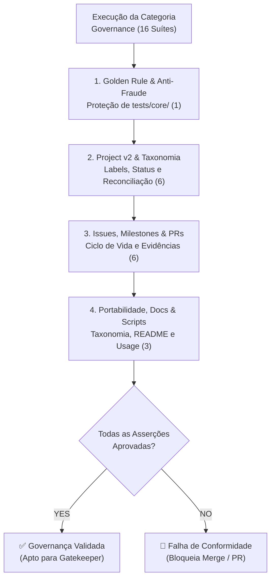

[← Voltar ao Sumário de Testes](Tests-Catalog)

> **Governança GitHub & AIDD**  
> **Diretório**: [`tests/features/governance/`](https://github.com/VitorJacom/my-agents/tree/main/tests/features/governance)  
> **Quantidade**: 16 suítes  
> **Comando**: `./tests/run.sh --category governance`

---

## 🎯 Propósito da Camada

A categoria **Governance** valida deterministicamente todas as regras de governança de ciclo de vida, rastreabilidade no GitHub e integridade estrutural definidas no [`AIDD-Manifesto`](AIDD-Manifesto) e na [`ARCHITECTURE`](ARCHITECTURE).

Enquanto [`Test-core`](Test-core) protege invariantes históricos imutáveis, esta camada assegura que contratos operacionais — como a *Golden Rule* Anti-Fraude, sincronização resiliente com **GitHub Projects v2**, **Milestones/Épicos**, taxonomia de labels, convenções de Pull Requests, portabilidade de documentação e padronização de scripts — permaneçam íntegros e verificáveis por execução automatizada com *sandboxes* Git temporários e *mocks* de CLI.

---

## 🔄 Arquitetura de Validação de Governança



---

## 📋 Suítes da Categoria (16)

### Visão Geral por Pilar

| Pilar | Suítes | Foco Principal | Isolamento / Mocks |
| :--- | ---: | :--- | :--- |
| **1. Golden Rule & Anti-Fraude** | 1 | Filtro `MD` em `tests/core/` e *Circuit Breaker* | Sandbox Git (`mktemp`) |
| **2. Project v2 & Taxonomia** | 6 | Labels, Views, Status, Workflow Actions e Reconciliador | `mock-gh`, `MOCK_env`, `mktemp` |
| **3. Issues, Milestones & PRs** | 6 | Ciclo de vida, Milestones, Regras Core, Closing Keywords e URLs Raw | `mock-gh`, `MOCK_env`, `mktemp` |
| **4. Portabilidade, Docs & Scripts** | 3 | Taxonomia canônica, portabilidade do `README.md` e cabeçalhos de scripts | Análise estática + execução local |
| **Total** | **16** | **Governança GitHub, AIDD e Portabilidade** | **Determinístico / Offline** |

---

### Pilar 1: Golden Rule & Anti-Fraude (1 suíte)

| Suíte | Origem | O que Valida | Happy Path & Edge Cases / Failure Modes | Isolamento |
| :--- | :--- | :--- | :--- | :--- |
| **`test_golden_rule_diff_filter.sh`** | Issue #65 | Modernização da *Golden Rule* com `--diff-filter=MD` (ADR-0015 em [`ARCHITECTURE`](ARCHITECTURE)), validada em [`Agent-gatekeeper`](Agent-gatekeeper) e [`AIDD-Manifesto`](AIDD-Manifesto). | **Happy Path**: Permite adições legítimas (`A`) em `tests/core/` (promoção) e alterações normais em `src/` e `tests/features/`.<br>**Edge Cases**: Dispara *Circuit Breaker* (`exit 1`) ao modificar (`M`), deletar (`D`) ou tentar camuflar adulteração junto com adição legítima em `tests/core/`. | Sandbox Git isolado (`mktemp` + `git init`) |

---

### Pilar 2: GitHub Project v2 & Taxonomia (6 suítes)

| Suíte | Origem | O que Valida | Happy Path & Edge Cases / Failure Modes | Isolamento |
| :--- | :--- | :--- | :--- | :--- |
| **`test_labels_views_conventions.sh`** | Issue #22 | Padronização de Views essenciais no GitHub Projects v2 e taxonomia canônica de labels AIDD (`type:*`, `status:*`, `aidd:wave-*`) em [`ARCHITECTURE`](ARCHITECTURE) e [`Skill-plan-feature`](Skill-plan-feature). | **Happy Path**: Presença das Views e labels canônicas na documentação e instruções do `/plan-feature`.<br>**Edge Cases**: Prevenção de regressões e detecção negativa de labels legadas/obsoletas. | Análise estática de contratos |
| **`test_project_v2_plan_feature.sh`** | Issue #20 | Vinculação automática de issues ao GitHub Projects v2 durante o Estado 4 de [`Skill-plan-feature`](Skill-plan-feature). | **Happy Path**: Lê metadados de `PROJECT_CONTEXT.md` e executa `gh project item-add` com owner, número do projeto e URL.<br>**Edge Cases**: Degradação graciosa (`exit 0` com `⚠️ [WARN]`) sob falha simulada da API (`MOCK_PROJECT_FAIL=1`) e omissão quando `Project Number: None`. | `mock-gh`, `MOCK_env`, `mktemp` |
| **`test_project_v2_status_transition.sh`** | Issue #71 | Sincronização resiliente de transições de status (`Planned` ➔ `In Progress` ➔ `Done`) via [`Script-pipeline`](Script-pipeline) (`project-status-sync.sh`) e contratos de [`Agent-gatekeeper`](Agent-gatekeeper). | **Happy Path**: Normalização da taxonomia canônica e auto-inclusão resiliente (`item-add` antes de nova tentativa de `item-edit`).<br>**Edge Cases**: Degradação graciosa *non-blocking* sob falhas simuladas de CLI/rede e validação de entradas inválidas. | `mock-gh`, `MOCK_env`, `mktemp` |
| **`test_project_v2_workflow.sh`** | Issue #72 | Workflow automatizado de sincronização contínua do GitHub Projects v2 no GitHub Actions. | **Happy Path**: Validação de sintaxe YAML, triggers de eventos, permissões mínimas, concorrência, lógica de transição no Kanban e execução funcional dos steps com *mocks*.<br>**Edge Cases**: Comportamento resiliente frente a eventos ausentes ou metadados incompletos. | `MOCK_env`, `mktemp` |
| **`test_reconcile_github_governance.sh`** | Issue #45 | Comportamento idempotente do script [`Script-pipeline`](Script-pipeline) (`reconcile-github-governance.sh`) na sincronização de labels, milestones e Project v2. | **Happy Path**: Reconciliação normal de Milestone + Project v2 sem duplicar itens ou chamadas redundantes.<br>**Edge Cases**: Verificação de shebang/flags *fail-fast*, comportamento sob ausência de `PROJECT_CONTEXT.md` e valores `None` ou vazios. | `MOCK_env`, `mktemp` |
| **`test_reconcile_status_init.sh`** | Issue #70 | Inicialização de status `Planned`, suporte a `Default Status` customizado, ciclo `--include-closed` ➔ `Done` e idempotência no reconciliador de governança. | **Happy Path**: Inicializa issues sem status como `Planned` (ou customizado), preserva status existente em issues abertas e transiciona fechadas para `Done` (incluindo `--dry-run`).<br>**Edge Cases**: Degradação graciosa quando `Status` é `None` ou quando `item-list`/`item-edit` falham via `MOCK_PROJECT_*_FAIL=1`. | `MOCK_env`, `mktemp` |

---

### Pilar 3: Issues, Milestones & Pull Requests (6 suítes)

| Suíte | Origem | O que Valida | Happy Path & Edge Cases / Failure Modes | Isolamento |
| :--- | :--- | :--- | :--- | :--- |
| **`test_issue_lifecycle_modernization.sh`** | Issue #58 | Modernização do ciclo de vida de issues em [`AIDD-Manifesto`](AIDD-Manifesto), [`Skill-plan-feature`](Skill-plan-feature), [`Skill-publish-rule-issue`](Skill-publish-rule-issue) e [`Script-pipeline`](Script-pipeline): Épicos (Milestones), campo `Release`, sub-issues `--parent` e refinamento *in-place*. | **Happy Path**: Presença das diretrizes canônicas e instruções de Épicos, Releases e `--parent` nas skills.<br>**Edge Cases**: Extração funcional de Épicos/Releases e comportamento do reconciliador sob valores ausentes ou inválidos. | `MOCK_env`, `mktemp` |
| **`test_milestone_plan_feature.sh`** | Issue #19 | Suporte nativo à vinculação dinâmica de Milestones no Estado 4 de [`Skill-plan-feature`](Skill-plan-feature) a partir de `PROJECT_CONTEXT.md`. | **Happy Path**: Leitura da seção de governança em `PROJECT_CONTEXT.md` e especificação de vinculação de Milestone no `/plan-feature`.<br>**Edge Cases**: Avaliação funcional da lógica de extração e injeção de Milestone (incluindo fallback quando ausente ou `None`). | Avaliação funcional isolada |
| **`test_plan_core_rule_detection.sh`** | Issue #63 | Protocolo socrático de identificação concreta e propagação de `CORE_RULE` em [`Agent-product-owner`](Agent-product-owner), [`Skill-plan-feature`](Skill-plan-feature), [`Agent-system-architect`](Agent-system-architect) e [`Agent-planner`](Agent-planner). | **Happy Path**: Exige detecção concreta de invariantes críticos durante a descoberta funcional e propagação do metadado `CORE_RULE` até o plano técnico.<br>**Edge Cases**: Proibição explícita de perguntas genéricas no vácuo durante a entrevista socrática. | Análise estática de contratos |
| **`test_publish_rule_issue_governance.sh`** | Issue #44 | Modernização da skill [`Skill-publish-rule-issue`](Skill-publish-rule-issue) com contratos atômicos no template da issue, flags de governança no `gh issue create` e vinculação ao Project v2. | **Happy Path**: Template estruturado, flags corretas de criação e vinculação resiliente ao Project v2.<br>**Edge Cases**: Avaliação funcional da extração de Milestone e fallback gracioso em caso de indisponibilidade do projeto. | `mock-gh`, `MOCK_env`, `mktemp` |
| **`test_pr_closing_keyword_convention.sh`** | Issue #69 | Obrigatoriedade de palavras-chave de fechamento (`Fixes #<id>`, `Closes #<id>`, `Resolves #<id>`) em texto puro nos corpos de PR (`walkthrough.md`) em [`AIDD-Manifesto`](AIDD-Manifesto), [`Agent-gatekeeper`](Agent-gatekeeper) e [`Skill-git-workflow`](Skill-git-workflow). | **Happy Path**: Aceita closing keywords em texto puro para garantir *auto-close* nativo no merge.<br>**Edge Cases**: Parser determinístico rejeita closing keywords envolvidas em crases inline ou blocos de código e previne anti-padrões nos templates. | Análise estática + parser |
| **`test_walkthrough_image_url_governance.sh`** | Issue #75 | Exigência de URLs canônicas absolutas `raw.githubusercontent.com` para evidências visuais em `walkthrough.md` e PRs, cobrindo [`AIDD-Manifesto`](AIDD-Manifesto), [`Agent-gatekeeper`](Agent-gatekeeper) e [`Skill-issue-pipeline`](Skill-issue-pipeline). | **Happy Path**: Aceita tags `` e Markdown com URL raw, além de aprovar conteúdo sem imagens (backend/CLI).<br>**Edge Cases**: Rejeita caminhos relativos (`docs/assets/mockups/...`, `./`, `../`), URLs GitHub `/blob/` e tabelas misturando URL válida e relativa. | Análise estática + parser |

---

### Pilar 4: Portabilidade, Documentação & Scripts (3 suítes)

| Suíte | Origem | O que Valida | Happy Path & Edge Cases / Failure Modes | Isolamento |
| :--- | :--- | :--- | :--- | :--- |
| **`test_canonical_taxonomy_alignment.sh`** | Issue #603 | Alinhamento da taxonomia canônica de diretórios (`scripts/` e suas 4 categorias, `tests/run.sh` e 5 subcategorias de `tests/features/`) entre `PROJECT_CONTEXT.md`, [`Agent-qa-engineer`](Agent-qa-engineer) e [`Script-hooks`](Script-hooks). | **Happy Path**: Documentação consistente das categorias de scripts e testes e instrução de alocação em `tests/features/<categoria>/`.<br>**Edge Cases**: Limite de 40 linhas em `PROJECT_CONTEXT.md` (evitando truncamento no `session-start-context.sh`), preservação de invariantes e ausência de estado volátil. | Verificação local + hook |
| **`test_readme_portability.sh`** | Issue #57 | Portabilidade universal, guias de instalação remota como opção primária e prévia visual em ASCII da statusline no `README.md`. | **Happy Path**: Estrutura do `README.md`, instalação remota oficial, configuração portável de scripts e prévia da statusline.<br>**Edge Cases**: Tolerância zero a caminhos locais *hardcoded* (ex.: `/home/...`) e integridade de existência dos scripts referenciados (cobrindo [`Script-migrations`](Script-migrations) e [`Script-pr-reviewer`](Script-pr-reviewer) via catálogo). | Análise estática + filesystem |
| **`test_scripts_usage_canonical_paths.sh`** | Issue #604 | Padronização de cabeçalhos canônicos e strings de `usage`/`--help` nos scripts categorizados documentados em [`Scripts-Catalog`](Scripts-Catalog) (`hooks/`, `pipeline/`, `statusline/`, `migrations/`). | **Happy Path**: Cabeçalhos e saídas de `usage`/`--help` refletem os caminhos categorizados reais.<br>**Edge Cases**: Ausência de caminhos legados pré-migração e integridade básica de execução sem falhas de sintaxe. | Análise estática + execução `--help` |

---

## ⚡ Execução & Diagnóstico

```bash
# Executar todas as 16 suítes de governança
./tests/run.sh --category governance

# Executar uma suíte específica via filtro
./tests/run.sh --category governance --filter golden_rule
./tests/run.sh --category governance --filter project_v2
./tests/run.sh --category governance --filter reconcile_status_init

# Execução direta de uma suíte individual para diagnóstico detalhado
bash tests/features/governance/test_golden_rule_diff_filter.sh
```

> [!TIP]
> **Diagnóstico de Falhas**: Todas as suítes desta camada operam 100% *offline* com *sandboxes* Git temporários (`mktemp`) e *mocks* do `gh` CLI. Caso uma suíte falhe durante o desenvolvimento, verifique primeiro se alterações em `rules/AGENTS.md`, `PROJECT_CONTEXT.md`, `skills/*/SKILL.md` ou `agents/*/agent.md` quebraram algum contrato textual ou flag esperada pelo parser determinístico.

---

## 🔗 Navegação

[← Anterior: Core Invariants](Test-core) | [Sumário de Testes](Tests-Catalog) | [Próxima Categoria: Pipeline & Maestro →](Test-pipeline)
