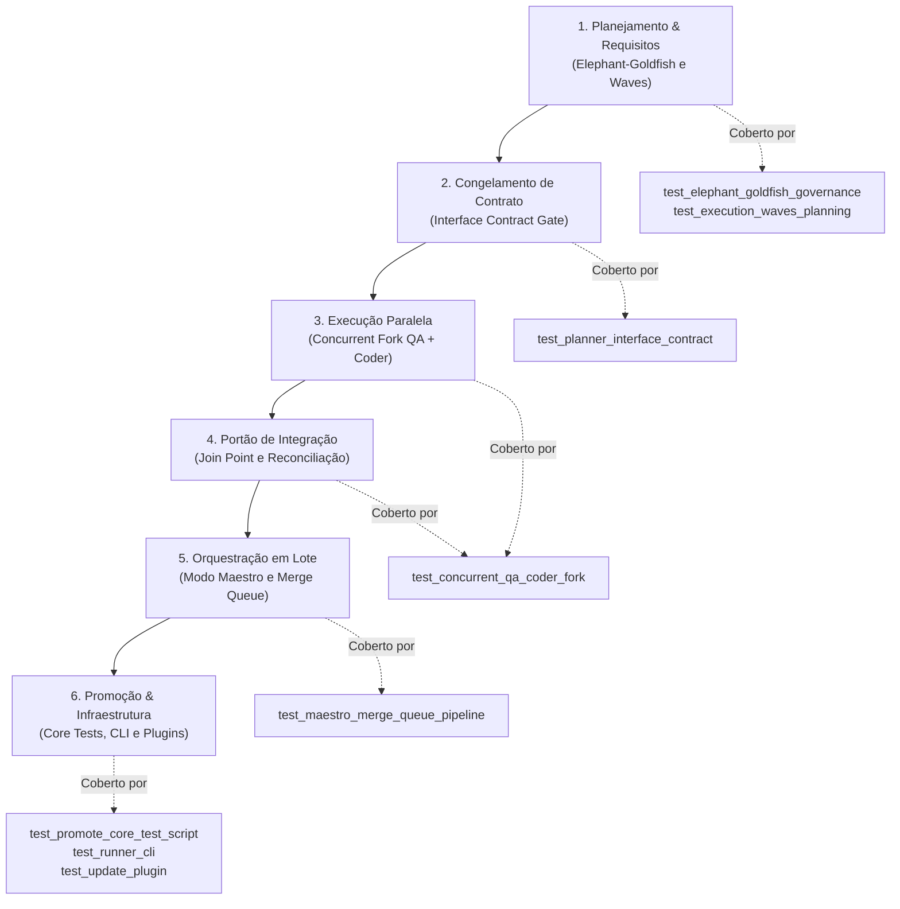

[← Voltar ao Sumário de Testes](Tests-Catalog)

> **Pipeline & Maestro**  
> **Diretório**: [`tests/features/pipeline/`](https://github.com/VitorJacom/my-agents/tree/main/tests/features/pipeline)  
> **Quantidade**: 8 suítes  
> **Comando**: `./tests/run.sh --category pipeline`

---

## 🎯 Propósito da Camada

Valida o núcleo da máquina de estados multiagente do `my-agents` ([`plan-feature`](Skill-plan-feature) e [`issue-pipeline`](Skill-issue-pipeline)): ciclo de planejamento *Elephant-Goldfish*, validação de `## Interface Contract`, particionamento de *Execution Waves*, execução paralela *Concurrent Fork* ([`qa-engineer`](Agent-qa-engineer) + [`coder`](Agent-coder)) com *Join Point* determinístico, *Merge Queue* sequencial no Modo Maestro, promoção auditada de testes para [`tests/core/`](Test-core), hardening do CLI `tests/run.sh` e atualização segura de plugins.

---

## 🔄 Cobertura na Máquina de Estados AIDD

O diagrama abaixo mapeia como as 8 suítes da categoria `pipeline` cobrem cada estágio do ciclo de vida AIDD — do planejamento à execução paralela, integração e infraestrutura do executor:



---

## 📋 Suítes da Categoria (8)

| # | Suíte | Origem | Foco Principal |
| ---: | :--- | :--- | :--- |
| 1 | **`test_concurrent_qa_coder_fork.sh`** | Issue #11 ([`ARCHITECTURE`](ARCHITECTURE) ADR-0005) | *Concurrent Fork* ([`qa-engineer`](Agent-qa-engineer) + [`coder`](Agent-coder)), *Join Point* (`contract-integration-gate.sh`), timeouts rígidos e travas anti-fraude |
| 2 | **`test_elephant_goldfish_governance.sh`** | Issue #61 ([`ARCHITECTURE`](ARCHITECTURE) ADR-0014) | Modelo *Elephant-Goldfish* no [`plan-feature`](Skill-plan-feature), confinamento do PO, *Cold Audit* do [`gatekeeper`](Agent-gatekeeper) e auto-healing ($\le 2$ iterações) |
| 3 | **`test_execution_waves_planning.sh`** | Issue #36 | Mapeamento de *Blast Radius* (`Target Files & Dependencies`) e partição em *Execution Waves* disjuntas ($\le 3$ issues/onda) |
| 4 | **`test_maestro_merge_queue_pipeline.sh`** | Issue #9 | Modo Maestro no [`issue-pipeline`](Skill-issue-pipeline), worktrees isoladas, *Merge Queue* sequencial (`rebase-sync`) e auto-reconciliação |
| 5 | **`test_planner_interface_contract.sh`** | Issue #10 ([`ARCHITECTURE`](ARCHITECTURE) ADR-0005) | Validação determinística do `## Interface Contract` do [`planner`](Agent-planner) via [`validate-interface-contract.sh`](Script-pipeline) |
| 6 | **`test_promote_core_test_script.sh`** | Issue #64 | Utilitário [`promote-core-test.sh`](Script-pipeline), protocolo interativo de promoção para [`tests/core/`](Test-core) e rollback automático |
| 7 | **`test_runner_cli.sh`** | Issue #601 | Hardening, fail-fast, parsing de flags (`--category`, `--filter`), confinamento de escopo e regex do executor `tests/run.sh` |
| 8 | **`test_update_plugin.sh`** | Issue #66 | Utilitário [`update-plugin.sh`](Script-pipeline), cache JSON com TTL 24h, lock `flock` e proteção contra *working tree* suja |
| | **Total** | **8 suítes** | **Cobertura integral do ciclo Planejamento ➔ Execução ➔ Merge ➔ Infraestrutura** |

---

## 🔍 Detalhamento por Suíte

### 1. `test_concurrent_qa_coder_fork.sh`

- **Origem**: Issue #11 — *Concurrent QA-Coder Fork and Contract Integration Gate* ([`ARCHITECTURE`](ARCHITECTURE), ADR-0005).
- **O que Valida**: Contratos estáticos em `skills/issue-pipeline/SKILL.md` (ESTADOS 2 e 3 + diagrama Mermaid), [`qa-engineer`](Agent-qa-engineer), [`coder`](Agent-coder), `docs/ARCHITECTURE.md`, `docs/System-Architecture.md`, `rules/AGENTS.md` e execução funcional do portão [`contract-integration-gate.sh`](Script-pipeline) (`.py`).
- **Happy Path**:
  - Aprovação imediata com `--test-exit-code 0 --coverage 92.5` emitindo `[JOIN_POINT: APPROVED]`.
  - Saída estruturada `--json` contendo `status: "APPROVED"`, `iteration` e `coverage`.
  - Execução via `--test-cmd "true"` e respeito ao `--test-timeout 10`.
- **Edge Cases & Failure Modes**:
  - Loop de reconciliação (`RECONCILE_REQUIRED`, exit code `1`) nas iterações 1 e 2 ou quando cobertura $< 85\%$ (`78.5`).
  - *Circuit Breaker* na iteração 3 (`FAILED_CONTRACT_INTEGRATION`, exit code `2`).
  - Travas anti-fraude (`ANTI_FRAUD_VIOLATION`, exit code `3`) bloqueando [`qa-engineer`](Agent-qa-engineer) em `src/` ou `tests/core/` (*Golden Rule*) e [`coder`](Agent-coder) em `tests/`, inclusive com normalização de caminhos absolutos.
  - Rejeição de parâmetros inválidos (`--iteration 0`, `--coverage 115.0`, `--test-timeout 0`).
  - Timeout rígido (`--test-cmd "sleep 5" --test-timeout 1`) abortando em $< 4\text{s}$ com diagnóstico `TIMEOUT` / exit code `124` em JSON.
  - Blindagem contra fallback pesado silencioso: invocação sem `--test-cmd` e sem `--test-exit-code` falha imediatamente.
- **Isolamento & Mocks**: Utiliza `--test-exit-code` e comandos sintéticos (`--test-cmd "true"` / `"sleep 5"`) em vez de acionar a suíte real do projeto.

### 2. `test_elephant_goldfish_governance.sh`

- **Origem**: Issue #61 — *Integração do Modelo Elephant-Goldfish no Pipeline AIDD* ([`ARCHITECTURE`](ARCHITECTURE), ADR-0014).
- **O que Valida**: Persona *The Elephant* em [`product-owner`](Agent-product-owner), *Cold Audit* stateless (*The Goldfish Reviewer*) no Modo 1 do [`gatekeeper`](Agent-gatekeeper), máquina de estados de [`plan-feature`](Skill-plan-feature), Decisão Técnica 0014 e catálogos da Wiki (`Subagents.md`, `Skills-Catalog.md`).
- **Happy Path**:
  - Presença dos contratos de postura socrática, contexto cumulativo, auditoria fria e prevenção a *context collapse*.
  - Simulação funcional aprovando especificação autocontida, atômica ($\le 3$ passos) e com critérios de aceite verificáveis.
- **Edge Cases & Failure Modes**:
  - **EC-01**: Parser YAML valida que [`product-owner`](Agent-product-owner) possui `read_file` e é estritamente proibido de declarar `write_file`, `edit_file` ou `run_command`.
  - **EC-02 / EC-03 / EC-04**: Bloqueio formal de premissas implícitas, quebra de atomicidade ($> 3$ passos) e teto máximo de 2 iterações de auto-healing.
  - Simulação funcional rejeitando termos especulativos (`"Supõe-se..."`), excesso de passos e disparando *Circuit Breaker* exatamente após 2 tentativas de auto-healing sem sucesso.
- **Isolamento & Mocks**: Análise estática via `yaml.safe_load` e simulação determinística em Python puro em memória, sem chamadas a LLMs ou mutação de arquivos.

### 3. `test_execution_waves_planning.sh`

- **Origem**: Issue #36 — *Target Files Blast-Radius & Execution Waves Planning*.
- **O que Valida**: Contratos de mapeamento de *Blast Radius* (`Target Files`, `Depends On`, matriz `Execution Waves`) em [`system-architect`](Agent-system-architect), [`planner`](Agent-planner) e nos Estados 2 e 4 de [`plan-feature`](Skill-plan-feature).
- **Happy Path**:
  - Algoritmo determinístico de particionamento separa issues colidentes (`src/auth.ts` compartilhado entre `#1` e `#2`) em ondas distintas, respeitando precedências e o teto de $\le 3$ issues simultâneas por wave.
- **Edge Cases & Failure Modes**:
  - Validador algorítmico rejeita: colisão de `target_files` na mesma onda, estouro de capacidade ($> 3$ issues na wave), ausência obrigatória de `target_files` ou `depends_on` e inversão de dependência (issue dependendo de outra na mesma onda).
- **Isolamento & Mocks**: Execução isolada em Python com conjuntos sintéticos de issues e arquivos-alvo.

### 4. `test_maestro_merge_queue_pipeline.sh`

- **Origem**: Issue #9 — *Maestro Multi-Issue Pipeline & Merge Queue*.
- **O que Valida**: Especificação do Modo Maestro em [`issue-pipeline`](Skill-issue-pipeline) (triagem Unitário vs. Maestro, `--epic`, *Pre-flight*, cap $\le 3$ workers, branch intermediária `integration/` ou `epic/`, worktrees via `invoke_subagent`, *Merge Queue* sequencial, PR consolidado, diagrama Mermaid) e suporte a `--base` / `worktree-manager.sh` no [`gatekeeper`](Agent-gatekeeper).
- **Happy Path**:
  - Criação de branch intermediária `integration/batch-20261106`, provisionamento de worktree isolada para Issue 201 via [`worktree-manager.sh`](Script-pipeline) (`create`), commit da feature/teste, sincronização (`rebase-sync --base`), merge `--ff-only` e remoção (`remove`).
- **Edge Cases & Failure Modes**:
  - **EC-05**: Particionador separa issues colidentes em `src/shared.sh` em ondas distintas.
  - **EC-06 (Anti-Fraude na Auto-Reconciliação)**: `rebase-sync` detecta adulteração de teste já integrado (`test_feature_201.sh`) e aborta com **Exit Code 3**.
  - **EC-07 (Conflito de Rebase & Fail-Safe)**: Conflito em `src/app.sh` retorna **Exit Code 4** e preserva a branch intermediária íntegra sem corrupção.
- **Isolamento & Mocks**: Repositório Git temporário estéril criado via `mktemp -d` com limpeza garantida via `trap EXIT`, exercitando o script real [`worktree-manager.sh`](Script-pipeline).

### 5. `test_planner_interface_contract.sh`

- **Origem**: Issue #10 — *Interface Contract Standard and Strict Validation Gate* ([`ARCHITECTURE`](ARCHITECTURE), ADR-0005).
- **O que Valida**: Exigência da seção `## Interface Contract` com 5 pilares (`Signatures`, `Types & Interfaces`, `Inputs`, `Outputs`, `Errors`) em [`planner`](Agent-planner), [`plan-feature`](Skill-plan-feature), [`issue-pipeline`](Skill-issue-pipeline), [`gatekeeper`](Agent-gatekeeper), `rules/AGENTS.md` (seção 1.2) e execução do validador [`validate-interface-contract.sh`](Script-pipeline) (`.py`).
- **Happy Path**:
  - Aprova `implementation_plan.md` completo com os 5 pilares tipados tanto via argumento de arquivo quanto via pipeline `stdin`.
- **Edge Cases & Failure Modes**:
  - Rejeita plano sem `## Interface Contract`, com seção vazia, sem `Signatures`, sem `Errors`, com placeholders (`TODO`, `TBD`, `a definir`), com premissas especulativas (`supõe-se`, `obviamente`), arquivo inexistente, arquivo vazio e `stdin` vazio.
- **Isolamento & Mocks**: Diretório temporário (`mktemp -d` com `trap cleanup EXIT`) populado com fixtures Markdown sintéticas.

### 6. `test_promote_core_test_script.sh`

- **Origem**: Issue #64 — *Utilitário `promote-core-test.sh` & Protocolo Interativo*.
- **O que Valida**: Script [`promote-core-test.sh`](Script-pipeline) (`set -euo pipefail`, `--help`/`-h`, `--list-candidates`, `--dry-run`, `--promote`) e o protocolo interativo de promoção no ESTADO 4 de [`issue-pipeline`](Skill-issue-pipeline).
- **Happy Path**:
  - `--list-candidates` identifica apenas testes com marcadores `@core` ou `CORE_RULE`.
  - `--dry-run` simula a operação sem mover arquivos em disco.
  - `--promote` move o teste para [`tests/core/`](Test-core) e valida a suíte core com exit code `0`.
- **Edge Cases & Failure Modes**:
  - Rejeita opção desconhecida, `--promote` sem argumento, arquivo inexistente e arquivo fora de `tests/features/`.
  - **Rollback Automático**: Quando um teste promovido falha na validação da suíte core, o script restaura o arquivo para `tests/features/` e o remove de `tests/core/`.
- **Isolamento & Mocks**: Sandbox temporário (`mktemp -d`) contendo cópia do script e um **mock de `tests/run.sh`** que executa apenas `tests/core/*.sh` do próprio sandbox.

### 7. `test_runner_cli.sh`

- **Origem**: Issue #601 — *Hardening, Fail-Fast e CLI de `tests/run.sh`*.
- **O que Valida**: Parsing determinístico de flags, mensagens de ajuda, escopo de filtragem e comportamento fail-fast do executor principal `tests/run.sh`.
- **Happy Path**:
  - `--help` e `-h` retornam exit code `0` com manual de uso.
  - `--category statusline` e `--category=statusline` executam exclusivamente a categoria alvo.
  - `--filter` e `--filter=` aceitam sintaxe com espaço ou `=` e reportam contagem exata de suítes.
- **Edge Cases & Failure Modes**:
  - Filtro sem correspondência (`--filter` inexistente) falha com exit code `1` e erro em `stderr`.
  - Confinamento de escopo: `--filter` avalia apenas o caminho relativo a `tests/` (ignorando tokens presentes no diretório pai temporário).
  - Rejeição imediata (exit code `1`) para valores faltantes antes de outra flag (`--category --core`, `--filter --all`), valores vazios (`--category=`, `--filter=`), regex inválida (`[unclosed_regex`), categoria inexistente e flag desconhecida.
- **Isolamento & Mocks**: Diretório temporário `/tmp/unique_parent_token_xyz_*` com `test_dummy.sh` para testar confinamento de caminho e execuções leves filtradas (`statusline` / `test_worktree_manager`).

### 8. `test_update_plugin.sh`

- **Origem**: Issue #66 — *Plugin Update Utility with Cache & Dirty Tree Safety*.
- **O que Valida**: Script [`update-plugin.sh`](Script-pipeline) (`--help`/`-h`, `--check`, `--status`, `--apply`, `--force-check`), cache JSON com TTL de 24h, escrita atômica com `flock`, proteção de *working tree* suja e variável `MY_AGENTS_AUTO_UPDATE=1`.
- **Happy Path**:
  - `--check` consulta remoto e persiste JSON válido (`current_version`, `latest_version`, `update_available`, `last_checked_timestamp`, `ttl_seconds`).
  - `--status` exibe versão atual, versão remota e estado de atualização.
  - `--apply` atualiza repositório limpo para `v1.1.0` e zera `update_available`.
  - `MY_AGENTS_AUTO_UPDATE=1` aplica automaticamente `v1.2.0` quando a árvore está limpa.
- **Edge Cases & Failure Modes**:
  - *Working tree* suja (`dirty_file.txt`) aborta `--apply` com fail-fast preservando a versão e as alterações locais.
  - *Cache Hit* dentro do TTL de 24h evita consulta redundante ao remoto; expiração simulada (timestamp retrocedido em `90000s` / 25h) força reconsulta e atualiza para `v1.4.0`.
  - Contenção de lock via `flock` e `MY_AGENTS_LOCK_TIMEOUT=1` preserva a integridade do JSON sem corrupção.
  - Comparação semântica (`sort -V`) evita falso alerta quando versão local (`v2.0.0`) supera a remota.
  - Caminhos de cache com espaços e aspas simples (`it's a tricky cache.json`) tratados com segurança via `sys.argv`.
- **Isolamento & Mocks**: Ambiente Git estéril em `/tmp/test_update_plugin_*` com repositório *bare* (`remote.git`), *seed repo*, *client repo* e variável `MY_AGENTS_CACHE_FILE` isolada.

---

## ⚡ Execução & Diagnóstico

```bash
# Executar todas as 8 suítes da categoria pipeline
./tests/run.sh --category pipeline

# Executar uma suíte específica via filtro
./tests/run.sh --filter test_concurrent_qa_coder_fork
./tests/run.sh --filter test_maestro_merge_queue_pipeline
```

### Códigos de Saída & Sinais Comuns

| Código / Tag | Origem | Significado |
| :--- | :--- | :--- |
| `0` / `[JOIN_POINT: APPROVED]` | [`contract-integration-gate.sh`](Script-pipeline) | Suíte verde e cobertura $\ge 85\%$ no *Join Point* |
| `1` / `RECONCILE_REQUIRED` | [`contract-integration-gate.sh`](Script-pipeline) | Falha de teste ou cobertura $< 85\%$ (até 2 iterações de ajuste) |
| `2` / `FAILED_CONTRACT_INTEGRATION` | [`contract-integration-gate.sh`](Script-pipeline) | *Circuit Breaker*: esgotamento das 2 iterações de reconciliação |
| `3` / `ANTI_FRAUD_VIOLATION` | [`contract-integration-gate.sh`](Script-pipeline) / [`worktree-manager.sh`](Script-pipeline) | Violação de confinamento (`qa-engineer` em `src/` ou `tests/core/`, `coder` em `tests/`) |
| `4` | [`worktree-manager.sh`](Script-pipeline) | Conflito de rebase na *Merge Queue* (branch intermediária preservada) |

---

## 🔗 Navegação

[← Anterior: Governança GitHub](Test-governance) | [Sumário de Testes](Tests-Catalog) | [Próxima Categoria: Wiki & Documentação →](Test-wiki)
