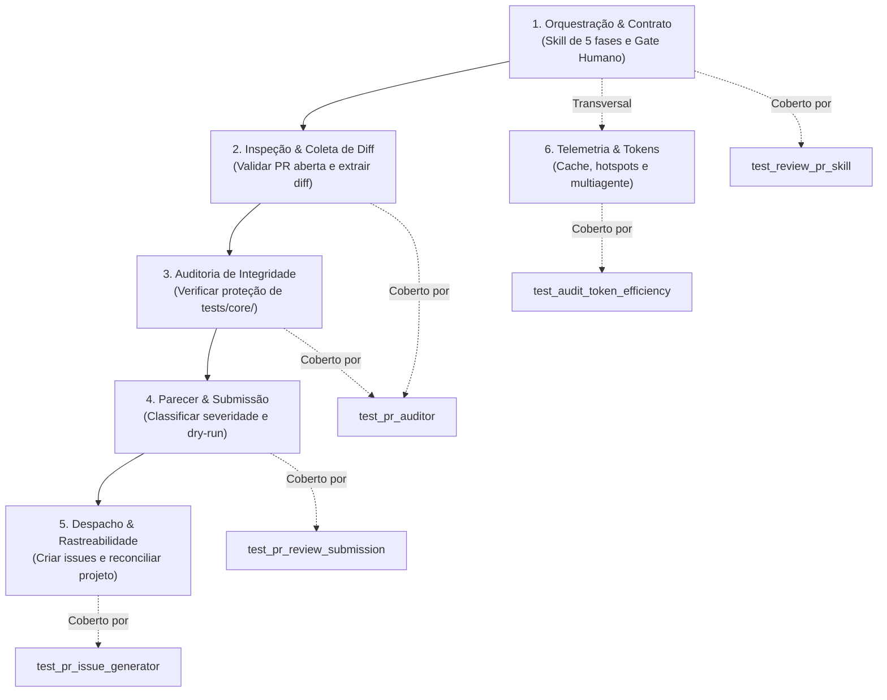

[← Voltar ao Sumário de Testes](Tests-Catalog)

> **Revisão de PR & Telemetria**  
> **Diretório**: [`tests/features/`](https://github.com/VitorJacom/my-agents/tree/main/tests/features) *(raiz de features)*  
> **Quantidade**: 5 suítes  
> **Comando**: `./tests/run.sh --filter "pr_|review_pr|token"`

---

## 🎯 Propósito da Camada

Valida a esteira determinística de revisão de Pull Requests ([`pr`](Skill-pr)) de ponta a ponta — desde a especificação orquestradora de 5 fases até a extração de diff, verificação anti-fraude da *Golden Rule* ([`AIDD-Manifesto`](AIDD-Manifesto)), submissão automatizada de pareceres e geração de issues rastreadas com governança via [`Script-pr-reviewer`](Script-pr-reviewer) — além do auditor de eficiência de tokens e telemetria multiagente do pipeline ([`Script-pipeline`](Script-pipeline)).

---

## 🔄 Cobertura na Esteira de Revisão (/pr)

O diagrama abaixo mapeia como as 5 suítes cobrem cada fase da esteira [`pr`](Skill-pr) e a auditoria transversal de telemetria e consumo de tokens:



---

## 📋 Suítes da Categoria (5)

| # | Suíte | Origem | Foco Principal |
| ---: | :--- | :--- | :--- |
| 1 | **`test_audit_token_efficiency.sh`** | Issue #49 | Auditoria de eficiência de tokens, taxa de cache, hotspots e agregação multiagente ([`Script-pipeline`](Script-pipeline)) |
| 2 | **`test_pr_auditor.sh`** | Issue #51 | Subcomandos `fetch-diff` e `audit-integrity` de [`pr-reviewer.sh`](Script-pr-reviewer), fallback `python3` e *Circuit Breaker* (exit `3`) em [`tests/core/`](Test-core) |
| 3 | **`test_pr_review_submission.sh`** | Issue #52 | Submissão determinística de pareceres (`submit-review`) com inferência automática de veredito e `--dry-run` |
| 4 | **`test_pr_issue_generator.sh`** | Issue #53 | Geração automática de issues rastreadas (`create-issues`), taxonomia AIDD e disparo do reconciliador de governança |
| 5 | **`test_review_pr_skill.sh`** | Issue #54 | Contrato estrutural da skill [`pr`](Skill-pr) em 5 fases, Gate de Validação Humana e cobertura local |
| | **Total** | **5 suítes** | **Cobertura integral da esteira `/pr` e telemetria de tokens** |

---

## 🔍 Detalhamento por Suíte

### 1. `test_audit_token_efficiency.sh`

- **Origem**: Issue #49 — *Token Efficiency & Pipeline Telemetry Auditor* (`scripts/audit-token-efficiency.py`).
- **O que Valida**: Presença e permissão de execução de `scripts/audit-token-efficiency.py` ([`Script-pipeline`](Script-pipeline)), interface CLI (`--help`, `--transcript`, `--json`, `--markdown`, `--stdin`, `--agents`, `--brain-dir`, `--min-score`), consolidação por fases multiagente e detecção de anomalias de consumo.
- **Happy Path**:
  - Exibe manual `--help` com exit code `0` e analisa transcript saudável exibindo `score` e chamadas de ferramentas (`read_file`).
  - Emite saída estruturada em `--json` (campos `score` e `tools`) e `--markdown` (tabelas GFM e diagnóstico), além de suportar pipeline via `--stdin` (`score >= 80`).
  - Agrega múltiplos subagentes (`Planner`, `QA`, `Coder`, `Gatekeeper`) via `--agents` + `--brain-dir`, calculando `score >= 85` para execuções saudáveis.
  - Quality gate `--min-score 70` aprova transcript saudável com exit code `0`.
- **Edge Cases & Failure Modes**:
  - Detecta *cache miss* severo e hotspots (`75k`–`82k` tokens de entrada vs. `100`–`200` de leitura em cache em `large_dump.log`), reduzindo `score < 70` e preenchendo `hotspots`, `cache_anomalies` ou `recommendations`.
  - Quality gate `--min-score 85` falha determinísticamente (`exit != 0`) no transcript com hotspots.
  - *Fail-fast* para arquivo de transcript inexistente, arquivo vazio (`0` eventos) e JSON malformado passado em `--agents`.
- **Isolamento & Mocks**: Diretório temporário (`mktemp -d` com `trap EXIT`) contendo fixtures JSONL sintéticas (`healthy_transcript.jsonl`, `hotspots_transcript.jsonl`, `empty.jsonl`) e árvore simulada de logs em `MOCK_BRAIN`.

### 2. `test_pr_auditor.sh`

- **Origem**: Issue #51 — *PR Reviewer Fetch-Diff & Integrity Auditor* ([`Script-pr-reviewer`](Script-pr-reviewer)).
- **O que Valida**: Subcomandos `fetch-diff` e `audit-integrity` de `scripts/pr-reviewer.sh`, exigência de estado `OPEN` da PR, resiliência de parsing JSON (`jq` com fallback em `python3`) e aplicação da *Golden Rule* do [`AIDD-Manifesto`](AIDD-Manifesto) sobre [`tests/core/`](Test-core).
- **Happy Path**:
  - Script executável com `--help` e `-h` documentando `fetch-diff` e `audit-integrity` (exit code `0`).
  - `fetch-diff 101` extrai metadados estruturados e diff unificado (`diff --git`) de uma PR `OPEN`.
  - `audit-integrity 101` aprova PR limpa sem alterações na zona protegida (exit code `0`).
  - Fallback `python3`: `fetch-diff 101` opera normalmente em ambiente sem `jq` no `PATH`.
- **Edge Cases & Failure Modes**:
  - Rejeita subcomando inválido, ausência de `PR_NUMBER` em `fetch-diff` ou `audit-integrity`, PR inexistente (`999`), PR `CLOSED` (`102`) e PR `MERGED` (`103`).
  - **Golden Rule Anti-Fraude**: `audit-integrity 105` (diff alterando `tests/core/test_invariants.sh`) dispara o *Circuit Breaker* e aborta com **exit code `3`**.
  - Degradação explícita: ambiente mínimo sem `jq` e sem `python3` falha com diagnóstico claro (`exit != 0`).
- **Isolamento & Mocks**: Diretório temporário (`mktemp -d` com `trap cleanup EXIT`), mock do CLI `gh` injetado no `PATH` simulando PRs `101`, `102`, `103`, `105` e `999`, além de sandboxes de `PATH` restrito (`NO_JQ_BIN` e `MINIMAL_BIN`).

### 3. `test_pr_review_submission.sh`

- **Origem**: Issue #52 — *Submissão Determinística de Pareceres de Code Review* ([`Script-pr-reviewer`](Script-pr-reviewer)).
- **O que Valida**: Subcomando `submit-review` de `scripts/pr-reviewer.sh`, inferência automática de veredito (`--status auto` ou omitido), vereditos explícitos (`approve`, `request-changes`, `comment`), proteção `--dry-run` e flexibilidade de argumentos.
- **Happy Path**:
  - `--help` documenta `submit-review`, `--body-file`, `--status` e `--dry-run`.
  - Inferência automática: parecer com `🚨 Crítico` ou violação de integridade submete `--request-changes`; parecer apenas com `⚠️ Importante` ou `💡 Sugestão` submete `--comment`; parecer limpo submete `--approve`.
  - Vereditos explícitos sobrescrevem a inferência; aceita sintaxe `--chave=valor` e flags posicionadas antes do número da PR.
  - `--dry-run` exibe o parecer simulado sem disparar `gh pr review` (log de mutações permanece vazio).
- **Edge Cases & Failure Modes**:
  - Aborta (`exit != 0`) sem `PR_NUMBER`, sem `--body-file`, com arquivo inexistente, com arquivo vazio ou com `--status` inválido.
  - Rejeita PR `CLOSED` (`102`), `MERGED` (`103`) e inexistente (`999`).
  - *Fail-fast* diante de falha de rede/API do `gh pr review` na PR `500`.
- **Isolamento & Mocks**: Mock do CLI `gh` registrando chamadas de `gh pr review` em `GH_REVIEW_LOG` dentro de `mktemp -d`, combinado com fixtures Markdown para cada severidade de parecer.

### 4. `test_pr_issue_generator.sh`

- **Origem**: Issue #53 — *Gerador Automático de Issues Rastreadas com Governança* ([`Script-pr-reviewer`](Script-pr-reviewer)).
- **O que Valida**: Subcomando `create-issues <pr_number> --findings-file <arquivo> [--dry-run]`, filtragem de severidades elegíveis (`🚨 Crítico` e `⚠️ Importante`, ignorando `💡 Sugestão`), taxonomia semântica, rastreabilidade e reconciliação de governança ([`Test-governance`](Test-governance)).
- **Happy Path**:
  - `--help` documenta `create-issues`, `--findings-file` e `--dry-run`; suporta sintaxe inline `--findings-file=arquivo`.
  - `--dry-run` lista as issues planejadas sem invocar `gh issue create` nem o reconciliador.
  - Execução real na PR `201` cria exatamente 2 issues: apontamento Crítico com `type:fix`, `status:planned`, `source:code-review`, e Importante com `type:refactor`, `status:planned`, `source:code-review`.
  - Injeta no corpo da issue o link da PR, branch head (`feature/issue-201`), commit SHA (`headRefOid`) e critérios de remediação, disparando o reconciliador de governança ao término do lote.
- **Edge Cases & Failure Modes**:
  - Rejeita ausência de `PR_NUMBER`, PR inexistente (`999`), `CLOSED` (`202`) ou `MERGED` (`203`).
  - Falha (`exit != 0`) se `--findings-file` for omitido, inexistente, vazio ou contiver apenas `💡 Sugestão` (sem apontamentos elegíveis).
  - *Fail-fast* quando `gh issue create` retorna erro de API (`FAIL_TRIGGER`).
- **Isolamento & Mocks**: Mock do CLI `gh` com registro em `GH_LOG`, script simulado de reconciliação injetado via `MY_AGENTS_RECONCILER_OVERRIDE` e fixtures de apontamentos em `mktemp -d`.

### 5. `test_review_pr_skill.sh`

- **Origem**: Issue #54 — *Orquestrador da Skill `/pr` com Gate Humano* ([`Skill-pr`](Skill-pr)).
- **O que Valida**: Contrato estrutural de `skills/pr/SKILL.md`, máquina de estados em 5 fases, Gate de Validação Humana mandatório, papéis de subagentes ([`Agent-gatekeeper`](Agent-gatekeeper)), critérios heurísticos em 4 dimensões e catalogação em [`Skills-Catalog`](Skills-Catalog).
- **Happy Path**:
  - Valida existência, frontmatter YAML (`name: pr`, `description:`) e protocolo de invocação (`/pr <#PR | URL>`, `/pr local`, ID numérico e URL completa).
  - Verifica documentação das 5 fases (`fetch-diff`, `audit-integrity`, 4 dimensões + 3 severidades, Gate de Validação Humana exigindo confirmação explícita do desenvolvedor, `submit-review` + `create-issues`) e atuação de [`gatekeeper`](Agent-gatekeeper) e orquestrador/planner.
  - Confirma o registro completo em `docs/Skills-Catalog.md`.
- **Edge Cases & Failure Modes**:
  - Verifica documentação do *Circuit Breaker* na Fase 2 (*Golden Rule* com exit code `3`), tratamento de recusa/cancelamento no Gate da Fase 4 sem mutação remota e preservação de estado em `--dry-run` na Fase 5.
  - Executa `tests/features/wiki/test_wiki_structure_and_links.sh` garantindo zero links quebrados na Wiki.
- **Isolamento & Mocks**: Inspeção estática determinística (`grep`/`test`) sobre os arquivos canônicos de skills e catálogos, complementada pela execução isolada da suíte de integridade da Wiki.

---

## ⚡ Execução & Diagnóstico

```bash
# Executar todas as 5 suítes de revisão de PR e telemetria
./tests/run.sh --filter "pr_|review_pr|token"

# Executar uma suíte específica (ex.: auditoria da Golden Rule)
bash tests/features/test_pr_auditor.sh

# Validar integridade de links da Wiki após edições documentais
./tests/run.sh --category wiki
```

---

## 🔗 Navegação

[← Anterior: UI/UX & Mockups](Test-ui-ux) | [Sumário de Testes](Tests-Catalog) | [Próxima Categoria: Statusline & Performance →](Test-statusline)
