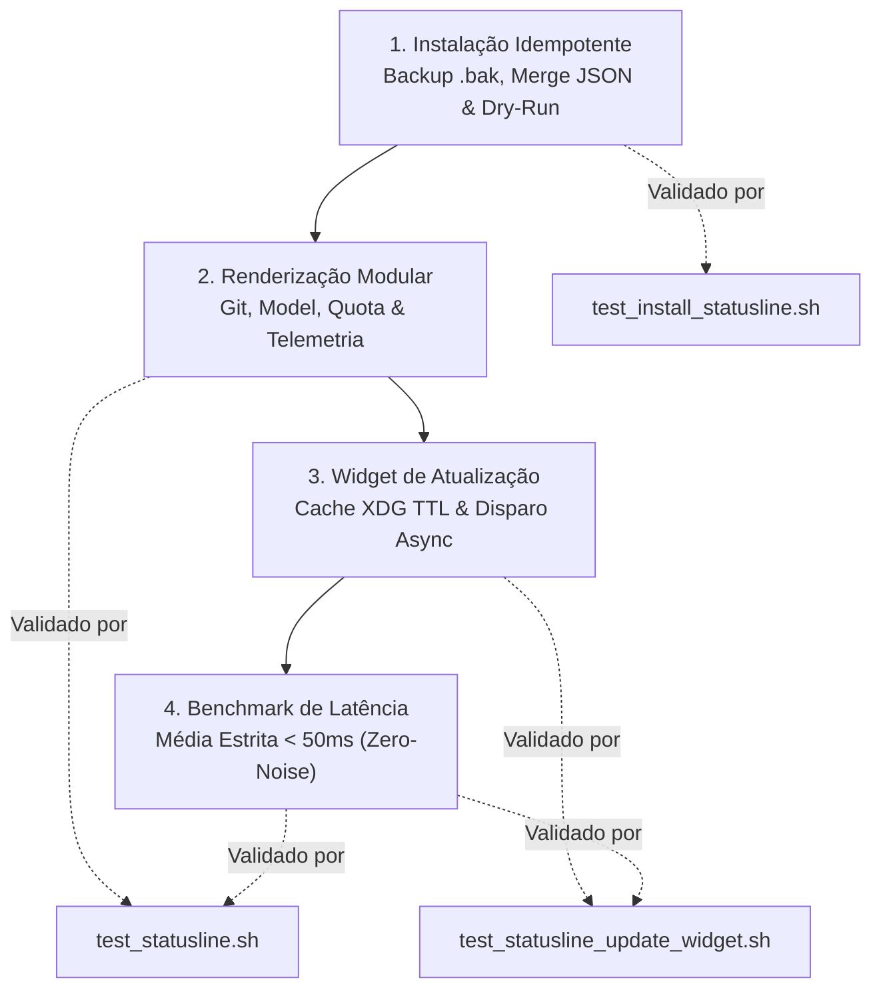

[← Voltar ao Sumário de Testes](Tests-Catalog)

> **Statusline & Performance**  
> **Diretório**: [`tests/features/statusline/`](https://github.com/VitorJacom/my-agents/tree/main/tests/features/statusline)  
> **Quantidade**: 3 suítes  
> **Comando**: `./tests/run.sh --category statusline`

---

## 🎯 Propósito da Camada

A categoria **Statusline & Performance** valida deterministicamente a arquitetura modular da barra de status do Antigravity CLI ([`Script-statusline`](Script-statusline)) e sua integração com o ciclo de instalação e atualização de plugins ([`Script-pipeline`](Script-pipeline)).

Conforme definido em [`System-Architecture`](System-Architecture) e documentado para onboarding em [`Getting-Started`](Getting-Started), a statusline executa a cada atualização de prompt do terminal. Por isso, esta camada assegura três invariantes operacionais críticos: **instalação idempotente e segura** sobre configurações existentes do usuário, **tolerância a falhas com zero ruído em `stderr`** diante de payloads ou caches inválidos, e **latência estritamente inferior a 50ms** (SLA sub-50ms) por meio de renderização modular e cache TTL. Problemas de latência, cache ou supressão do widget de atualização são diagnosticados em [`Troubleshooting`](Troubleshooting), enquanto a consistência documental desses contratos é auditada em [`Test-wiki`](Test-wiki).

---

## 🔄 Cobertura da Statusline & Performance

O fluxo abaixo mapeia como as 3 suítes cobrem o ciclo completo da statusline — do provisionamento local à renderização modular em tempo real e notificação assíncrona de atualizações:



---

## 📋 Suítes da Categoria (3)

| # | Suíte | Origem | Foco Principal | Isolamento / Mocks |
| ---: | :--- | :--- | :--- | :--- |
| 1 | **`test_install_statusline.sh`** | Issue #7 | Instalação idempotente, backup `.bak` (SHA-256), merge de `settings.json`, `--dry-run` e *fail-fast* em JSON corrompido | `mktemp -d`, `ANTIGRAVITY_SETTINGS_PATH`, mock de script via `--script-path` |
| 2 | **`test_statusline.sh`** | Issue #6 | Arquitetura modular de widgets, schema Antigravity CLI, estado volátil (`task.md` vs. `/context`), `LC_NUMERIC` e benchmark `< 50ms` | `mktemp -d`, `ANTIGRAVITY_WORKSPACE`, `stderr.log` |
| 3 | **`test_statusline_update_widget.sh`** | Issue #67 | `widget_update()`, estados Zero-Noise / Âmbar Bold, cache XDG TTL, trigger assíncrono `--check` e SLA `< 50ms` | `mktemp -d`, `MY_AGENTS_CACHE_FILE`, mock de `update-plugin.sh` |
| | **Total** | **3 suítes** | **Provisionamento seguro, renderização resiliente e SLA sub-50ms** | **100% Offline / Determinístico** |

---

## 🔍 Detalhamento por Suíte

### 1. `test_install_statusline.sh`

- **Origem**: Issue #7 — *Automated Plug-and-Play Statusline Setup*.
- **O que Valida**: Contrato de instalação automatizada de `scripts/statusline/install-statusline.sh` apontando para `scripts/statusline/statusline-quota.sh` ([`Script-statusline`](Script-statusline)).
- **Happy Path**:
  - Confirma existência e permissão de execução (`test -f`, `test -x`) de `install-statusline.sh`.
  - **Fresh Install**: Cria diretório e `settings.json` válido quando inexistente, configurando `statusLine.type = "command"`, `command` e `enabled = true`.
  - **Preservação & Backup**: Gera arquivo `.bak` com checksum SHA-256 idêntico ao original e preserva intactas todas as chaves pré-existentes do usuário (`artifactReviewPolicy`, `colorScheme`, `model`, `notifications`, `permissions.allow`, `trustedWorkspaces`).
  - **Merge de Atributos Customizados**: Atualiza `command`, `type` e `enabled` mantendo campos adicionais em `statusLine` (`stack_with_default`, `refreshInterval`).
  - **Flexibilidade de CLI & Env**: Suporta injeção via `ANTIGRAVITY_SETTINGS_PATH` e argumento `--settings-path=<caminho>`.
  - **Idempotência**: Garante saída idêntica entre 3 execuções consecutivas sem duplicar chaves.
  - **Simulação `--dry-run`**: Imprime prévia (`DRY-RUN`) sem gravar no disco nem gerar `.bak`.
- **Edge Cases & Failure Modes**:
  - **Permissões sem Mutação do Repositório**: Valida restauração da permissão executável (`chmod +x`) usando um script mockado passado via `--script-path` sem alterar arquivos versionados.
  - **Fail-Fast em JSON Corrompido**: Encerra com `exit 1`, emite mensagem explicativa (`Falha ao interpretar JSON`) em `stderr` e preserva o `settings.json` corrompido original intacto.
- **Isolamento & Mocks**: Diretório temporário `mktemp -d` com limpeza automática via `trap`, arquivos de configuração sintéticos e mock `mock-statusline.sh` isolado.

### 2. `test_statusline.sh`

- **Origem**: Issue #6 — *Modular Statusline Widgets & Sub-50ms Benchmark*.
- **O que Valida**: Estrutura modular, parsing de telemetria, resiliência a entradas inválidas e desempenho de `scripts/statusline/statusline-quota.sh` ([`Script-statusline`](Script-statusline)).
- **Happy Path**:
  - **Estrutura Modular**: Verifica a definição das 5 funções canônicas no script: `widget_git()`, `widget_model()`, `widget_quota()`, `widget_telemetry()` e `render_statusline()`.
  - **Compatibilidade de Schema**: Processa payload completo do Antigravity CLI (`model.display_name`, `quota.buckets` para `5h` e `weekly`, `telemetry.total_tokens`) renderizando modelo ativo, porcentagens arredondadas (`65%`, `22%`) e uso de contexto (`Context: 4%`).
  - **Alternância de Estado Volátil**: Alterna entre modo *idle* (`🧠 Context: 35%` via `context_percentage`) e tarefa em execução (`⏳ Falta: 40%` via JSON `status: "running", progress: 60` ou `⏳ Falta: 75%` calculado a partir de `task.md` no workspace).
  - **Dispatcher Individual**: Valida chamadas isoladas via `--widget <git|model|quota|telemetry>` garantindo ausência de sequências literais `\033` não interpretadas.
  - **Benchmark Sub-50ms**: Executa 10 iterações consecutivas medidas em nanossegundos (`date +%s%N`) e exige latência média estritamente inferior a `50ms`.
- **Edge Cases & Failure Modes**:
  - **Payloads Vazios, Nulos ou Corrompidos**: Testa `{}`, stdin fechado (`/dev/null`), JSON quebrado e campos `null` (`display_name`, `used_percentage`, `total_tokens`), exigindo **zero saída em `stderr`** e fallback seguro (`Quota 5h: ... ok`, `Semanal: ... ok`, `Context: ... 0%`, modelo `🤖`).
  - **Sensibilidade a Locale & Ordem de Buckets**: Executa sob `LC_ALL=pt_BR.UTF-8` e `LC_NUMERIC=pt_BR.UTF-8` com buckets invertidos (`weekly` antes de `5h`), garantindo arredondamento correto (`65.4` ➔ `65%`, `22.8` ➔ `23%`) sem erros de ponto flutuante em `stderr`.
- **Isolamento & Mocks**: Workspace temporário `mktemp -d` injetado via `ANTIGRAVITY_WORKSPACE` (incluindo `task_ws/task.md` sintético) e captura dedicada de `stderr.log`.

### 3. `test_statusline_update_widget.sh`

- **Origem**: Issue #67 — *Zero-Noise Update Notification Widget & Sub-50ms SLA*.
- **O que Valida**: Widget modular `widget_update()` em `statusline-quota.sh`, contrato de cache TTL gerado por [`update-plugin.sh`](Script-pipeline) e SLA de latência sub-50ms.
- **Happy Path**:
  - **Estrutura Modular**: Confirma existência, executabilidade e definição da função `widget_update()`.
  - **Estado A (Up to Date — Zero-Noise)**: Quando `update_available` é `false`, `--widget update` retorna string vazia sem `stderr`, e a statusline completa omite `📦`, sem separadores `│` órfãos no final ou duplicados (`│ │`).
  - **Estado B (Update Available — Âmbar Bold)**: Quando `update_available` é `true`, renderiza `📦 Update: v1.2.0` no slot à extrema direita usando cor âmbar bold (`\033[1;33m` ou `\033[38;5;214m`) + reset `\033[0m`, **proibindo estritamente cor vermelha** (`\033[31m` ou `\033[1;31m`). Também normaliza campo `latest_tag` sem prefixo `v` (`1.3.0` ➔ `v1.3.0`).
  - **SLA Sub-50ms**: Mede via `python3` (`time.time()`) 10 iterações de `--widget update` (cache hit) e 5 iterações de renderização completa com atualização ativa, exigindo média `< 50ms` em ambos os cenários.
- **Edge Cases & Failure Modes**:
  - **Cache Ausente ou Expirado (`ttl_seconds: 86400`)**: Retorna string vazia com zero ruído em `stderr` e dispara em background o trigger assíncrono `update-plugin.sh --check`.
  - **Cache Corrompido**: JSON inválido em `MY_AGENTS_CACHE_FILE` não interrompe a execução, retorna vazio e mantém `stderr` limpo.
- **Isolamento & Mocks**: `MY_AGENTS_CACHE_FILE` apontando para fixtures JSON temporárias em `mktemp -d` e mock executável de `scripts/pipeline/update-plugin.sh` em `ANTIGRAVITY_WORKSPACE` registrando `TRIGGERED:--check` em `mock_update.log` (sem chamadas de rede).

---

## ⚡ Execução & Diagnóstico

```bash
# Executar todas as 3 suítes da categoria statusline
./tests/run.sh --category statusline

# Executar uma suíte específica via filtro
./tests/run.sh --category statusline --filter install_statusline
./tests/run.sh --category statusline --filter test_statusline.sh
./tests/run.sh --category statusline --filter update_widget

# Execução direta para visualizar os tempos individuais do benchmark
bash tests/features/statusline/test_statusline.sh
bash tests/features/statusline/test_statusline_update_widget.sh
```

> [!TIP]
> **Diagnóstico de Latência e Cache**: Se o benchmark `< 50ms` falhar sob carga elevada de CPU ou em ambientes virtualizados, execute a suíte diretamente via `bash` para inspecionar as medições por iteração e consulte o guia de diagnóstico em [`Troubleshooting`](Troubleshooting).

---

## 🔗 Navegação

[← Anterior: Revisão de PR & Telemetria](Test-pr-review) | [Sumário de Testes](Tests-Catalog)
