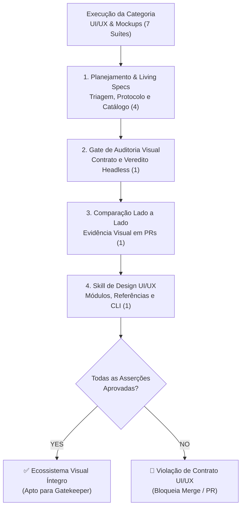

[← Voltar ao Sumário de Testes](Tests-Catalog)

> **UI/UX & Mockups**  
> **Diretório**: [`tests/features/ui-ux/`](https://github.com/VitorJacom/my-agents/tree/main/tests/features/ui-ux)  
> **Quantidade**: 7 suítes  
> **Comando**: `./tests/run.sh --category ui-ux`

---

## 🎯 Propósito da Camada

A categoria **UI/UX & Mockups** valida deterministicamente o ecossistema visual *Figma-less* do `my-agents`, garantindo que interfaces planejadas e implementadas cumpram os requisitos de prova visual demonstrativa do [`AIDD-Manifesto`](AIDD-Manifesto) e os contratos do [`Agent-uiux-designer`](Agent-uiux-designer).

Enquanto [`Test-wiki`](Test-wiki) verifica a integridade estrutural da documentação e dos links na Wiki, esta camada assegura que quatro pilares operacionais permaneçam íntegros:

1. **Protocolo & Living Specs**: O padrão *Mockup-as-Code* em 3 camadas, a estrutura do catálogo `docs/mockups/` e a higiene de arquivos efêmeros no `.gitignore`.
2. **Planejamento Condicional (`/plan-feature`)**: A triagem `UI_UX_REQUIRED` (*Zero Token Waste* para demandas backend), a persistência de *Living Mockups* e a publicação isolada de assets na branch `aidd-assets`.
3. **Execução & Auditoria Visual (`/issue-pipeline`)**: A propagação do contrato visual, o *Visual Audit Gate* (`ESTADO 3.5`) e a comparação lado a lado (*Mockup vs. Implementado*) exigida pelo [`Agent-gatekeeper`](Agent-gatekeeper) antes da abertura de PRs.
4. **Skill de Design (`ui-ux-design`)**: A integridade estrutural e funcional da skill [`Skill-ui-ux-design`](Skill-ui-ux-design) (7 módulos, 13 referências, assistente CLI `skill_assistant.py` com *fail-fast* e desacoplamento de domínio).

---

## 🔄 Cobertura no Ciclo Visual (Mockup-as-Code -> Visual Audit)



---

## 📋 Suítes da Categoria (7)

### Visão Geral por Pilar

| Pilar | Suítes | Foco Principal | Isolamento / Mocks |
| :--- | ---: | :--- | :--- |
| **1. Planejamento, Protocolo & Living Specs** | 4 | Protocolo 3 camadas, `docs/mockups/`, triagem `UI_UX_REQUIRED` e branch `aidd-assets` | Análise estática de contratos |
| **2. Gate de Auditoria Visual (`/issue-pipeline`)** | 1 | `Visual & UI/UX Contract` e `ESTADO 3.5` (*Visual Audit Gate*) | Análise estática de contratos |
| **3. Comparação Visual em PRs** | 1 | Tabela side-by-side e bloqueio preventivo no Gatekeeper | Análise estática de contratos |
| **4. Skill `ui-ux-design` & CLI** | 1 | 7 módulos, 13 referências, `skill_assistant.py` e *fail-fast* | Filesystem + execução Python local |
| **Total** | **7** | **Ciclo Visual Figma-less, Living Mockups e Skill UI/UX** | **Determinístico / Offline** |

---

### Pilar 1: Planejamento, Protocolo & Living Specs (4 suítes)

| Suíte | Origem | O que Valida | Happy Path & Edge Cases / Failure Modes | Isolamento |
| :--- | :--- | :--- | :--- | :--- |
| **`test_uiux_mockup_protocol.sh`** | Issue #13 | Higiene de arquivos efêmeros (`.mockup-preview.html`, `.mockup-preview.png`) no `.gitignore` e os dois modos de operação de [`Agent-uiux-designer`](Agent-uiux-designer): Modo 1 (*Mockup-as-Code* em 3 camadas: *Spatial Blueprint* ASCII, *Design Tokens & Luminance Contract* com *Value Contrast* $\ge$ 2:1 e *WCAG AA* $\ge$ 4.5:1, e protótipo estático autocontido) e Modo 2 (*Auditoria Visual Headless* via `chromium --headless`). | **Happy Path**: Presença das entradas efêmeras no `.gitignore`, das 3 camadas no `agent.md` e dos vereditos obrigatórios (`VISUAL_AUDIT: APPROVED` / `VISUAL_AUDIT: REJECTED`).<br>**Edge Cases**: Falha determinística (*RED*, `exit 1`) caso qualquer camada, limiar de contraste ou instrução headless seja omitida. | Análise estática de contratos |
| **`test_mockup_living_specs_structure.sh`** | Issue #31 | Estrutura canônica de *Living Specs* em `docs/mockups/` (`TEMPLATE.md`, `README.md`), diretório `docs/assets/mockups/` (com `.gitkeep`), metadados do template (`Slug`, `Status`, `Origem`, `Viewport`), preview visual apontando para `../assets/mockups/<slug>.png`, Camadas 1 e 2 (*Value Contrast* $\ge$ 2:1, *WCAG AA* $\ge$ 4.5:1), *Estados Interativos & Acessibilidade* e link em `docs/_Sidebar.md`. | **Happy Path**: Existência e não vacuidade dos diretórios, template canônico, catálogo central e integração na barra lateral da Wiki.<br>**Edge Cases**: Falha (`exit 1`) se o template estiver vazio, sem metadados obrigatórios ou sem referência em `_Sidebar.md`. | Análise estática de estrutura |
| **`test_plan_feature_uiux_state.sh`** | Issue #14 | Integração condicional do [`Agent-uiux-designer`](Agent-uiux-designer) em [`Skill-plan-feature`](Skill-plan-feature) (`ESTADO 1.5` / `UI/UX & Mockup Design`), diagrama Mermaid com nó condicional, validação de `.mockup-preview.png` no Estado 3, inclusão de `Visual & UI/UX Contract` no Estado 4 e persistência desse contrato pelo [`Agent-system-architect`](Agent-system-architect). | **Happy Path**: Classificação `UI_UX_REQUIRED: YES` aciona o Modo 1 e propaga o `Visual & UI/UX Contract` até o `planning_proposal.md` e issues fatiadas.<br>**Edge Cases**: Classificação `UI_UX_REQUIRED: NO` garante *Zero Token Waste* ao omitir o estágio visual em demandas puramente backend. | Análise estática de contratos |
| **`test_plan_feature_living_mockups.sh`** | Issues #32 & #81 | Persistência de *Living Mockups* (`docs/mockups/<slug>.md` baseado em `TEMPLATE.md` e captura headless em `docs/assets/mockups/<slug>.png`) em [`Agent-uiux-designer`](Agent-uiux-designer) e [`Skill-plan-feature`](Skill-plan-feature), publicação isolada na branch `aidd-assets` via `git worktree` temporário e embedding visual (`## 🎨 Mockup & Living Visual Spec`) no `gh issue create`. | **Happy Path**: URLs absolutas com `?raw=true` na branch `aidd-assets`, publicação conjunta de `.png`, `.md` e `README.md` via `git worktree` e push para `origin/aidd-assets` sem commitar assets na `main`.<br>**Edge Cases**: Asserções negativas (`check_not`) bloqueiam caminhos relativos residuais (`./docs/assets/mockups/...`) e rejeitam `raw.githubusercontent.com` no template de issues (por falhar em repositórios privados). | Análise estática de contratos |

---

### Pilar 2: Gate de Auditoria Visual no `/issue-pipeline` (1 suíte)

| Suíte | Origem | O que Valida | Happy Path & Edge Cases / Failure Modes | Isolamento |
| :--- | :--- | :--- | :--- | :--- |
| **`test_issue_pipeline_uiux_gate.sh`** | Issue #15 | Integração do `## Visual & UI/UX Contract` e do *Visual Audit Gate* (`ESTADO 3.5`) em [`Skill-issue-pipeline`](Skill-issue-pipeline) e nos subagentes [`Agent-planner`](Agent-planner), [`Agent-coder`](Agent-coder) e [`Agent-gatekeeper`](Agent-gatekeeper): fallback condicional para Modo 1 no `ESTADO 1`, invocação do Modo 2 no `ESTADO 3.5`, flag `UI_UX_REQUIRED`, consumo de *Design Tokens* e exigência de prova visual no `walkthrough.md`. | **Happy Path**: Veredito `VISUAL_AUDIT: APPROVED` libera o `ESTADO 4` e a validação final pelo Gatekeeper com evidência visual anexada.<br>**Edge Cases**: Tratamento explícito de `VISUAL_AUDIT: REJECTED`, proibição de o Coder inventar estilos fora do contrato e bloqueio no Gatekeeper na ausência de aprovação/prova visual. | Análise estática de contratos |

---

### Pilar 3: Comparação Visual Lado a Lado em PRs (1 suíte)

| Suíte | Origem | O que Valida | Happy Path & Edge Cases / Failure Modes | Isolamento |
| :--- | :--- | :--- | :--- | :--- |
| **`test_issue_pipeline_visual_comparison.sh`** | Issue #33 | Confronto visual entre implementação e mockup aprovado em [`Skill-issue-pipeline`](Skill-issue-pipeline) e [`Agent-gatekeeper`](Agent-gatekeeper): leitura de `docs/mockups/<slug>.md` no `ESTADO 1`, confronto contra `docs/assets/mockups/<slug>.png` no `ESTADO 3.5` e seção obrigatória `## 👁️ Visual Comparison Audit` com tabela `| Mockup Original Aprovado | Implementação Renderizada |` no `ESTADO 4`. | **Happy Path**: `walkthrough.md` e corpo do PR contêm a seção `## 👁️ Visual Comparison Audit` com a tabela comparativa side-by-side.<br>**Edge Cases**: O Gatekeeper bloqueia explicitamente `gh pr create` caso a auditoria visual comparativa esteja ausente quando `UI_UX_REQUIRED: true`. | Análise estática de contratos |

---

### Pilar 4: Skill `ui-ux-design` & Assistente CLI (1 suíte)

| Suíte | Origem | O que Valida | Happy Path & Edge Cases / Failure Modes | Isolamento |
| :--- | :--- | :--- | :--- | :--- |
| **`test_skill_ui_ux_design.sh`** | Issue #17 | Integridade completa da skill [`Skill-ui-ux-design`](Skill-ui-ux-design): frontmatter (`name: ui-ux-design`, `description`), os 7 módulos temáticos (`01-motion-and-physics.md` a `07-adaptive-decision-ux.md`), as 13 referências técnicas profundas, comandos do CLI `skill_assistant.py` (`--help`, `list`, `formulas`, `recipe button`, `checklist --type pre-delivery`) e higienização de nomes legados. | **Happy Path**: Todos os módulos e referências existem e os subcomandos do `skill_assistant.py` executam com `exit 0`.<br>**Edge Cases**: *Fail-fast* obrigatório (`exit 1` + `Erro:` em `stderr`) ao solicitar módulo inválido (`module 99`), auditar arquivo inexistente ou pedir receita inexistente, além de tolerância zero a menções legadas (`znapzap`). | Filesystem + execução Python local |

---

## ⚡ Execução & Diagnóstico

```bash
# Executar todas as 7 suítes de UI/UX & Mockups
./tests/run.sh --category ui-ux

# Executar suítes específicas via filtro
./tests/run.sh --category ui-ux --filter mockup
./tests/run.sh --category ui-ux --filter visual_comparison
./tests/run.sh --category ui-ux --filter skill_ui_ux_design

# Execução direta de uma suíte individual para diagnóstico detalhado
bash tests/features/ui-ux/test_skill_ui_ux_design.sh
```

> [!TIP]
> **Diagnóstico de Falhas**: Todas as suítes desta categoria rodam 100% *offline*. Em caso de regressão, verifique se alterações em [`Agent-uiux-designer`](Agent-uiux-designer), [`Skill-plan-feature`](Skill-plan-feature), [`Skill-issue-pipeline`](Skill-issue-pipeline), [`Agent-gatekeeper`](Agent-gatekeeper), [`Skill-ui-ux-design`](Skill-ui-ux-design) ou `docs/mockups/` quebraram contratos textuais, limiares de contraste ou subcomandos do `skill_assistant.py`. Após atualizar documentos da Wiki, execute também `./tests/run.sh --category wiki`.

---

## 🔗 Navegação

[← Anterior: Wiki & Documentação](Test-wiki) | [Sumário de Testes](Tests-Catalog) | [Próxima Categoria: Revisão de PR & Telemetria →](Test-pr-review)
