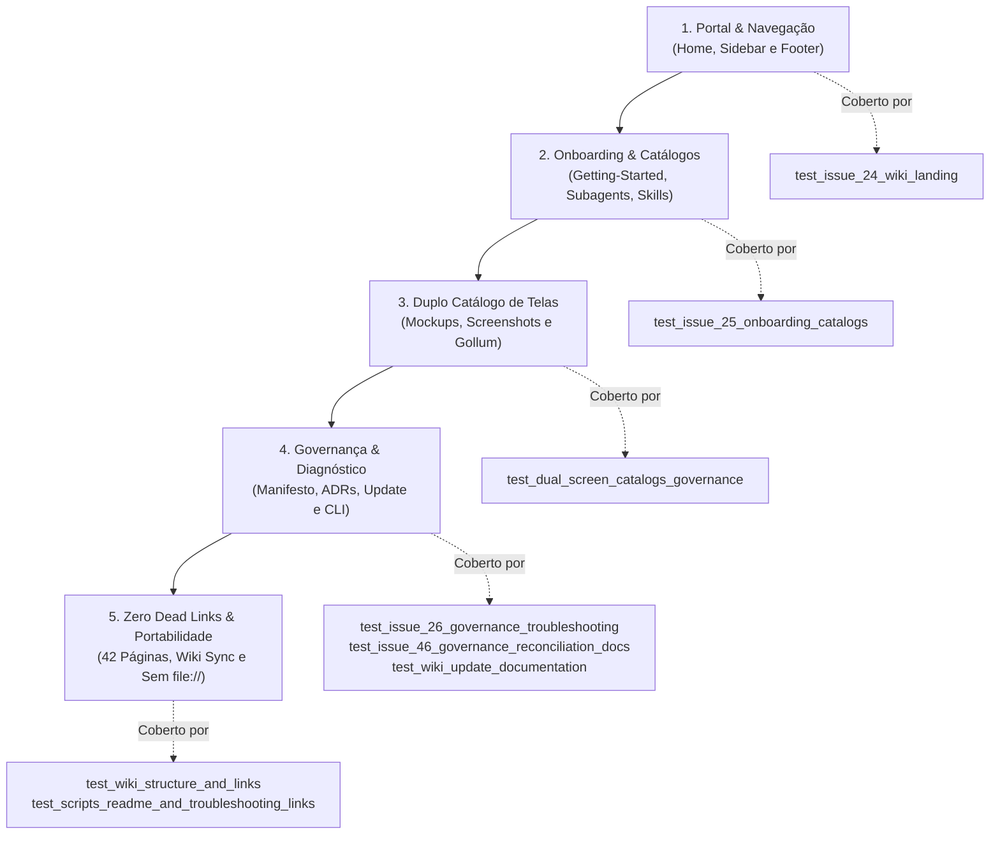

[← Voltar ao Sumário de Testes](Tests-Catalog)

> **Wiki & Documentação**  
> **Diretório**: [`tests/features/wiki/`](https://github.com/VitorJacom/my-agents/tree/main/tests/features/wiki)  
> **Quantidade**: 8 suítes  
> **Comando**: `./tests/run.sh --category wiki`

---

## 🎯 Propósito da Camada

Garante que toda a documentação *Docs-as-Code* em `docs/`, os manuais da raiz e a sincronização automatizada com a **GitHub Wiki** (`.github/workflows/wiki-sync.yml`) permaneçam íntegros, navegáveis e alinhados aos contratos reais do ecossistema. As suítes desta categoria verificam a existência de todas as páginas canônicas, **zero links quebrados** no namespace plano do motor Gollum, ausência de caminhos locais proibidos (`file://` ou `/home/<user>/`), paridade entre os dois catálogos de telas ([`Test-ui-ux`](Test-ui-ux)) e aderência às regras documentadas em [`AIDD-Manifesto`](AIDD-Manifesto), [`System-Architecture`](System-Architecture) e [`Troubleshooting`](Troubleshooting).

---

## 🔄 Arquitetura de Validação da Wiki (Docs-as-Code)

O diagrama abaixo mapeia os 5 domínios de integridade cobertos pelas 8 suítes da categoria `wiki` — da estrutura de navegação às travas de portabilidade e sincronização:



---

## 📋 Suítes da Categoria (8)

| # | Suíte | Origem | Foco Principal |
| ---: | :--- | :--- | :--- |
| 1 | **`test_dual_screen_catalogs_governance.sh`** | Issue #83 | Governança do portal Wiki, duplo catálogo de telas (`Mockups-Catalog` vs. `Implemented-Screens-Catalog`) e escape seguro para Gollum |
| 2 | **`test_issue_24_wiki_landing.sh`** | Issue #24 | Estrutura da landing page ([`Home`](Home)), `_Sidebar.md` e `_Footer.md` como hub central de navegação |
| 3 | **`test_issue_25_onboarding_catalogs.sh`** | Issue #25 | Conteúdo, contratos e links locais de [`Getting-Started`](Getting-Started), [`Subagents`](Subagents) e [`Skills-Catalog`](Skills-Catalog) |
| 4 | **`test_issue_26_governance_troubleshooting.sh`** | Issue #26 | Guias [`AIDD-Manifesto`](AIDD-Manifesto), [`System-Architecture`](System-Architecture) (ADRs `0001`–`0009`) e matriz diagnóstica em [`Troubleshooting`](Troubleshooting) |
| 5 | **`test_issue_46_governance_reconciliation_docs.sh`** | Issue #46 | Documentação operacional da reconciliação idempotente de governança e indexação da Decisão `0009` em [`ARCHITECTURE`](ARCHITECTURE) |
| 6 | **`test_scripts_readme_and_troubleshooting_links.sh`** | Issue #602 | Ausência de links locais `file://` em [`Scripts-Catalog`](Scripts-Catalog) (`scripts/README.md`) e contratos CLI reais em [`Troubleshooting`](Troubleshooting) |
| 7 | **`test_wiki_structure_and_links.sh`** | Issue #27 | Existência das 42 páginas canônicas da Wiki, **zero links quebrados**, `wiki-sync.yml` e conformidade com `PROJECT_CONTEXT.md` |
| 8 | **`test_wiki_update_documentation.sh`** | Issue #68 | Documentação do mecanismo de atualização (`update-plugin.sh`), cache, statusline, `ADR-0016` e tolerância zero a `/home/<user>/` |
| | **Total** | **8 suítes** | **Cobertura integral da integridade estrutural, semântica e de links da Wiki** |

---

## 🔍 Detalhamento por Suíte

### 1. `test_dual_screen_catalogs_governance.sh`

- **Origem**: Issue #83 — *GitHub Wiki & Dual Screen Catalogs Governance*.
- **O que Valida**: Regras de governança Wiki em `rules/AGENTS.md`, fluxos Modo 1/Modo 2 em [`uiux-designer`](Agent-uiux-designer), auditoria em [`gatekeeper`](Agent-gatekeeper) e gates de catálogo em [`plan-feature`](Skill-plan-feature) e [`issue-pipeline`](Skill-issue-pipeline).
- **Happy Path**:
  - `rules/AGENTS.md` exige o portal Wiki (`docs/Home.md`, `docs/_Sidebar.md`, `docs/_Footer.md`), workflow `.github/workflows/wiki-sync.yml`, Catálogo 1 (`docs/mockups/README.md` ➔ `Mockups-Catalog`), Catálogo 2 (`docs/screenshots/README.md` ➔ `Implemented-Screens-Catalog`) e padrão de captura em produção (`docs/screenshots/<slug>.md` e `<slug>-preview.png`).
  - [`uiux-designer`](Agent-uiux-designer) e [`gatekeeper`](Agent-gatekeeper) referenciam ambos os catálogos nos modos de concepção e auditoria pós-implementação.
  - [`plan-feature`](Skill-plan-feature) exige estrutura Wiki e `Mockups-Catalog`; [`issue-pipeline`](Skill-issue-pipeline) (Estados 3.5 e 4) exige atualização de `Implemented-Screens-Catalog`.
- **Edge Cases & Failure Modes**:
  - `check_not` bloqueia comandos `sed -i` sem escape de pontos literais (`\.\.`) em `../assets/mockups/` ou `../screenshots/`, prevenindo corrupção silenciosa de caminhos `docs/assets/mockups/` e `docs/screenshots/`.
  - Exige presença explícita da normalização para `wiki-temp/Mockups-Catalog.md` e `wiki-temp/Implemented-Screens-Catalog.md`.
- **Isolamento & Mocks**: Análise estática determinística via `grep` nos arquivos de regras, agentes e skills do repositório, sem mutação em disco.

### 2. `test_issue_24_wiki_landing.sh`

- **Origem**: Issue #24 — *Build Wiki Navigation Hub and Landing Pages*.
- **O que Valida**: Presença, estrutura e navegabilidade do hub [`Home`](Home), da barra lateral `_Sidebar.md` e do rodapé institucional `_Footer.md`.
- **Happy Path**:
  - Existência e não-vacuidade de `docs/Home.md`, `docs/_Sidebar.md` e `docs/_Footer.md`.
  - [`Home`](Home) contém título de boas-vindas, badges (`img.shields.io`), os 4 valores do Manifesto AIDD (*Method over Model*, *Ownership over Delegation*, *Understanding over Acceptance*, *Outcome over Output*), os 7 subagentes e links rápidos para [`Getting-Started`](Getting-Started), [`AIDD-Manifesto`](AIDD-Manifesto), [`System-Architecture`](System-Architecture), [`Subagents`](Subagents), [`Skills-Catalog`](Skills-Catalog) e [`Troubleshooting`](Troubleshooting).
  - `_Sidebar.md` declara as 5 seções de navegação e links canônicos (Markdown ou `<a href="...">`); `_Footer.md` declara divisor horizontal, URL oficial do repositório, referência à Licença e aviso de sincronização via `wiki-sync.yml`.
- **Edge Cases & Failure Modes**:
  - Rejeita a presença de links Markdown vazios (`[texto]()` sem alvo) em qualquer um dos três arquivos estruturais.
- **Isolamento & Mocks**: Validação estática direta nos arquivos de `docs/`, sem dependências externas.

### 3. `test_issue_25_onboarding_catalogs.sh`

- **Origem**: Issue #25 — *Manuais de Onboarding e Catálogos de Recursos*.
- **O que Valida**: Completude e integridade referencial de [`Getting-Started`](Getting-Started), [`Subagents`](Subagents) e [`Skills-Catalog`](Skills-Catalog).
- **Happy Path**:
  - [`Getting-Started`](Getting-Started) documenta pré-requisitos (`git`, `gh`, `agy`), `.agents/plugins.json` (`entries`), primeiro comando `agy`, estrutura canônica (`PROJECT_CONTEXT.md`, [`Test-core`](Test-core), `tests/features/`, `.gitignore`) e ciclo AIDD (`/plan-feature` e `/issue-pipeline`).
  - [`Subagents`](Subagents) documenta as 7 personas (`product-owner`, `system-architect`, `uiux-designer`, `planner`, `qa-engineer`, `coder`, `gatekeeper`) com arquivo `agents/<persona>/agent.md` real, link relativo, Matriz Geral de Personas, contratos de I/O e diretrizes de UI/UX (*Value Contrast*, Monocromático, WCAG).
  - [`Skills-Catalog`](Skills-Catalog) documenta *Progressive Disclosure*, *Zero Token Waste* e as 9 skills base com arquivo `SKILL.md` existente, link relativo e gatilho de ativação.
- **Edge Cases & Failure Modes**:
  - Extrai todos os links relativos internos (excluindo `http` e `#`) dos três catálogos e falha se qualquer destino não resolver para arquivo real em `docs/` ou subdiretórios (`agents/`, `skills/`, `scripts/`, `tests/`).
- **Isolamento & Mocks**: Verificação estática cruzada entre `docs/`, `agents/` e `skills/`.

### 4. `test_issue_26_governance_troubleshooting.sh`

- **Origem**: Issue #26 — *Modularização de Governança AIDD e Troubleshooting*.
- **O que Valida**: Conteúdo normativo, diagramas Mermaid, índice de ADRs e matriz diagnóstica em [`AIDD-Manifesto`](AIDD-Manifesto), [`System-Architecture`](System-Architecture) e [`Troubleshooting`](Troubleshooting).
- **Happy Path**:
  - [`AIDD-Manifesto`](AIDD-Manifesto) documenta os 4 valores em português, Triângulo de Arquivos Efêmeros (`task.md`, `implementation_plan.md`, `walkthrough.md`), `.gitignore`, publicação via `gh pr create --body-file walkthrough.md`, *Fail-Fast* (`set -euo pipefail`), Trava Dupla Anti-Fraude (`tests/core/` + *Golden Rule*), cobertura $\ge 85\%$, Happy Path vs. Edge Cases/Failure Modes, provas demonstrativas, protocolo *Clean Room* (`agy --dangerously-skip-permissions`) e diagramas Mermaid.
  - [`System-Architecture`](System-Architecture) documenta camadas concêntricas, taxonomia de componentes, diagramas `sequenceDiagram` do Maestro, fluxo `/plan-feature` ➔ `/issue-pipeline`, ADRs `0001` a `0009` e referência a [`ARCHITECTURE`](ARCHITECTURE).
  - [`Troubleshooting`](Troubleshooting) documenta Matriz Diagnóstica e soluções para locks em worktrees (`worktree-manager.sh`), permissões de `gh project` (degradação graciosa), `ALERTA DE FRAUDE` em `tests/core/`, cobertura $< 85\%$, latência sub-50ms (`test-statusline.sh`), `Interface Contract`, inicialização manual da GitHub Wiki (*Create the first page*) e colisão de *Target Files* em *Execution Waves*.
- **Edge Cases & Failure Modes**:
  - Simuladores de omissão via `mktemp` comprovam detecção imediata se um valor AIDD (`Outcome over Output`) ou um ADR (`0009`) for removido.
  - Valida paridade de abertura e fechamento de cercas ` ```mermaid ` (`total_count % 2 == 0`) em [`AIDD-Manifesto`](AIDD-Manifesto) e [`System-Architecture`](System-Architecture), além de detector de arquivo inexistente.
- **Isolamento & Mocks**: Arquivos temporários isolados criados via `mktemp` e descartados ao fim da checagem, sem alterar os documentos versionados.

### 5. `test_issue_46_governance_reconciliation_docs.sh`

- **Origem**: Issue #46 — *Documentação de Reconciliação Idempotente de Governança (ADR-0009)*.
- **O que Valida**: Alinhamento documental entre [`plan-feature`](Skill-plan-feature), [`ARCHITECTURE`](ARCHITECTURE), `PROJECT_CONTEXT.md` e o script [`reconcile-github-governance.sh`](Script-pipeline).
- **Happy Path**:
  - Confirma que `scripts/pipeline/reconcile-github-governance.sh` existe e possui permissão executável (`-x`).
  - Valida em [`plan-feature`](Skill-plan-feature) a seção `Procedimento Operacional: Reconciliação de Backlog e Governança`, referência ao script, modo `--dry-run`, views (*Kanban Board*, *Milestone Roadmap*, *Backlog Table*) e princípios de *Idempotência Estrita* e *Degradação Graciosa*.
  - Valida em [`ARCHITECTURE`](ARCHITECTURE) a indexação do script e a `Decisão 0009` (*Reconciliação Idempotente de Governança*) com status `Implementada`.
- **Edge Cases & Failure Modes**:
  - Falha imediatamente se o script perder permissão de execução ou se qualquer princípio/seção da Decisão `0009` for suprimido.
- **Isolamento & Mocks**: Inspeção estática de arquivos e permissões no workspace, sem requisições à API do GitHub.

### 6. `test_scripts_readme_and_troubleshooting_links.sh`

- **Origem**: Issue #602 — *Links Relativos em `scripts/README.md` e Contratos CLI*.
- **O que Valida**: Portabilidade dos links em `scripts/README.md` ([`Scripts-Catalog`](Scripts-Catalog)) e aderência dos comandos documentados em [`Troubleshooting`](Troubleshooting) aos contratos reais dos scripts.
- **Happy Path**:
  - `scripts/README.md` referencia links relativos válidos e existentes em disco para `hooks/safety-guard.sh`, `hooks/session-start-context.sh`, `statusline/install-statusline.sh`, `statusline/statusline-quota.sh` e `statusline/test-statusline.sh`, além de documentar `--agents` nos exemplos de `metrics-collector.py`.
  - [`Troubleshooting`](Troubleshooting) documenta os subcomandos reais de [`worktree-manager.sh`](Script-pipeline) (`create`, `list`, `remove`).
- **Edge Cases & Failure Modes**:
  - Rejeita estritamente URLs locais `file://` ou caminhos absolutos `/home/` em `scripts/README.md`.
  - Rejeita subcomandos ou flags inexistentes em [`Troubleshooting`](Troubleshooting) (`worktree-manager.sh add` e `worktree-manager.sh remove ... --force`).
- **Isolamento & Mocks**: Análise estática via `grep` e checagem de arquivos locais em `scripts/`.

### 7. `test_wiki_structure_and_links.sh`

- **Origem**: Issue #27 — *Modernize Wiki Sync Pipeline & Integrity Test Suite*.
- **O que Valida**: Topologia completa da GitHub Wiki (`42` páginas obrigatórias em `ALL_WIKI_DOCS`), integridade referencial de links internos, workflow `.github/workflows/wiki-sync.yml` e conformidade com `PROJECT_CONTEXT.md`.
- **Happy Path**:
  - Verifica existência e não-vacuidade (`test -s`) das 12 páginas estruturais/sumários ([`Home`](Home), `_Sidebar.md`, `_Footer.md`, [`Getting-Started`](Getting-Started), [`Subagents`](Subagents), [`Skills-Catalog`](Skills-Catalog), [`Scripts-Catalog`](Scripts-Catalog), [`Tests-Catalog`](Tests-Catalog), [`AIDD-Manifesto`](AIDD-Manifesto), [`System-Architecture`](System-Architecture), [`Troubleshooting`](Troubleshooting), [`ARCHITECTURE`](ARCHITECTURE)), das 7 páginas `Agent-*.md`, 11 `Skill-*.md`, 5 `Script-*.md` e 7 `Test-*.md`.
  - Valida em `wiki-sync.yml` o espelhamento fiel de `docs/` (`rsync` ou `cp -r docs/*`), `set -euo pipefail` e anotações `::error::`.
  - Valida em `PROJECT_CONTEXT.md` as referências a `wiki-sync.yml`, `test_wiki_structure_and_links.sh`, `Home.md`, `_Sidebar.md` e `_Footer.md`.
- **Edge Cases & Failure Modes**:
  - **Zero Dead Links & Zero Links Vazios**: bloqueia links Markdown vazios (`[ ]( )` sem rótulo ou alvo) e resolve cada link relativo interno contra `docs/`, raiz do repositório e subpastas canônicas (`agents/`, `skills/`, `scripts/`, `tests/`, `mockups/`), suportando slugs planos do Gollum sem extensão `.md`.
  - **Proteção contra Regressão Legada**: bloqueia em `wiki-sync.yml` qualquer comando legado que sobrescreva `Home.md` com `ARCHITECTURE.md`.
- **Isolamento & Mocks**: Varredura estática determinística no sistema de arquivos local, sem clones remotos ou execução de Actions.

### 8. `test_wiki_update_documentation.sh`

- **Origem**: Issue #68 — *Documentação do Mecanismo de Atualização e Notificação*.
- **O que Valida**: Cobertura documental do fluxo de atualização do plugin em `README.md`, [`Getting-Started`](Getting-Started), [`Troubleshooting`](Troubleshooting) e [`System-Architecture`](System-Architecture).
- **Happy Path**:
  - `README.md` e [`Getting-Started`](Getting-Started) documentam [`update-plugin.sh`](Script-pipeline) (`--check`, `--status`, `--apply`), `MY_AGENTS_AUTO_UPDATE=1`, caminhos portáveis (`~/.gemini/...` ou `./.agents/...`) e a notificação visual na statusline.
  - [`Troubleshooting`](Troubleshooting) documenta entrada na matriz rápida, proteção contra *working tree* suja, cache `my-agents-update.json`, `XDG_CACHE_HOME` / `~/.cache/antigravity`, liberação de lockfile retido e supressão da notificação na statusline.
  - [`System-Architecture`](System-Architecture) referencia [`update-plugin.sh`](Script-pipeline), `widget_update`, [`statusline-quota.sh`](Script-statusline) e `ADR-0016`.
- **Edge Cases & Failure Modes**:
  - **Tolerância Zero a Caminhos Hardcoded**: falha se `README.md` contiver `/home/vitor/` ou qualquer `/home/<user>/`.
  - **Zero Dead Links**: valida que todos os links relativos internos de `README.md`, [`Getting-Started`](Getting-Started), [`Troubleshooting`](Troubleshooting) e [`System-Architecture`](System-Architecture) apontam para alvos existentes.
- **Isolamento & Mocks**: Inspeção estática por `grep` e resolução local de caminhos no workspace.

---

## ⚡ Execução & Diagnóstico

```bash
# Executar todas as 8 suítes da categoria wiki
./tests/run.sh --category wiki

# Executar uma suíte específica via filtro
./tests/run.sh --category wiki --filter test_wiki_structure_and_links
./tests/run.sh --filter test_dual_screen_catalogs_governance
```

### Falhas Comuns & Resolução

| Sintoma | Suíte Afetada | Causa Provável & Ação |
| :--- | :--- | :--- |
| `Link quebrado ... (alvo inexistente)` | `test_wiki_structure_and_links.sh` / `test_issue_25` / `test_wiki_update_documentation` | Slug ou caminho relativo incorreto; usar slug plano do Gollum (ex.: [`Skills-Catalog`](Skills-Catalog)) ou caminho válido a partir da raiz |
| `caminhos /home/<user>/` ou `file://` | `test_wiki_update_documentation.sh` / `test_scripts_readme_and_troubleshooting_links.sh` | Substituir caminho absoluto local por `~/.gemini/...` ou link relativo |
| `sed sem escapar pontos` | `test_dual_screen_catalogs_governance.sh` | Escapar pontos literais (`\.\./`) em `rules/AGENTS.md` e `.github/workflows/wiki-sync.yml` |
| `blocos mermaid desbalanceados` | `test_issue_26_governance_troubleshooting.sh` | Garantir fechamento ` ``` ` para cada abertura ` ```mermaid ` |

---

## 🔗 Navegação

[← Anterior: Pipeline & Maestro](Test-pipeline) | [Sumário de Testes](Tests-Catalog) | [Próxima Categoria: UI/UX & Mockups →](Test-ui-ux)
