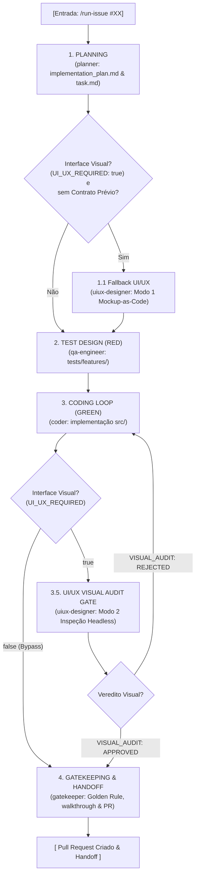

# Issue Pipeline Orchestrator (`/run-issue`)

Esta Skill gerencia a execução da máquina de estados do pipeline determinístico multiagente para implementar requisitos e Issues do GitHub com garantia estrita de integridade e TDD.

## 🚀 Como Invocar
O usuário dispara o comando informando o número ou URL da Issue:
```text
/run-issue #12
# ou
/run-issue 12
# ou
/run-issue https://github.com/org/repo/issues/12
```

---

## 🔄 Máquina de Estados e Protocolo de Orquestração



> [!IMPORTANT]
> **Execução Concorrente e Isolada:**
> Cada estado do pipeline DEVE invocar o subagente correspondente usando `invoke_subagent`. O orquestrador nunca executa o código ou os testes diretamente; ele delega, aguarda a mensagem com o resultado e audita a transição.

O agente orquestrador deve guiar a execução estado por estado, chamando os subagentes dedicados via `invoke_subagent` e validando os critérios de transição:

### 📍 ESTADO 1: PLANNING
1. Identifique o número da Issue e seu contexto.
2. Invoque o subagente `planner`:
   - Envie a tarefa para ler a Issue e inspecionar a arquitetura existente.
   - Solicite a classificação explícita de impacto visual (`UI_UX_REQUIRED: true` ou `UI_UX_REQUIRED: false`).
   - Solicite a geração de `implementation_plan.md` e `task.md`.
3. **Validação do Portão de Planejamento**:
   - O plano possui mais de 3 passos ou atinge domínios desconexos?
   - **Se SIM (Rejeitado)**: Pare a execução imediatamente. Informe ao usuário os motivos do arquiteto e solicite o fatiamento da Issue.
   - **Se NÃO (Aprovado)**: Verifique se a demanda possui impacto visual (`UI_UX_REQUIRED: true`).
4. **Fallback Condicional de Concepção UI/UX (Modo 1)**:
   - Se `UI_UX_REQUIRED: true` e a Issue ainda **não possuir** um `## Visual & UI/UX Contract` consolidado:
     - Invoque o subagente `uiux-designer` em **Modo 1 (Concepção & Mockup-as-Code)**.
     - O designer gera o Spatial Blueprint (Wireframe ASCII), Design Tokens e protótipo efêmero com captura `.mockup-preview.png`.
     - Injeta a seção `## Visual & UI/UX Contract` no `implementation_plan.md`.
   - Se `UI_UX_REQUIRED: false` ou se o contrato visual já estiver presente: avance diretamente para o **ESTADO 2**.

---

### 📍 ESTADO 2: TEST DESIGN (TDD RED)
1. Crie uma branch de trabalho dedicada seguindo o padrão de branches:
   ```bash
   git checkout -b feature/issue-<numero>-<slug>
   ```
2. Invoque o subagente `qa-engineer`:
   - Instrua-o a ler `implementation_plan.md` e criar os testes de aceite estritamente em `tests/features/`.
   - Instrua-o a categorizar e cobrir explicitamente cenários de **Happy Path** e cenários de **Edge Cases** / borda e falha.
   - Instrua-o a rodar o test runner e capturar a prova de falha (**RED**).
3. **Validação do Portão de QA**:
   - Os testes novos falharam conforme esperado e cobrem regras reais e cenários de borda?
   - **Se SIM (Aprovado)**: Registre a prova do RED e avance para o **ESTADO 3**.
   - **Se NÃO (Falso Positivo, Teste Trivial ou Ausência de Casos de Borda)**: Interrompa a esteira e exija correção dos testes.

---

### 📍 ESTADO 3: CODING LOOP (TDD GREEN)
1. Invoque o subagente `coder`:
   - Instrua-o a implementar a solução estritamente dentro da pasta `src/`.
   - Para tarefas visuais, obrigue o consumo rigoroso dos Design Tokens e Wireframe ASCII da seção `## Visual & UI/UX Contract`.
   - Instrua-o a garantir e comprovar cobertura mínima de código $\ge 85\%$. Se a cobertura for inferior a 85% (< 85%), interrompa e bloqueie a esteira exigindo complementação.
   - Lembre-o da **Trava Anti-Fraude**: é proibido tocar em arquivos da pasta `tests/`.
   - Execute o loop de até 3 iterações (editar código ➔ rodar testes).
2. **Validação do Portão de Implementação**:
   - Todos os testes passaram (**GREEN**) e a cobertura é $\ge 85\%$?
   - **Se NÃO (Estourou 3 tentativas sem passar ou cobertura < 85%)**: Interrompa a esteira imediatamente com status de falha e apresente o log de erro ao usuário.
   - **Se SIM (Sucesso)**:
     - Se `UI_UX_REQUIRED: true`: avance para o **ESTADO 3.5**.
     - Se `UI_UX_REQUIRED: false`: faça bypass direto para o **ESTADO 4** (Zero Token Waste).

---

### 📍 ESTADO 3.5: UI/UX VISUAL AUDIT GATE (Condicional)
> [!NOTE]
> Este portão condicional só é ativado quando `UI_UX_REQUIRED: true`. Demandas puramente lógicas ou backend realizam bypass automático direto para o ESTADO 4.

1. Invoque o subagente `uiux-designer` operando em **Modo 2 (Auditoria Visual Headless)**:
   - Instrua o subagente a capturar a tela renderizada da UI/componente implementado via navegador headless (`chromium --headless` ou canvas/headless).
   - O designer audita o resultado confrontando-o com o Spatial Blueprint e os Design Tokens acordados no `implementation_plan.md` (hierarquia tipográfica, contraste de luminância, affordance e espaçamentos).
2. **Avaliação do Veredito Visual**:
   - Se o parecer for `VISUAL_AUDIT: REJECTED`:
     - Retorne imediatamente ao **ESTADO 3 (Coder)** fornecendo o relatório detalhado de desvios visuais para correção no código em `src/`.
   - Se o parecer for `VISUAL_AUDIT: APPROVED`:
     - Armazene o parecer aprovado e a evidência visual (screenshot) para o relatório final.
     - Avance para o **ESTADO 4**.

---

### 📍 ESTADO 4: GATEKEEPING & HANDOFF
1. Invoque o subagente `gatekeeper`:
   - Envie os IDs de conversa de todos os subagentes que participaram da rodada (`planner`, `qa-engineer`, `coder` e, quando aplicável, `uiux-designer`).
   - Executar auditoria de integridade com `git diff --stat origin/main` (ou branch base).
   - Validar que nenhum teste fora da nova feature foi modificado ou relaxado (Golden Rule).
   - **Auditoria do Duplo Gate**: Comprovar conformidade estrutural contra o `PROJECT_CONTEXT.md` (zero alucinação de padrões).
   - **Auditoria de Cobertura e Casos**: Auditar que a cobertura de código é $\ge 85\%$ e que a suíte contempla separadamente cenários de Happy Path e Edge Cases / cenários de borda. Se a cobertura for inferior a 85% (< 85%), aborte e bloqueie a finalização.
   - **Auditoria Visual Mandatória**: Para issues com `UI_UX_REQUIRED: true`, exigir obrigatoriamente a auditoria visual aprovada com `VISUAL_AUDIT: APPROVED` e anexar a prova visual irrefutável (screenshot headless) no `walkthrough.md`.
   - **Provas Demonstrativas Universais**: Exigir provas demonstrativas no `walkthrough.md` para todos os domínios (screenshots para UI; saídas reais formatadas de terminal, logs estruturados ou CLI para backend/infra).
   - Executar `./scripts/sync-project-context.py .` para persistir o novo estado arquitetural da entrega.
   - Executar `./scripts/metrics-collector.py` para calcular o consumo de tokens da esteira.
   - Gerar o artefato consolidado `walkthrough.md`.
   - Comitar as alterações e abrir o Pull Request no GitHub (via MCP ou `gh pr create`) vinculando a Issue (`Fixes #<numero>`).
2. **Conclusão & Handoff**:
   - Apresente ao usuário o link do Pull Request aberto, a tabela de telemetria de consumo/cota e a documentação gerada em `walkthrough.md`.
