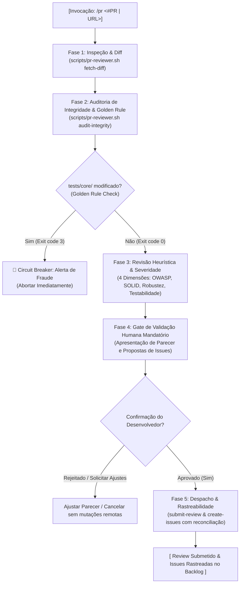

# Code Review & Pull Request Orchestrator (`/pr`)

Esta Skill unifica a auditoria heurística de qualidade de código e a máquina de estados determinística de revisão aprofundada de Pull Requests no GitHub. Ela opera em dois modos complementares:

1. **Modo Auditoria Local (`/pr` ou `/pr local`)**: Revisão crítica de alterações na working tree, arquivos específicos ou branch local antes de commits e abertura de PR.
2. **Modo Esteira de Pull Request (`/pr <#PR | URL>`)**: Orquestração determinística em 5 fases via `scripts/pr-reviewer.sh`, com verificação estrita da Golden Rule, **Gate de Validação Humana mandatório**, submissão oficial via `gh pr review` e abertura automática de issues rastreadas no backlog.

---

## 🚀 Como Invocar

```text
# Modo 1: Auditoria Local (working tree, branch atual ou módulo)
/pr
/pr local
/pr Revise as alterações da branch atual contra vulnerabilidades OWASP

# Modo 2: Esteira de Pull Request no GitHub
/pr <#PR | URL>
/pr #12
/pr 54
/pr https://github.com/VitorJacom/my-agents/pull/12
```

---

## 🔍 1. Critérios Heurísticos de Avaliação (4 Dimensões)

Aplicados tanto no **Modo Auditoria Local** quanto na **Fase 3 do Modo Pull Request**:

### 1.1. Segurança (Security & OWASP)
- **Injection**: Consultas SQL dinâmicas não sanitizadas, comandos de shell interpolados.
- **Exposição de Dados**: Logs contendo tokens, senhas, CPFs ou dados pessoais sensíveis.
- **Validação de Inputs**: Ausência de schemas ou validações de payloads em endpoints de API.

### 1.2. Arquitetura e Clean Code
- **SOLID**: Violação de responsabilidade única (funções/classes inchadas com muitas obrigações).
- **Acoplamento**: Dependências fortes e diretas em vez de interfaces ou injeção de dependências.
- **Complexidade Ciclomática**: Loops e condicionais aninhados excessivos (recomenda-se *early return*).

### 1.3. Robustez e Tratamento de Erros
- Blocos `try/catch` vazios ou que apenas suprimem exceções sem log nem rethrow.
- Ausência de tratamento para timeouts e falhas em chamadas de rede ou IO.
- Riscos de Null Pointer / `undefined` sem checagem adequada.

### 1.4. Testabilidade & Integridade
- Código difícil de isolar para teste unitário devido a dependências estáticas ou globais.
- Efeitos colaterais ocultos dentro de funções de cálculo ou getters.
- Ausência de testes de regressão, testes tautológicos ou falta de cobertura de *Happy Path* e *Edge Cases / Failure Modes*.

---

## 📋 2. Formato do Relatório & Taxonomia de Severidade

Organize o feedback em três níveis objetivos de severidade:

```markdown
### 🚨 Crítico (Bloqueia Merge)
Vulnerabilidades de segurança, falhas de lógica graves, quebra de contratos de API ou vazamento de dados.
- Mapeia para `request-changes` na PR e gera issues com label `type:fix`.
- **[Arquivo:Linha]**: Descrição objetiva da vulnerabilidade ou defeito crítico.
  - *Sugestão de correção*: Código ou abordagem recomendada.

### ⚠️ Importante (Refatoração Recomendada)
Violações de boas práticas, arquitetura/SOLID, ausência de testes em fluxos relevantes ou complexidade excessiva.
- Gera issues com label `type:refactor`.
- **[Arquivo:Linha]**: Descrição da melhoria técnica.

### 💡 Sugestão (Melhoria Opcional)
Ajustes estéticos, clareza em nomes de variáveis ou pequenas micro-otimizações de sintaxe.
- **[Arquivo:Linha]**: Sugestão.
```

---

## 🔄 3. Modo Esteira de Pull Request — Máquina de Estados (5 Fases)

Quando invocada com um identificador de PR (`/pr <#PR | URL>`), a skill executa a máquina de estados determinística abaixo:



### 📍 Fase 1: Inspeção & Diff
- **Papel / Subagente**: Orquestrador / `planner`
- **Comando**:
  ```bash
  scripts/pr-reviewer.sh fetch-diff <#PR>
  ```
- **Ações**:
  1. Valida se a PR informada existe e possui status `OPEN` no GitHub CLI (`gh pr view`).
  2. Extrai metadados estruturados: número da PR, autor, título, branch head, branch base e commit SHA (`headRefOid`).
  3. Obtém o diff unificado completo via GitHub CLI com parsing resiliente (`jq` com fallback em `python3`).
  4. Falha imediatamente com código `1` caso a PR não exista, esteja fechada ou ocorra erro de rede.

### 📍 Fase 2: Auditoria de Integridade & Golden Rule
- **Papel / Subagente**: `gatekeeper` (The Goldfish / Auditor Anti-Fraude)
- **Comando**:
  ```bash
  scripts/pr-reviewer.sh audit-integrity <#PR>
  ```
- **Invariante da Golden Rule**:
  - Verifica estritamente se qualquer arquivo protegido sob o diretório `tests/core/` foi adicionado, modificado ou removido no diff da PR.
  - **Circuit-Breaker e Fail-Fast**: Se for detectada qualquer alteração em `tests/core/`, o comando encerra imediatamente com **exit code 3** (`ALERTA DE FRAUDE: Violação da Golden Rule`). O orquestrador aborta imediatamente o pipeline, sem avançar para as fases de revisão, aprovação humana ou submissão.

### 📍 Fase 3: Revisão Heurística & Severidade
- **Papel / Subagente**: `gatekeeper` (Modo 2: Auditoria de Código & PR)
- **Ações**:
  - Avalia integralmente o diff coletado aplicando as **4 Dimensões de Avaliação** (Seção 1) e classifica todos os achados na **Taxonomia de Severidade** (Seção 2).

### 📍 Fase 4: Gate de Validação Humana Mandatório
- **Papel / Subagente**: Orquestrador
- **Objetivo**: Garantir soberania e controle humano antes de qualquer efeito colateral remoto.
- **Protocolo de Validação**:
  1. O orquestrador sintetiza os achados e apresenta o relatório completo ao desenvolvedor:
     - Resumo executivo com total de apontamentos críticos, importantes e sugestões.
     - Status recomendado para a PR: `approve`, `request-changes` ou `comment`.
     - Tabela detalhada de apontamentos (`[Arquivo:Linha]`, severidade, descrição e recomendação).
     - Relação de issues propostas a serem cadastradas no GitHub Backlog.
  2. **Confirmação Explícita Obrigatória**:
     - O agente solicita expressamente a confirmação do desenvolvedor:
       > *"Deseja submeter este parecer formal na Pull Request e criar as issues no GitHub Backlog? [Sim / Não / Solicitar Ajustes]"*
  3. **Regra de Bloqueio**:
     - **Sem confirmação expressa do desenvolvedor, é estritamente proibido publicar comentários oficiais ou criar issues.**
     - Se o desenvolvedor rejeitar ou solicitar ajustes, o orquestrador refina os apontamentos localmente ou encerra o atendimento sem efetuar mutações remotas no GitHub.

### 📍 Fase 5: Despacho & Rastreabilidade
- **Papel / Subagente**: Orquestrador / `gatekeeper`
- **Condição**: Disparada **exclusivamente** após a confirmação positiva (aprovação) no Gate de Validação Humana.
- **Submissão do Parecer Formal**:
  ```bash
  scripts/pr-reviewer.sh submit-review <#PR> --body-file <parecer.md> --status auto
  ```
- **Criação de Issues Rastreadas no Backlog**:
  ```bash
  scripts/pr-reviewer.sh create-issues <#PR> --findings-file <findings.md>
  ```
- **Garantias de Rastreabilidade**:
  - Toda issue criada recebe as labels semânticas correspondentes (`type:fix` para Crítico, `type:refactor` para Importante, `status:planned`, `source:code-review`).
  - O corpo da issue inclui automaticamente o link da PR de origem, a branch head e o SHA do commit auditado (`headRefOid`).
  - O utilitário executa automaticamente o script de reconciliação de governança (`reconcile-github-governance.sh`) ao final do lote.
- **Modo Simulação (`--dry-run`)**:
  - Ambos os subcomandos suportam a flag `--dry-run`, permitindo exibir os comandos `gh` formatados e os corpos das mensagens sem realizar chamadas de rede ou alterações remotas no GitHub.
