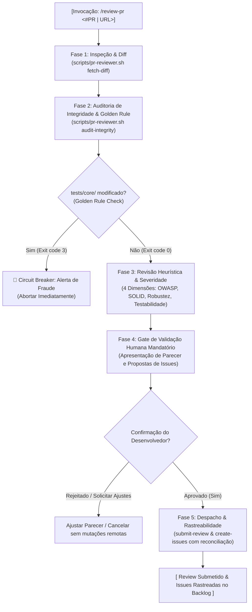

# Pull Request Reviewer Orchestrator (`/review-pr`)

Esta Skill orquestra a máquina de estados determinística de revisão aprofundada de Pull Requests no GitHub. A esteira integra auditoria automatizada de conformidade, verificação estrita da Golden Rule, avaliação heurística de código em 4 dimensões (OWASP, SOLID, Robustez e Testabilidade), um **Gate de Validação Humana mandatório** e despacho com geração automática de issues rastreadas no backlog.

---

## 🚀 Como Invocar

O comando `/review-pr` aceita identificadores de PR em múltiplos formatos:

```text
# Sintaxe canônica:
/review-pr <#PR | URL>

# Exemplos com número precedido de hash:
/review-pr #12
/review-pr #54

# Exemplos com número direto:
/review-pr 12
/review-pr 54

# Exemplo com URL completa da Pull Request no GitHub:
/review-pr https://github.com/VitorJacom/my-agents/pull/12
```

---

## 🔄 Máquina de Estados Determinística (5 Fases)



---

## 📋 Protocolo de Execução por Fase

### 📍 Fase 1: Inspeção & Diff
- **Papel / Subagente**: Orquestrador / `planner`
- **Comando**:
  ```bash
  scripts/pr-reviewer.sh fetch-diff <#PR>
  ```
- **Ações**:
  1. Valida se a PR informada existe e possui status `OPEN` no GitHub CLI (`gh pr view`).
  2. Extrai metadados estruturados: número da PR, autor, título, branch head, branch base e commit SHA (`headRefOid`).
  3. Obtém o diff unificado completo via GitHub CLI com parsing resiliente (jq com fallback em Python3).
  4. Falha imediatamente com código 1 caso a PR não exista, esteja fechada ou ocorra erro de rede.

---

### 📍 Fase 2: Auditoria de Integridade & Golden Rule
- **Papel / Subagente**: `gatekeeper` (The Goldfish / Auditor Anti-Fraude)
- **Comando**:
  ```bash
  scripts/pr-reviewer.sh audit-integrity <#PR>
  ```
- **Invariante da Golden Rule**:
  - Verifica estritamente se qualquer arquivo protegido sob o diretório `tests/core/` foi adicionado, modificado ou removido no diff da PR.
  - **Circuit-Breaker e Fail-Fast**: Se for detectada qualquer alteração em `tests/core/`, o comando encerra imediatamente com **exit code 3** (`ALERTA DE FRAUDE: Violação da Golden Rule`). O orquestrador aborta imediatamente o pipeline, sem avançar para as fases de revisão, aprovação humana ou submissão.

---

### 📍 Fase 3: Revisão Heurística & Severidade
- **Papel / Subagente**: `gatekeeper` (Modo 2: Auditoria de Código & PR) em colaboração com os padrões da skill `code-review`.
- **Dimensões Críticas de Avaliação**:
  1. **Segurança (OWASP & Data Protection)**: Injeção de SQL ou Shell, dados sensíveis em logs ou variáveis expostas, ausência de sanitização de inputs.
  2. **Arquitetura & Clean Code**: Violação de SOLID, complexidade ciclomática excessiva, acoplamento indevido, nomenclatura ambígua.
  3. **Robustez & Tratamento de Erros**: Blocos `try/catch` vazios ou mascaradores de erros, tratamento de timeouts em IO/rede, riscos de Null Pointer ou undefined.
  4. **Testabilidade & Integridade**: Ausência de testes de regressão, testes tautológicos ou incompletos, cobertura de Happy Path e Edge Cases / Failure Modes.
- **Taxonomia de Severidade**:
  - **🚨 Crítico (Bloqueia Merge)**: Vulnerabilidades de segurança, quebra de contratos fundamentais ou bugs bloqueantes. Mapeia para o parecer `request-changes` e gera issues com label `type:fix`.
  - **⚠️ Importante (Refatoração Recomendada)**: Oportunidades relevantes de melhoria de qualidade ou arquitetura. Gera issues com label `type:refactor`.
  - **💡 Sugestão (Melhoria Opcional)**: Pequenos ajustes estéticos, nomes de variáveis ou micro-otimizações.

---

### 📍 Fase 4: Gate de Validação Humana Mandatório
- **Papel / Subagente**: Orquestrador
- **Objetivo**: Garantir soberania e controle humano antes de qualquer efeito colateral remoto.
- **Protocolo de Validação**:
  1. O orquestrador sintetiza os achados e apresenta o relatório completo ao desenvolvedor:
     - Resumo executivo com total de apontamentos críticos, importantes e sugestões.
     - Status recomendado para a PR: `approve`, `request-changes` ou `comment`.
     - Tabela detalhada de apontamentos (`[Arquivo:Linha]`, severidade, descrição e recomendação).
     - Relação de issues propostas a serem cadastradas no GitHub Backlog.
  2. **Confirmação Explícita Obrigatória**:
     - O agente solicita expressamente a confirmação do desenvolvedor:
       > *"Deseja submeter este parecer formal na Pull Request e criar as issues no GitHub Backlog? [Sim / Não / Solicitar Ajustes]"*
  3. **Regra de Bloqueio**:
     - **Sem confirmação expressa do desenvolvedor, é estritamente proibido publicar comentários oficiais ou criar issues.**
     - Se o desenvolvedor rejeitar ou solicitar ajustes, o orquestrador refina os apontamentos localmente ou encerra o atendimento sem efetuar mutações remotas no GitHub.

---

### 📍 Fase 5: Despacho & Rastreabilidade
- **Papel / Subagente**: Orquestrador / `gatekeeper`
- **Condição**: Disparada **exclusivamente** após a confirmação positiva (aprovação) no Gate de Validação Humana.
- **Submissão do Parecer Formal**:
  ```bash
  scripts/pr-reviewer.sh submit-review <#PR> --body-file <parecer.md> --status auto
  ```
- **Criação de Issues Rastreadas no Backlog**:
  ```bash
  scripts/pr-reviewer.sh create-issues <#PR> --findings-file <findings.md>
  ```
- **Garantias de Rastreabilidade**:
  - Toda issue criada recebe as labels semânticas correspondentes (`type:fix` para Crítico, `type:refactor` para Importante, `status:planned`, `source:code-review`).
  - O corpo da issue inclui automaticamente o link da PR de origem, a branch head e o SHA do commit auditado (`headRefOid`).
  - O utilitário executa automaticamente o script de reconciliação de governança (`reconcile-github-governance.sh`) ao final do lote.
- **Modo Simulação (`--dry-run`)**:
  - Ambos os subcomandos suportam a flag `--dry-run`, permitindo exibir os comandos `gh` formatados e os corpos das mensagens sem realizar chamadas de rede ou alterações remotas no GitHub.
